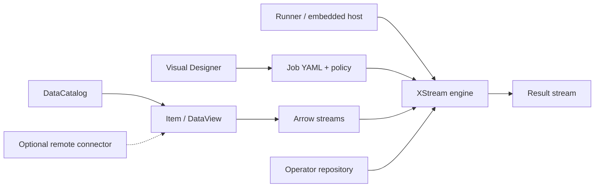

# XStream


[中文](README_zh.md)

XStream is a Scala toolkit for stream-oriented computation: typed data access, an embeddable Job engine and a browser-based visual designer. Steps consume and produce streams; intermediate data need not be saved as files. Explicit execution policies enable materialization and replay when required.

## Components

| Module | Purpose |
|---|---|
| [xstream-data](xstream-data/README.md) | DataCatalog → Dataset → Item, typed DataView/DataStream contracts, plugin discovery, file and scientific-format implementations and network codecs |
| [xstream-operator-sdk](xstream-operator-sdk/README.md) | JVM/Python operator templates and metadata contracts |
| [xstream-operator-inference](xstream-operator-inference/README.md) | Reusable on-demand structure and sample workers |
| [xstream-operator-repository](https://github.com/rdcn-link/xstream-operator-repository) | Source submissions, isolated builds, review, public operator and runtime downloads |
| [xstream-engine](xstream-engine/README.md) | Embedded execution, cancellation, execution policies, automatic remote compute pushdown and the `xstream-runner` launcher |
| [xstream-designer](xstream-designer/README.md) | Visual Job editing, catalogs, variables, schema and sample previews, chat proposals and YAML import/export |

`context:/dataset/item` resolves through the catalog bound to the current JVM. Explicit `dacp://host:port/dataset/item` URIs use configured remote connections. Scientific arrays, images and sequences keep their structures rather than being flattened into records. Format and backend implementations register through plugin contracts.

## Build

Use JDK 17 and sbt 1.10.x. Building requires only this checkout, without DACP source or DACP artifacts. The bootstrap script publishes XStream development artifacts to the local repository in dependency order.

```bash
git clone git@github.com:rdcn-link/xstream-codex.git
cd xstream-codex
scripts/bootstrap-local.sh
sbt test
(cd xstream-engine && sbt stage)
(cd xstream-designer && sbt stage)
```

Remote DACP data access is implemented by the connector in this repository. Local execution needs no running data service. See [modules and builds](docs/repositories.md).

## Run

From the XStream repository root:

```bash
xstream-engine/target/universal/stage/bin/xstream-runner \
  examples/xstream/engine.yaml examples/xstream/read.yaml
xstream-designer/target/universal/stage/bin/xstream-designer \
  xstream-designer/example.yaml
```

Edit configuration paths, service addresses and credentials first. The runner prints its selected output stream to stdout; the designer listens on `http://127.0.0.1:8840/` by default. Operators use approved public repositories, verified package caches, or explicit [local source libraries](docs/local-operators.md) for standalone development. The built-in `read_item` needs no package download.

## Documentation

- [Write an operator](docs/operator-authoring.md)
- [Submit source and review](docs/operator-submission.md)
- [Engine and embedding](docs/xstream.md)
- [Typed streams and scientific views](docs/data-streams.md)
- [Arrow stream contracts and representations](docs/arrow-streams.md)
- [Scientific authoring and previews](docs/designer-scientific.md)
- [Plugin contracts and registration](xstream-data/README.md)
- [Job YAML](docs/jobs.md)

## Logo

The vector [logo](assets/xstream-logo.svg) and [symbol](assets/xstream-mark.svg) depict crossing streams forming an X. The designer uses the symbol as its favicon.

Documentation ownership and website publishing: [maintenance policy](docs/documentation.md).

Complete Scala examples: [DataView and view streams](docs/data-view-examples.md).

## Architecture

The local catalog, engine and designer are usable independently. Remote services are optional connectors.



## Visual identity

The canonical visual assets are `assets/xstream-mark.svg` and `assets/xstream-logo.svg`. The X symbol sits above five parallel, continuous small waves with short wavelengths and low amplitude. Keep the symbol geometry, dark background and cyan/blue/purple/amber palette consistent across applications.
