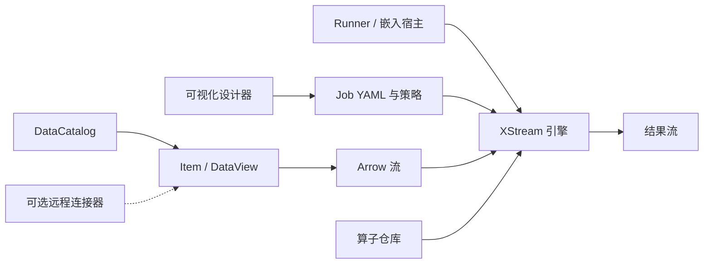

# XStream


[English](README.md)

XStream 是 Scala 编写的流式计算工具集，包含类型化数据访问、可嵌入的作业引擎和浏览器图形设计器。步骤消费和生成数据流，中间数据无需保存为文件；需要时可通过显式执行策略启用物化和重放。

## 组成

| 模块 | 用途 |
|---|---|
| [xstream-data](xstream-data/README_zh.md) | DataCatalog → Dataset → Item、类型化 DataView/DataStream 契约、插件发现、文件及科学格式实现和网络编码 |
| [xstream-operator-sdk](xstream-operator-sdk/README_zh.md) | JVM/Python 算子模板及元数据契约 |
| [xstream-operator-inference](xstream-operator-inference/README_zh.md) | 按需启动并复用的结构及样例推导 worker |
| [xstream-operator-repository](https://github.com/rdcn-link/xstream-operator-repository/blob/main/README_zh.md) | 源码提交、隔离构建、审核、公开算子和运行环境下载 |
| [xstream-engine](xstream-engine/README_zh.md) | 嵌入式执行、取消、执行策略、自动远程计算下推及 `xstream-runner` 启动程序 |
| [xstream-designer](xstream-designer/README_zh.md) | 图形化作业编辑、目录、变量、结构和样例预览、聊天草案及 YAML 导入导出 |

`context:/dataset/item` 在当前 JVM 绑定的目录中解析；显式 `dacp://host:port/dataset/item` URI 使用配置的远程连接。科学数组、图像和序列保留自身结构，不会被隐式展平成记录。格式和后端实现通过插件契约注册。

## 构建

使用 JDK 17 和 sbt 1.10.x。构建只需要本仓库，不需要 DACP 源码或 DACP 制品。初始化脚本按依赖顺序将 XStream 开发制品发布到本机仓库。

```bash
git clone git@github.com:rdcn-link/xstream-codex.git
cd xstream-codex
scripts/bootstrap-local.sh
sbt test
(cd xstream-engine && sbt stage)
(cd xstream-designer && sbt stage)
```

远程 DACP 数据访问由本仓库的连接器实现，本地执行无需启动任何数据服务。详见[模块和构建](docs/repositories_zh.md)。

## 运行

在 XStream 项目根目录执行：

```bash
xstream-engine/target/universal/stage/bin/xstream-runner \
  examples/xstream/engine.yaml examples/xstream/read.yaml
xstream-designer/target/universal/stage/bin/xstream-designer \
  xstream-designer/example.yaml
```

请先修改配置路径、服务地址和凭据。启动程序将所选输出流写入 stdout；设计器默认监听 `http://127.0.0.1:8840/`。算子使用审核公开的仓库、经校验的包缓存，或用于独立开发的[本地源码库](docs/local-operators_zh.md)，内置 `read_item` 无需下载算子包。

## 文档

- [编写算子](docs/operator-authoring_zh.md)
- [源码提交与审核](docs/operator-submission_zh.md)
- [引擎和嵌入](docs/xstream_zh.md)
- [类型化流和科学视图](docs/data-streams_zh.md)
- [Arrow 流契约与数据表示](docs/arrow-streams_zh.md)
- [科学数据编排和预览](docs/designer-scientific_zh.md)
- [插件契约和注册](xstream-data/README_zh.md)
- [作业 YAML](docs/jobs_zh.md)

## 标志

矢量[完整标志](assets/xstream-logo.svg)和[图形符号](assets/xstream-mark.svg)以交叉的数据流构成 X。设计器使用图形符号作为 favicon。

文档归属与官网发布方式：[维护规则](docs/documentation_zh.md)。

完整 Scala 示例：[DataView 与视图流](docs/data-view-examples_zh.md)。

## 架构

本地目录、引擎和设计器可独立使用，远程服务通过可选连接器接入。



## 视觉样式

标准视觉资源为 `assets/xstream-mark.svg` 和 `assets/xstream-logo.svg`。X 图形背景包含五条平行、连续、短波长且低波幅的小波浪线。各应用应保持图标尺寸、深色底色和青蓝紫橙配色一致。
