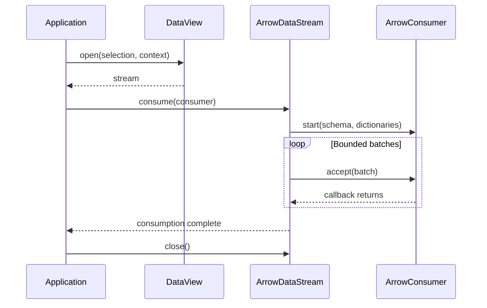

# Arrow view streams

[中文](arrow-streams_zh.md)

Every `DataView[S]` opens an `ArrowDataStream`. The type parameter describes request selection, not a private output encoding. The stream calls `ArrowConsumer.start(schema, dictionaries)` exactly once, even when it has no batches, then calls `accept(ArrowBatch)` synchronously. The schema is constant for that consumption. Each output port has an independent stream and schema. Execution status and retry events are control messages, not data rows.

## Ownership and flow control

Callbacks borrow vectors and dictionaries. The producer may refill or close them after `accept` returns. Consumers must not retain a root or its buffers for later use. `batch.copyTo(allocator)` creates a separately owned snapshot for asynchronous processing; close it after use. Merely retaining buffers does not protect against a producer overwriting them. Synchronous callbacks propagate backpressure. Async links must bound their queues and close queued snapshots on failure or cancellation.

The caller owns `StreamContext.allocator`. Streams close their own vectors, readers and resources, never that allocator. A stream can be consumed once; closing it before consumption prevents acquisition, and closing during consumption prevents subsequent callbacks. Producers must call the context cancellation check before blocking work and between bounded chunks. Callback failures propagate and release producer resources.

## Schema metadata

All view schemas carry:

| Key | Meaning |
| --- | --- |
| `xstream.view` | Representation name, for example `records` or `array` |
| `xstream.view.version` | Representation version, currently `1` |
| `xstream.descriptor` | Bounded JSON object describing the representation |

Unrelated schema and field metadata are retained. Dictionary-encoded fields require a dictionary provider at stream start, including empty streams, and at every batch. Dictionaries share the same borrowing lifetime as vectors.

## Standard representations

| View | Arrow columns | Interpretation |
| --- | --- | --- |
| bytes | `data: binary` | One non-null byte chunk per row; concatenate in stream order |
| records | Ordinary typed Arrow columns | A batch of records; preserve nested and dictionary types |
| array | `origin: list<int64>`, `shape: list<int64>`, `stride: list<int64>`, `values: list<T>` | One row per dense multidimensional block, not one record per scalar |
| sequence | `id: utf8`, `offset: int64`, `symbols: utf8`, `last: bool`, `description: utf8?` | Ordered chunks of a named sequence; offsets count symbols |

Array `T` is the Arrow integer or floating type matching the source numeric encoding, including unsigned integers. `values` is in row-major order. The descriptor retains dimensions, coordinate Item references, units, scaling and missing-value attributes. Consumers must interpret attributes explicitly. This representation does not automatically rescale values, replace missing values or flatten arrays into records. Format plugins bound the block sizes; the standard block helpers cap payloads at 16 MiB. Arrow IPC handles physical byte order; the descriptor's byte order describes the parser block projection.

`ArrowRepresentations.writer` and `DataViews.blocks` provide standard parser helpers for bytes, records, arrays and sequences. `ArrowBlocks` projects a standard Arrow stream into bounded parser blocks for convenience APIs. A custom view emits Arrow batches directly with its own schema and descriptor; it needs no output codec registry. Request parsing and validation remain the responsibility of the representation/plugin implementation. Register file readers and dataset providers through their existing ServiceLoader contracts; see [plugins](plugins.md).

## Encoding and persistence boundaries

`ArrowIpc` uses the same Arrow stream/file readers and writers for all views. In-process callbacks exchange batches without IPC serialization. Across process and node boundaries, Arrow IPC or Flight transports the batches. A materialized output uses ordered Arrow IPC File segments, a manifest, checksums and atomic publication. Only a complete published output is a replay boundary; individual segments do not imply recovery from arbitrary positions inside an operator.

Compatible same-process JVM and Python operator groups hand batches through bounded links with backpressure. A producer may reuse its buffers only after the consumer advances. Group boundaries and external operator inputs still require encoding. The multiplexed Job protocol retains its `OperatorFrame` envelopes: bytes payloads are raw bounded chunks; records and scientific payloads contain Arrow IPC batches. This is distinct from the public View interface, which always emits Arrow batches.

Materialization stores one initial zero-row Arrow File segment, preserving dictionaries, followed by ordered data segments. Its manifest records segment order, size and SHA-256. Replay checks integrity before exposing each segment; failed writes cannot be committed. Empty dictionary streams carry explicit dictionary messages. IPC stream writing supports changing dictionary providers; IPC File segments are independent snapshots.

## Stream consumption sequence

The next batch is produced after the current consumer callback returns. Serialization is required only at an explicit IPC boundary.

