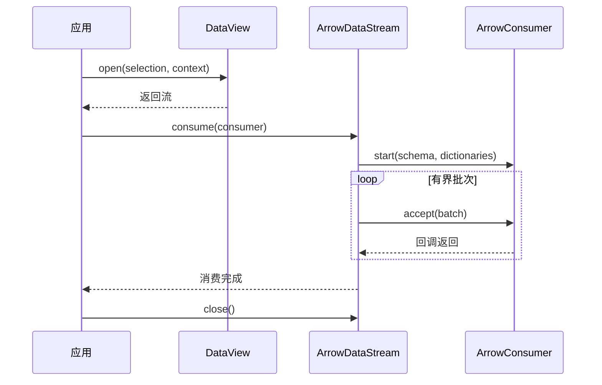

# Arrow 视图流

[English](arrow-streams.md)

每个 `DataView[S]` 都打开一个 `ArrowDataStream`。类型参数描述请求的选择条件，而不是私有输出编码。流恰好调用一次 `ArrowConsumer.start(schema, dictionaries)`，即使没有批次也如此，随后同步调用 `accept(ArrowBatch)`。一次消费期间 schema 保持不变。每个输出端口拥有独立的流和 schema。执行状态和重试事件属于控制消息，不是数据行。

## 所有权与流控

回调借用向量和字典。`accept` 返回后，生产者可以重新填充或关闭它们。消费者不能保留 root 或其缓冲区供以后使用。`batch.copyTo(allocator)` 创建独立拥有的快照，用于异步处理；使用后必须关闭。仅增加缓冲区引用计数不能防止生产者覆盖其内容。同步回调传递背压。异步链路必须限制队列大小，并在失败或取消时关闭队列中的快照。

调用者拥有 `StreamContext.allocator`。流关闭自身的向量、读取器和资源，不关闭这个 allocator。流只能消费一次；消费前关闭流会阻止资源获取，消费中关闭会阻止后续回调。生产者必须在阻塞工作前、在有界数据块之间检查 context 的取消状态。回调异常向上传播，并释放生产者资源。

## Schema 元数据

所有视图 schema 都带有：

| 键 | 含义 |
| --- | --- |
| `xstream.view` | 表示名称，例如 `records` 或 `array` |
| `xstream.view.version` | 表示版本，目前为 `1` |
| `xstream.descriptor` | 描述该表示的有界 JSON 对象 |

保留无关的 schema 和字段元数据。字典编码的字段要求在流启动时提供字典，包括空流；每个批次也必须提供字典。字典与向量遵循相同的借用生命周期。

## 标准表示

| View | Arrow 列 | 解释 |
| --- | --- | --- |
| bytes | `data: binary` | 每行一个非空字节块，按流的顺序拼接 |
| records | 普通的有类型 Arrow 列 | 一批记录；保留嵌套类型和字典类型 |
| array | `origin: list<int64>`、`shape: list<int64>`、`stride: list<int64>`、`values: list<T>` | 每行是一个稠密多维块，不是将每个标量变为记录 |
| sequence | `id: utf8`、`offset: int64`、`symbols: utf8`、`last: bool`、`description: utf8?` | 一个命名序列的有序分块；offset 按符号计数 |
| items | `uri`, `name`, `kind`, `format`, `views`, `metadata`（UTF-8 列） | 有序的资源引用；不携带成员内容或凭据 |

数组的 `T` 是与源数值编码一致的 Arrow 整数或浮点类型，包括无符号整数。`values` 采用行优先顺序。描述信息保留维度、坐标 Item 引用、单位、缩放和缺失值属性。消费者应显式解释这些属性。此表示不会自动缩放数值、替换缺失值或将数组展平成记录。格式插件限制数据块大小；标准数据块辅助工具将载荷限制为 16 MiB。Arrow IPC 处理实际字节序；描述中的 byte order 用于解析器数据块投影。

`ArrowRepresentations.writer` 和 `DataViews.blocks` 为 bytes、records、array、sequence 提供标准解析器辅助工具。`ArrowBlocks` 将标准 Arrow 流投影为有界的解析器数据块，供便捷 API 使用。自定义视图直接输出带自身 schema 和描述信息的 Arrow 批次，不需要输出编码器注册表。请求解析和校验仍由表示或插件实现负责。文件读取器和数据集提供者仍使用现有 ServiceLoader 契约注册，参见[插件说明](plugins_zh.md)。

## 编码与持久化边界

`ArrowIpc` 对所有视图使用同一套 Arrow stream/file 读写器。同进程回调交换批次，不进行 IPC 序列化。跨进程和跨节点通过 Arrow IPC 或 Flight 传输批次。应用可以显式采用 Arrow IPC File 保存最终结果。引擎不把中间流保留为恢复检查点，失败尝试通过完整 Job 重跑处理。

兼容的同进程 JVM 和 Python 算子组通过有界链路和背压交接批次。只有消费者推进后，生产者才能复用缓冲区。算子组边界和外部算子输入仍然需要编码。多路复用 Job 协议保留 `OperatorFrame` 信封：bytes 载荷为原始有界字节块，records 和科学视图载荷为 Arrow IPC 批次。这与公共 View 接口有所区别，后者始终输出 Arrow 批次。

空字典流显式携带字典消息，IPC Stream 写入支持切换字典提供者。应用保存最终 Arrow IPC File 时，应保留对应 schema 和字典。

## 流消费时序

当前消费者回调返回后才继续下一批数据，只有显式 IPC 边界才需要序列化。

