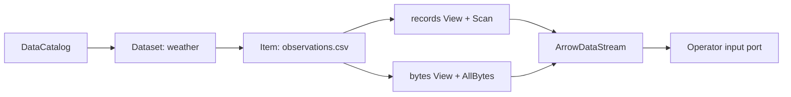
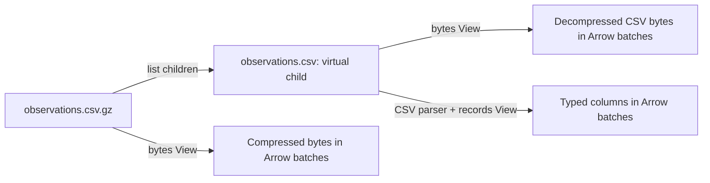

# Data model: catalogs, Items and streams

[中文](data-model_zh.md)

XStream separates where data is stored, how it is addressed and how it is consumed. A DataCatalog lists Datasets. A Dataset exposes a tree of logical Items. Select an Item's View to read an Arrow stream. The same Job can read a CSV file, a compressed file's member, a database table or a scientific variable without embedding a filesystem reader in each operator.

## The five concepts

| Concept | Responsibility | Example |
| --- | --- | --- |
| DataCatalog | Discover named Datasets in the current execution context or a configured service | The catalog bound to the Runner JVM |
| Dataset | Provide one logical namespace through a backend plugin | `weather`, backed by `/srv/weather` |
| Item | Identify a folder, readable object or browsable file container within a Dataset | `/observations.csv.gz/observations.csv` |
| View | Choose a supported representation and its selection parameters | `records` with a row limit, or `bytes` |
| ArrowDataStream | Deliver a schema and ordered, bounded Arrow batches | Records flowing into the next processing step |

A Dataset name is an address component. Its description is a JSON object containing a nonempty string `title`, a string `description` and optional application fields. For example, `weather` can have the human-readable title “Station observations.” An Item's name is its final path component; its path identifies it within the Dataset. Dataset names, Item paths and physical storage paths serve different purposes.



## A logical tree over physical storage

A directory Dataset maps files and folders under its configured root into logical paths. It also delegates supported archive and scientific-file structures to plugins. The children of such a file are virtual Items: they need not exist as separate files beside the original.

Suppose `/srv/weather` contains these physical files:

```text
/srv/weather/
├── observations.csv
├── observations.csv.gz
├── reports.tar.gz      # contains daily/east.csv and daily/west.csv
├── stations.zip        # contains metadata/stations.csv
├── climate.nc          # contains a variable named temperature
├── genome.fa
└── station.jpg
```

With the relevant plugins installed, the catalog exposes:

```text
DataCatalog
└── weather                         Dataset
    ├── observations.csv            Item: bytes, records
    ├── observations.csv.gz         browsable Item: bytes of the GZIP file
    │   └── observations.csv        virtual Item: decompressed bytes, records
    ├── reports.tar.gz              browsable Item: bytes of the TAR.GZ file
    │   └── daily/                  virtual folder
    │       ├── east.csv            virtual Item: bytes, records
    │       └── west.csv            virtual Item: bytes, records
    ├── stations.zip                browsable Item: bytes of the ZIP file
    │   └── metadata/               virtual folder
    │       └── stations.csv        virtual Item: bytes, records
    ├── climate.nc                  browsable Item: original bytes
    │   └── temperature             variable Item: array View
    ├── genome.fa                   browsable Item: original bytes
    │   └── sequences               Item: sequence View
    └── station.jpg                 Item: bytes
```

The scientific children shown here depend on the actual file contents. A NetCDF variable may be inside groups. FITS exposes HDUs: image HDUs provide arrays and table HDUs provide records. JPEG currently exposes bytes; decode the image inside an operator. See [View examples](data-view-examples.md) for Scala consumers.

Browsing and reading are separate capabilities. A plain folder has children but no content stream. An archive is advertised as a folder-like Item with children **and** a `bytes` View for the original archive. Always inspect its advertised Views rather than deciding readability from `kind` alone. A container's total size and record count can be unknown even when its original bytes are readable.

## How GZIP becomes an Item

GZIP compresses a byte stream; it does not itself describe a directory tree. The `gzip` container plugin exposes one child. Its name is the public Item's final component with `.gz` removed, ignoring case. The optional filename in the GZIP header is not used. If no useful name can be derived, the child is named `content`.

For the Dataset `weather`:

| Address | Meaning |
| --- | --- |
| `context:/weather/observations.csv.gz` with `view: bytes` | Original compressed file |
| `context:/weather/observations.csv.gz/observations.csv` with `view: bytes` | Decompressed CSV bytes |
| `context:/weather/observations.csv.gz/observations.csv` with `view: records` | Rows parsed from the decompressed CSV |

Removing the suffix creates a **child path**, not a second sibling. If both `/observations.csv` and `/observations.csv.gz/observations.csv` appear, the first comes from the separate physical CSV and the second is derived from GZIP. The child format reader is selected from its filename; a generic `payload.gz` does not promise a records View. GZIP child size and source timestamps remain unknown when the source cannot supply them reliably.



## ZIP, TAR and TAR.GZ

| File | Virtual namespace |
| --- | --- |
| `stations.zip` | Archive paths under `/stations.zip/`, including intermediate folders |
| `reports.tar` | Archive paths under `/reports.tar/` |
| `reports.tar.gz` or `reports.tgz` | TAR entries directly under the compressed archive's Item path |
| `observations.csv.gz` | One child named `observations.csv` |

`/reports.tar.gz/daily/east.csv` is the correct path for the example. There is no automatically inserted `/reports.tar.gz/reports.tar/` layer. A sibling `/reports.tar` exists only if a separate file or explicit publication creates it. The compound TAR.GZ reader takes precedence over generic GZIP handling.

Archive member paths are logical paths; missing intermediate directories are synthesized. Current readers reject invalid paths, duplicate members and file/folder conflicts. TAR links, sparse files and special entries are unsupported. Nested ZIP/TAR/GZIP members remain binary Items and are not recursively expanded. For example, `stations.zip/nested.zip` can be read as bytes, but does not automatically expose `stations.zip/nested.zip/stations.csv`.

### Discovery, extraction and disk use

Virtual Items do not mean permanent extraction. ZIP browsing reads its index. GZIP browsing exposes its single child after opening the compressed header. TAR and TAR.GZ browsing scans archive entries; TAR.GZ requires sequential decompression, so browsing a large archive may take time.

When reading an archive member, current ZIP, TAR and GZIP plugins stage the requested member as a temporary local file, then pass it to the appropriate reader. Cleanup runs when the operation exits, including on failures. TAR extraction scans the archive, while ZIP can select an entry through its index. Schema or count queries for a child can also require extraction. Ordinary browsing does not create a permanently extracted directory.

The current limits are 10,000 entries, 512 MiB per extracted member and 2 GiB of declared total member sizes for ZIP/TAR, with an additional bound on decompressed TAR headers and padding. GZIP's single extracted child is bounded to 512 MiB. These are plugin limits, not promises that arbitrary large archives are supported.

Archive staging is distinct from Job output materialization. A policy forbidding intermediate output materialization does not disable the temporary files required by an input plugin. Once the reader emits data, steps consume bounded Arrow batches; the complete result need not be collected in memory. For [materialization and replay](materialization.md), choose output persistence separately.

## Configure and use the catalog

The following fragment defines a Runner catalog:

```yaml
datasets:
  weather:
    description: '{"title":"Station observations","description":"CSV observations and archived reports."}'
    provider: directory
    source:
      root: /srv/weather
```

For Designer configuration, place the same `datasets` mapping under `local_catalog`. Catalog roots appear in its Catalogs tab; expand a Dataset and then its folders or archive Items to load children. Selecting a readable View creates a `read_item` step. Local Items use `context:` URIs. Expanding the tree does not run a Job.

Archive browsing requires `xstream-data-archives` and its runtime dependencies, in addition to the directory and format plugins. The Designer distribution bundles archive support. The Runner distribution does not currently bundle that module: put the archive plugin and its dependencies on the runtime classpath or in the configured `plugin_directory` before using these archive examples. Plugins register through `META-INF/services/xstream.data.ContainerReader`; the archive plugin supplies `zip`, `gzip`, `tar` and `tar-gzip`. A CSV child additionally needs the CSV format reader. See [plugin discovery and deployment](plugins.md).

This Job reads decompressed observations as records:

```yaml
name: Read compressed station observations
steps:
  - id: read
    title: Read observations from GZIP
    operator: read_item@1.0
    inputs: {}
    params:
      uri: context:/weather/observations.csv.gz/observations.csv
      view: records
outputs:
  result: read
```

To read an archived report, replace the URI with `context:/weather/reports.tar.gz/daily/east.csv`. To read the original archive itself, use `context:/weather/reports.tar.gz` and `view: bytes`. `context:` is resolved by the execution environment's DataCatalog; it is not an operating-system path. The same namespace can be browsed and read through an optional configured remote data service.

## What crosses an operator port

An Item is an addressable source; a View supplies its representation. A step input receives the stream produced by an upstream step, not a Dataset object or a filename to reopen. `read_item` connects the catalog to the processing graph. Subsequent steps reference upstream outputs, for example `inputs: {source: read}`.

| View | Content of a bounded Arrow batch |
| --- | --- |
| `bytes` | Binary chunks in a `data` column; a chunk need not end at a line or UTF-8 character boundary |
| `records` | Business columns and typed rows, preserving supported nested values |
| `array` | Multidimensional blocks with origin, shape, stride and typed values |
| `sequence` | Named sequence chunks with symbol offsets and final markers |

Every View emits one schema followed by ordered batches; even an empty stream has a schema. Arrays keep their dimensions instead of silently becoming tabular rows. Same-process consumers may use Arrow batches directly; process boundaries use Arrow IPC. This common stream contract does not make every View interchangeable: the operator's input must accept the selected representation.

For API ownership, backpressure and cancellation, read [Data views and Arrow streams](data-streams.md) and [Arrow stream contracts](arrow-streams.md). For complete Job syntax, see [Jobs](jobs.md).
