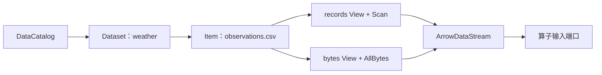
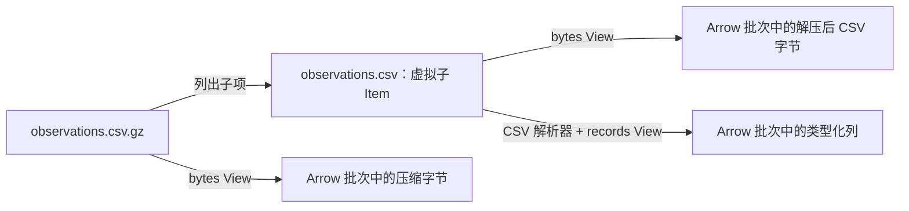

# 数据模型：目录、Item 与流

[English](data-model.md)

XStream 分别定义数据存在哪里、如何寻址以及如何消费。DataCatalog 列出 Dataset；Dataset 通过逻辑 Item 树暴露内容；选择 Item 的 View 后，便可读取 Arrow 流。同一类 Job 可以读取 CSV 文件、压缩文件的成员、数据库表或者科学变量，无需在每个算子中嵌入文件系统读取逻辑。

## 五个核心概念

| 概念 | 职责 | 示例 |
| --- | --- | --- |
| DataCatalog | 发现当前执行上下文或已配置服务中的具名数据集 | 绑定到 Runner JVM 的数据目录 |
| Dataset | 通过后端插件提供一个逻辑命名空间 | 以 `/srv/weather` 为根目录的 `weather` |
| Item | 标识数据集中的目录、可读对象或可浏览文件容器 | `/observations.csv.gz/observations.csv` |
| View | 选择支持的数据表示及其选择参数 | 限制行数的 `records`，或者 `bytes` |
| ArrowDataStream | 提供结构信息以及有序、有界的 Arrow 批次 | 流向下一个处理步骤的记录 |

数据集名称参与寻址。数据集描述是 JSON 对象，其中必须包含非空字符串 `title`、字符串 `description`，还可以包含应用自定义字段。例如，名称为 `weather` 的数据集可以使用“气象站观测”作为易读标题。Item 的名称是路径的最后一段；路径标识其在数据集中的位置。数据集名称、Item 路径和物理存储路径各有不同用途。



## 物理存储之上的逻辑树

目录型数据集将配置根目录下的文件、文件夹映射为逻辑路径，并将支持的归档文件及科学文件结构交给插件展开。这些文件下的子节点是虚拟 Item，不必在原始文件旁边实际存放独立文件。

假设 `/srv/weather` 包含以下物理文件：

```text
/srv/weather/
├── observations.csv
├── observations.csv.gz
├── reports.tar.gz      # 包含 daily/east.csv 和 daily/west.csv
├── stations.zip        # 包含 metadata/stations.csv
├── climate.nc          # 包含名为 temperature 的变量
├── genome.fa
└── station.jpg
```

安装相关插件后，目录可以展示为：

```text
DataCatalog
└── weather                         Dataset
    ├── observations.csv            Item：bytes、records
    ├── observations.csv.gz         可浏览 Item：GZIP 原文件的 bytes
    │   └── observations.csv        虚拟 Item：解压后的 bytes、records
    ├── reports.tar.gz              可浏览 Item：TAR.GZ 原文件的 bytes
    │   └── daily/                  虚拟目录
    │       ├── east.csv            虚拟 Item：bytes、records
    │       └── west.csv            虚拟 Item：bytes、records
    ├── stations.zip                可浏览 Item：ZIP 原文件的 bytes
    │   └── metadata/               虚拟目录
    │       └── stations.csv        虚拟 Item：bytes、records
    ├── climate.nc                  可浏览 Item：原文件 bytes
    │   └── temperature             变量 Item：array View
    ├── genome.fa                   可浏览 Item：原文件 bytes
    │   └── sequences               Item：sequence View
    └── station.jpg                 Item：bytes
```

这里的科学文件子节点取决于实际文件内容，NetCDF 变量也可能位于 group 中。FITS 暴露 HDU：图像 HDU 提供数组，表格 HDU 提供记录。JPEG 当前提供 bytes，可在算子中解码图像。Scala 消费示例见[视图示例](data-view-examples_zh.md)。

浏览与读取是两个独立能力。普通文件夹具有子节点，但没有内容流；归档文件以类似文件夹的 Item 展示，既有子节点，**又**有读取原始归档文件的 `bytes` View。应查看其声明的 Views，不能只凭 `kind` 判断能否读取。容器的总大小和记录数可以未知，即使仍能读取原始 bytes。

## GZIP 如何映射成 Item

GZIP 压缩的是一条字节流，本身不描述目录树。`gzip` 容器插件为其暴露一个子 Item。子 Item 名称取自公开 Item 路径的最后一段，去掉 `.gz` 后缀，匹配时不区分大小写；不使用 GZIP 文件头里的可选原始文件名。无法获得有效名称时，子 Item 名称为 `content`。

以 `weather` 数据集为例：

| 地址 | 含义 |
| --- | --- |
| `context:/weather/observations.csv.gz`，`view: bytes` | 原始压缩文件 |
| `context:/weather/observations.csv.gz/observations.csv`，`view: bytes` | 解压后的 CSV 字节 |
| `context:/weather/observations.csv.gz/observations.csv`，`view: records` | 解析解压后的 CSV 所得到的记录 |

去掉后缀形成的是**子路径**，不是同级的另一份文件。如果同时出现 `/observations.csv` 和 `/observations.csv.gz/observations.csv`，前者来自独立的物理 CSV 文件，后者才是从 GZIP 派生的虚拟 Item。子文件按名称选择格式读取器；通用名称 `payload.gz` 不保证具有 records View。如果来源不能可靠提供，GZIP 子 Item 的大小与来源时间戳保持未知。



## ZIP、TAR 与 TAR.GZ

| 文件 | 虚拟命名空间 |
| --- | --- |
| `stations.zip` | 归档路径位于 `/stations.zip/` 下，包含中间目录 |
| `reports.tar` | 归档路径位于 `/reports.tar/` 下 |
| `reports.tar.gz` 或 `reports.tgz` | TAR 成员直接位于压缩归档 Item 的路径下 |
| `observations.csv.gz` | 一个名为 `observations.csv` 的子 Item |

示例的正确路径是 `/reports.tar.gz/daily/east.csv`，不会自动增加 `/reports.tar.gz/reports.tar/` 这一层。只有存在独立文件或显式发布时，才会出现同级 `/reports.tar`。复合 TAR.GZ 读取器优先于通用 GZIP 处理。

归档成员采用逻辑路径；缺失的中间目录会自动补出。当前读取器拒绝非法路径、重复成员以及文件与目录冲突。TAR 链接、稀疏文件和特殊条目不受支持。嵌套的 ZIP、TAR、GZIP 成员保持为二进制 Item，不会递归展开。例如，可以读取 `stations.zip/nested.zip` 的 bytes，但不会自动暴露 `stations.zip/nested.zip/stations.csv`。

### 发现、解压与磁盘使用

虚拟 Item 不意味着永久解压。浏览 ZIP 时读取索引；浏览 GZIP 时打开压缩头后展示唯一子 Item；浏览 TAR 和 TAR.GZ 时扫描归档条目。TAR.GZ 需要顺序解压，因此浏览较大归档可能耗时。

读取归档成员时，当前 ZIP、TAR 和 GZIP 插件会将请求的成员暂存为本地临时文件，再交给相应格式读取器。操作退出时执行清理，失败时也会清理。TAR 提取需要扫描归档，ZIP 可以通过索引选择成员。对子 Item 查询结构或记录数也可能触发提取。普通浏览不会生成永久解压目录。

当前限制为：最多 10,000 个条目，每个提取成员最多 512 MiB，ZIP/TAR 声明的成员总大小最多 2 GiB，另外限制解压后 TAR 的文件头和填充总量。GZIP 唯一解压子 Item 也限制为 512 MiB。这些是插件限制，不表示支持任意大的归档文件。

归档暂存与 Job 输出物化是不同机制。禁止中间输出物化的策略，不会禁止输入插件所需的临时文件。读取器开始输出后，各步骤消费有界 Arrow 批次，不必将完整结果收集到内存中。[物化与重放](materialization_zh.md)涉及的输出持久化需要另行设置。

## 配置并使用目录

以下片段定义 Runner 的数据目录：

```yaml
datasets:
  weather:
    description: '{"title":"Station observations","description":"CSV observations and archived reports."}'
    provider: directory
    source:
      root: /srv/weather
```

在 Designer 配置中，将相同的 `datasets` 映射放到 `local_catalog` 下。目录根节点显示在 Catalogs 标签页；展开 Dataset，再展开文件夹或归档 Item，便会加载子节点。选择可读 View 可以创建 `read_item` 步骤。本地 Item 使用 `context:` URI；展开目录树不会执行 Job。

归档浏览除目录和格式插件外，还需要 `xstream-data-archives` 及其运行依赖。Designer 发行包包含归档支持；Runner 发行包当前未内置这个模块，使用上述归档示例前，需要将归档插件及其依赖放入运行 classpath，或配置的 `plugin_directory`。插件通过 `META-INF/services/xstream.data.ContainerReader` 注册；归档插件提供 `zip`、`gzip`、`tar`、`tar-gzip`。CSV 子 Item 还需要 CSV 格式读取器。见[插件发现与部署](plugins_zh.md)。

下面的 Job 将解压后的观测数据作为记录读取：

```yaml
name: Read compressed station observations
steps:
  - id: read
    title: Read observations from GZIP
    operator: read_item@1.0
    inputs: {}
    params:
      uri: context:/weather/observations.csv.gz/observations.csv
      view: records
outputs:
  result: read
```

读取归档中的报告时，将 URI 替换为 `context:/weather/reports.tar.gz/daily/east.csv`。读取原始归档文件时，使用 `context:/weather/reports.tar.gz` 和 `view: bytes`。`context:` 由执行环境绑定的 DataCatalog 解析，并非操作系统路径；同一命名空间也可通过可选的已配置远程数据服务浏览和读取。

## 算子端口之间传递什么

Item 是可寻址的数据来源，View 提供其表示形式。步骤输入端口接收的是上游步骤输出的流，不是 Dataset 对象或者需要重新打开的文件名。`read_item` 将目录接入处理图；后续步骤引用上游输出，例如 `inputs: {source: read}`。

| View | 有界 Arrow 批次的内容 |
| --- | --- |
| `bytes` | `data` 列中的二进制块，块边界不保证与行边界或 UTF-8 字符边界一致 |
| `records` | 业务列与类型化记录，保留支持的嵌套值 |
| `array` | 包含 origin、shape、stride 和类型化值的多维块 |
| `sequence` | 包含标识、符号偏移量和末块标记的序列块 |

每个 View 先输出一次结构，再输出有序批次；空流也具有结构。数组保留维度，不会被静默转换为表格行。同进程内的消费者可以直接使用 Arrow 批次；跨进程边界使用 Arrow IPC。统一的流契约不表示各种 View 可以相互替代：算子输入必须接受所选表示。

API 的资源归属、背压和取消见[数据视图与 Arrow 流](data-streams_zh.md)及 [Arrow 流契约](arrow-streams_zh.md)。完整 Job 语法见 [Jobs](jobs_zh.md)。
