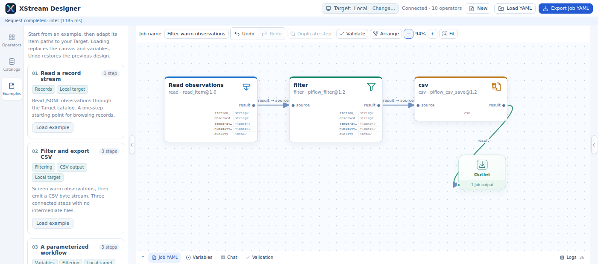
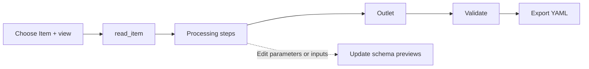
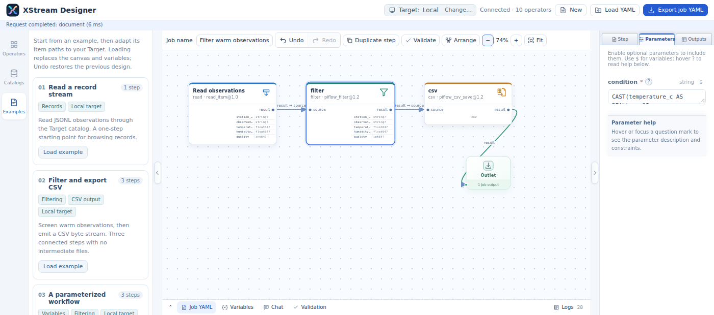

# Designer user guide

[中文](designer-guide_zh.md)

Create a Job by connecting operator ports, inspect structures and bounded samples, then export YAML for execution. Start Designer using the [configuration reference](../xstream-designer/README.md#start). Its startup configuration supplies the local catalog, available targets, operator repository and optional Chat model API.

## 1. Find your way around

| Area | Use |
|---|---|
| Header | Confirm Target, create or load a Job, and export YAML |
| Left sidebar | Browse operators, catalogs and bundled examples |
| Canvas | Arrange steps and connect ports to the single Outlet |
| Right sidebar | Edit the selected step, parameters and output previews |
| Bottom panel | Inspect Job YAML, edit variables, validate, read logs or use Chat |

The screenshots show a running Designer and its supplied weather example. The software interface is shown in its original English; catalog contents depend on host configuration.

## 2. Select Target and data

Target defaults to Local. Use the Target control to select a configured remote target and confirm the change. **Target catalog** then shows that target's catalog; other configured catalogs remain available separately. Expand a catalog, Dataset or folder to load its direct children.

Select an Item and one of its advertised views to create or configure `read_item`. A selection from Target catalog uses `context:/dataset/item`; another catalog uses an explicit remote URI. Folder expansion uses its triangle; readable containers may also offer their original bytes. Review Item paths when loading an example into another environment.

The exported `designer.target` remembers the design target. Execution uses the catalog of the receiving engine; the designer metadata does not submit or relocate a Job.

## 3. Build the processing chain

1. Load an example from **Examples**, or add operators from the library.
2. Click an output port, move to the destination input port and click to connect. Right-click cancels the pending connection.
3. Connect the desired final output to Outlet. One step output port supplies the Job output.
4. Drag steps to arrange them. Box-select multiple elements to move them together. Use Delete, Duplicate step, Undo and Redo as needed.
5. Double-click a step to open its properties. A single click selects it without opening the sidebar.

Deleting multiple steps or replacing the design with an example opens a styled in-page confirmation. Cancel or Escape preserves the current design; confirmed changes can still be undone.

## 4. Set parameters, variables and descriptions

The right sidebar separates **Step**, **Parameters** and **Outputs**. Step contains the readable title and multiline description. Parameters presents typed controls using the operator's declaration. Hover over or focus the help marker to read its description in the panel.

Edits apply automatically. Use the bottom **Variables** tab for values referenced by the Job; variable substitution preserves numbers, booleans, lists and mappings. The bottom Job YAML stays synchronized with the canvas. See the [Job reference](jobs.md) for exact syntax.

## 5. Inspect schemas and samples

Schema inference follows affected stream dependencies when parameters or inputs change. Canvas steps display compact output schemas; the Outputs tab shows each port's expected structure and operator-provided sample. Samples are bounded, normally to 10 rows and 16 KiB per port. Record samples display as tables; binary samples use Base64. They are previews rather than results from the complete dataset.

Unknown schema is a valid inference outcome, for example when parsing bytes without enough structure information. An inference error is reported separately. Use Logs for details and verify variables and Item paths. Scientific selection examples are in [scientific views](designer-scientific.md).

## 6. Validate, import and export

Use **Validate** to check disconnected steps, missing output connections and input compatibility. Run this before export. Load YAML with **Load YAML**; use the matching variable values for the target environment.

**Export job YAML** opens a preview with **Include designer information** selected by default. That information preserves layout, Outlet position, viewport and generator metadata. Copy, print or download from this preview. Execution uses the Job definition; the auxiliary layout is for restoring the editor.

## 7. Compose with Chat

Describe the complete processing requirement, data paths, intended transformations and output. Chat uses the model API configured by the administrator to propose a Job. Review and apply the proposal, then inspect parameters, validate and export. Follow-up messages refine the proposal. See [Chat configuration](../xstream-designer/README.md#chat-composition).

For execution commands and policies, continue with the [user guide](usage.md#3-write-and-run-jobs).
