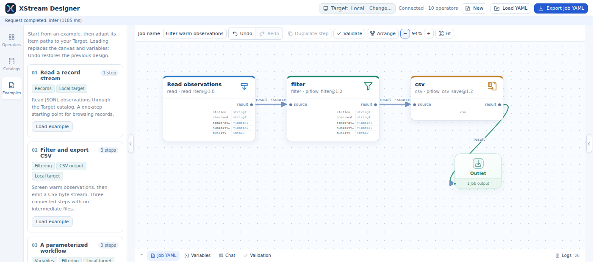
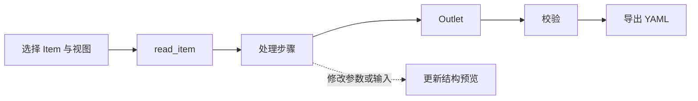
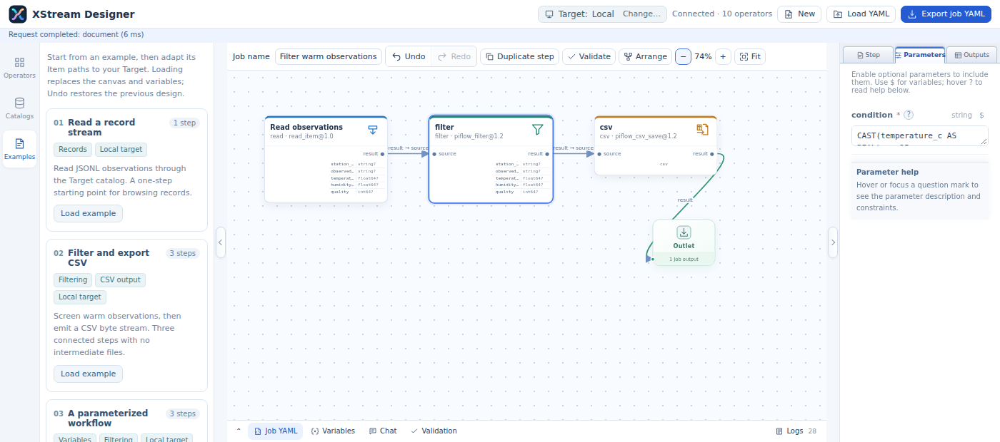

# Designer 使用指南

[English](designer-guide.md)

通过连接算子端口创建 Job，检查结构及有界样例，再导出 YAML 执行。启动方式见[配置参考](../xstream-designer/README_zh.md)。启动配置提供本地目录、可选 Target、算子仓库及可选的 Chat 模型 API。

## 1. 认识界面

| 区域 | 用途 |
|---|---|
| 顶栏 | 确认 Target、新建或加载 Job、导出 YAML |
| 左侧栏 | 浏览算子、数据目录及内置示例 |
| 画布 | 布置步骤，将端口连至唯一 Outlet |
| 右侧栏 | 编辑所选步骤、参数及输出预览 |
| 底部面板 | 查看 Job YAML、编辑变量、校验、查看日志及使用 Chat |

截图来自实际运行的 Designer 及其气象示例。软件界面保留原始英文；目录内容取决于宿主配置。

## 2. 选择 Target 与数据

Target 默认为 Local。通过 Target 控件选择已配置的远程目标，并确认切换。**Target catalog** 随后显示该目标的目录；其他已配置目录单独提供。展开 Catalog、Dataset 或文件夹时加载直接子项。

选择 Item 及其提供的视图，可以创建或配置 `read_item`。Target catalog 中的选择使用 `context:/dataset/item`；其他目录的选择使用完整远程 URI。用文件夹左侧三角展开子项，可读容器也可能提供原始 bytes。将示例加载到其他环境时，检查 Item 路径。

导出的 `designer.target` 记录设计目标。执行时使用接收引擎的数据目录；设计器辅助信息不会提交或迁移 Job。

## 3. 建立处理链

1. 从 **Examples** 加载示例，或从算子库添加算子。
2. 点击输出端口，移动到目标输入端口后再点击完成连线；右键取消本次连线。
3. 将需要的最终输出连接到 Outlet。Job 输出来自一个步骤的一个输出端口。
4. 拖动步骤布置画布；框选多个元素后可一起移动。按需使用 Delete、复制步骤、Undo 和 Redo。
5. 双击步骤打开属性；单击只选中，不展开侧栏。

批量删除步骤或用示例替换当前设计时，设计器使用页面内确认弹窗。可点击取消或按 Escape 保留当前设计；确认后仍可使用 Undo 撤销。

## 4. 配置参数、变量与描述

右侧栏分为 **Step**、**Parameters** 和 **Outputs**。Step 包含可读标题与多行描述；Parameters 根据算子声明提供有类型的控件。将鼠标移到帮助标记或使其获得焦点后，在面板说明区域阅读解释。

编辑自动生效。底部 **Variables** 标签页提供 Job 引用的变量值；变量替换保留数值、布尔、列表和映射类型。底部 Job YAML 与画布同步。准确语法见 [Job 参考](jobs_zh.md)。

## 5. 查看结构与样例

参数或输入变化时，结构推导沿受影响的流依赖更新。画布以紧凑形式展示输出结构；Outputs 标签页逐端口展示预期结构和算子提供的样例。样例有大小限制，通常每个端口最多 10 行、16 KiB。记录样例展示为表格，二进制样例用 Base64 展示。样例是预览，不是完整数据集的执行结果。

结构未知是合法的推导结果，例如解析字节时尚无足够结构信息。推导错误单独报告；详细原因查看 Logs，并检查变量与 Item 路径。科学视图的选择示例见[科学视图](designer-scientific_zh.md)。

## 6. 校验、导入与导出

使用 **Validate** 检查游离步骤、缺失输出连接和输入兼容性，建议导出前执行。用 **Load YAML** 加载已有 Job，并为目标环境提供相应变量。

**Export job YAML** 打开预览，默认勾选 **Include designer information**。辅助信息保存布局、Outlet 位置、视口及生成器元数据。预览中支持复制、打印及下载。执行使用 Job 定义，辅助布局用于恢复编辑器。

## 7. Chat 编排

描述完整处理需求、数据路径、转换过程和期望输出。Chat 使用管理员配置的模型 API 提议 Job。检查并应用提议后，继续核对参数、校验与导出；后续问答可修改提议。参见 [Chat 配置](../xstream-designer/README_zh.md)。

执行命令和策略见[使用指南](usage_zh.md)。
