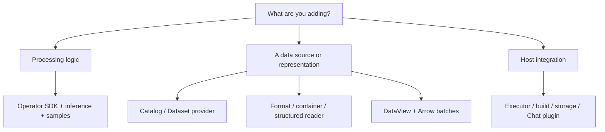

# Development guide

[中文](development_zh.md)

Develop operators and extend data access or execution through public plugin contracts. Choose the extension matching your task, then follow its examples and reference.

## 1. Operator development

**Scala is the preferred language for new XStream operators.** Start with the JVM SDK templates and keep processing, structure inference and bounded samples in the same operator implementation. Java uses the same JVM contracts; Python, scripts and native commands remain supported for existing code and language-specific libraries.

| Task | Tutorial, examples and reference |
|---|---|
| Write your first operator | [Complete authoring tutorial](operator-authoring.md) |
| Use Scala templates (preferred) | [JVM SDK](../xstream-operator-sdk/README.md), [Scala examples](../examples/operators/scala/README.md) |
| Implement the same JVM interfaces in Java | [JVM SDK](../xstream-operator-sdk/README.md) |
| Use Python templates | [Python SDK](../xstream-operator-sdk/README.md), [Python examples](../examples/operators/python/README.md) |
| Wrap scripts or third-party commands | [Script examples](../examples/operators/scripts/README.md), [native command adapters](native-commands.md) |
| Declare parameters, defaults and validation | [Parameter contract](operator-parameters.md) |
| Implement output inference and bounded samples | [Structure inference](structure-inference.md) |
| Handle ports, batches, backpressure, cancellation and termination | [Stream contract](operator-streams.md), [Arrow ownership](arrow-streams.md) |
| Declare dependencies and package code | [Dependency environments](dependency-environments.md), [packaging reference](operator-packaging.md), [runtime selection](operator-runtimes.md) |
| Test locally | [Local operator library](local-operators.md), [CLI](../xstream-operator-sdk/cli/README.md) |
| Submit source for publication | [Submission workflow](operator-submission.md), [provenance](operator-provenance.md), [icons](operator-presentation.md) |

Processing, structure inference and bounded output samples are part of an operator's implementation. Use the SDK to manage stream framing and resource lifetime.

## 2. Data extensions

| Task | Contract and example |
|---|---|
| Set up a plugin and register it | [Plugin guide](plugins.md) |
| Discover Datasets dynamically | [DataCatalogProvider](dataset-catalogs.md) |
| Implement a Dataset or Item backend | [DatasetProvider](dataset-providers.md), [access API](dataset-access.md) |
| Parse a file format | [FormatHandler](format-handlers.md) |
| Browse containers or scientific file structures | [ContainerReader and StructuredFileHandler](format-handlers.md) |
| Add a representation and its selection parameters | [DataView API](data-streams.md), [Arrow schemas](arrow-streams.md) |
| Optimize filtering, projection and limits | [Records scan implementation](records-scans.md) |
| Connect a remote data service | [RemoteItemProvider](execution-targets.md) |

Dataset discovery belongs to catalog providers; Items and their views belong to Dataset backends. Preserve scientific groups, dimensions and metadata. Register implementations through ServiceLoader and keep parser dependencies in their plugin modules.

## 3. Execution and tooling extensions

| Task | Contract and example |
|---|---|
| Add an executor or local builder | [Executor plugin](../plugins/xstream-plugin-operator-executors/README.md), [local build extensions](local-operators.md) |
| Implement execution-record storage | [Execution history API](execution-history.md) |
| Implement materialized-output storage | [Storage contract](materialization.md#storage-plugin-contract) |
| Integrate a model API into Designer Chat | [Chat configuration and adapters](../xstream-designer/README.md#chat-composition) |
| Add source analysis or build recipes | [Build extensions](operator-build-extensions.md) |

## 4. Contract checks

Follow the tests documented by each extension point. Cover discovery, invalid configuration, bounded output, cancellation, failure and resource release. Data extensions also test recursive and immediate-child listing, stable schemas and empty streams; scientific readers test exact structure. Storage plugins test commit/abort, quotas, retention, active leases and corrupted data.

For ordinary catalog configuration and application embedding, use the [user guide](usage.md).
