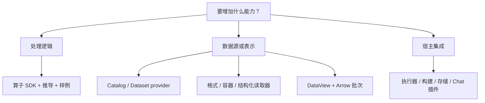

# 开发指南

[English](development.md)

通过公共插件契约开发算子，扩展数据访问或执行能力。先按任务选择扩展点，再阅读对应示例与参考。

## 1. 算子开发

**Scala 是新建 XStream 算子的首选开发语言。** 建议从 JVM SDK 模板开始，将数据处理、结构推导和有界样例放在同一个算子实现中。Java 使用相同的 JVM 契约；Python、脚本和原生命令继续用于已有程序及特定语言生态的库。

| 目标 | 教程、示例与参考 |
|---|---|
| 编写第一个算子 | [完整开发教程](operator-authoring_zh.md) |
| 使用 Scala 模板（首选） | [JVM SDK](../xstream-operator-sdk/README_zh.md)、[Scala 示例](../examples/operators/scala/README_zh.md) |
| 使用 Java 实现相同 JVM 接口 | [JVM SDK](../xstream-operator-sdk/README_zh.md) |
| 使用 Python 模板 | [Python SDK](../xstream-operator-sdk/README_zh.md)、[Python 示例](../examples/operators/python/README_zh.md) |
| 包装脚本或第三方命令 | [脚本示例](../examples/operators/scripts/README_zh.md)、[原生命令适配](native-commands_zh.md) |
| 声明参数、默认值及校验 | [参数契约](operator-parameters_zh.md) |
| 实现输出推导与有界样例 | [结构推导](structure-inference_zh.md) |
| 处理端口、批次、背压、取消及结束 | [流契约](operator-streams_zh.md)、[Arrow 所有权](arrow-streams_zh.md) |
| 声明依赖并打包代码 | [依赖环境](dependency-environments_zh.md)、[打包参考](operator-packaging_zh.md)、[运行时选择](operator-runtimes_zh.md) |
| 本地测试 | [本地算子库](local-operators_zh.md)、[命令行工具](../xstream-operator-sdk/cli/README_zh.md) |
| 提交源码发布 | [提交流程](operator-submission_zh.md)、[来源材料](operator-provenance_zh.md)、[图标](operator-presentation_zh.md) |

处理、结构推导及有界输出样例均属于算子的实现内容。使用 SDK 管理流帧和资源生命周期。

## 2. 数据扩展

| 目标 | 契约与示例 |
|---|---|
| 创建并注册插件 | [插件指南](plugins_zh.md) |
| 动态发现 Dataset | [DataCatalogProvider](dataset-catalogs_zh.md) |
| 实现 Dataset 或 Item 后端 | [DatasetProvider](dataset-providers_zh.md)、[访问 API](dataset-access_zh.md) |
| 解析文件格式 | [FormatHandler](format-handlers_zh.md) |
| 浏览容器或科学文件结构 | [ContainerReader 与 StructuredFileHandler](format-handlers_zh.md) |
| 增加表示及选择参数 | [DataView API](data-streams_zh.md)、[Arrow schema](arrow-streams_zh.md) |
| 优化筛选、投影和 limit | [记录扫描实现](records-scans_zh.md) |
| 连接远程数据服务 | [RemoteItemProvider](execution-targets_zh.md) |

目录 provider 负责 Dataset 发现；Dataset 后端负责 Item 及视图。保留科学分组、维度和元数据。通过 ServiceLoader 注册实现，将解析器依赖留在插件模块内。

## 3. 执行与工具扩展

| 目标 | 契约与示例 |
|---|---|
| 增加执行器或本地构建器 | [执行器插件](../plugins/xstream-plugin-operator-executors/README_zh.md)、[本地构建扩展](local-operators_zh.md) |
| 实现执行记录存储 | [执行历史 API](execution-history_zh.md) |
| 实现物化输出存储 | [存储契约](materialization_zh.md) |
| 接入 Designer Chat 模型 API | [Chat 配置与适配器](../xstream-designer/README_zh.md) |
| 增加源码分析或构建配方 | [构建扩展](operator-build-extensions_zh.md) |

## 4. 契约检查

按各扩展点的说明执行测试，覆盖发现、无效配置、有界输出、取消、失败和资源释放。数据扩展还应测试递归及直接子项列举、稳定 schema 和空流；科学读取器校验精确结构。存储插件测试提交/中止、配额、保留时间、活动租约及损坏数据。

普通目录配置与应用嵌入见[使用指南](usage_zh.md)。
