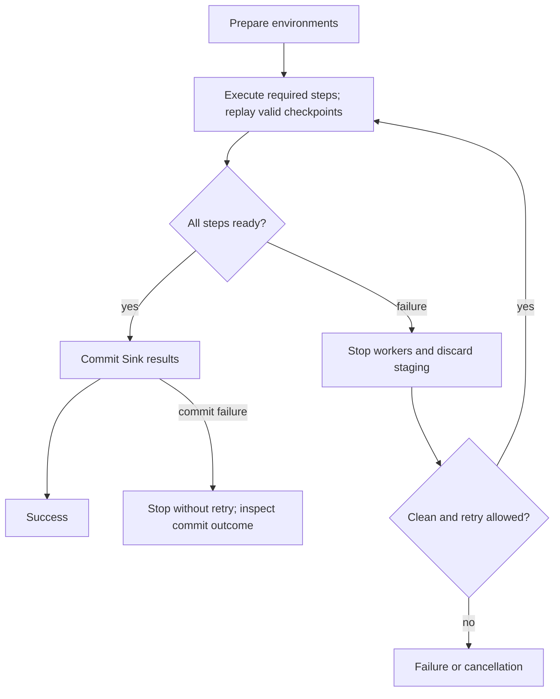

# Job execution policies and recovery

[中文](execution-policy_zh.md)

Execution policies are separate from the Job definition:

```yaml
max_retries: 1
timeout_seconds: 1800
resources:
  tmp_size_mb: 512
  memory_mb: 1024
```

`max_retries` accepts integers 0–10, default 0. It counts additional execution attempts, not independent retries inside an operator. Without checkpoints each attempt executes the complete Job. `timeout_seconds` accepts integers 1–86400, bounded by the host limit. Attempts share the execution time budget. Union prepares every participating node before starting execution; environment preparation has its own startup-configured deadline and does not consume the execution budget. Unknown policy keys are rejected.

## Failure and cancellation

A step failure stops the entire attempt. Every previous worker must stop and every staged Sink result must be discarded before a retry can begin. A retry creates a new attempt identity. Valid configured checkpoints replace their producer and covered upstream work; uncovered branches reopen their inputs and execute again. Without checkpoints every step runs again. Cancellation, timeout, invalid configuration, authorization failures, failed cleanup and failures after commit begins are not automatically retried.



Input format plugins and blocking operators may use temporary files or memory to parse, sort, join or aggregate data. These workspaces are not recovery checkpoints. Execution history stores metadata and attempt identities. A manual rerun submits the saved Job and its resolved variables again; it does not restore an earlier process or reuse intermediate outputs. Reproducibility requires stable input versions, pinned operators and controlled randomness.

## Explicit output checkpoints

Streaming is the default. Select connected step output ports in the separate execution policy:

```yaml
max_retries: 2
checkpoints:
  sort_step: [result]
  another_step: [output_a, output_b]
```

Omit `checkpoints` or use `{}` for no intermediate retention. Unknown steps, unconnected ports, duplicate ports and empty lists are rejected. A producer writes selected streams incrementally and commits them together only after successful processing and valid output termination. Downstream readers of selected ports start after commit; unselected ports remain streaming. Checkpoint boundaries prevent process fusion in that Job. Operators and Job YAML need no checkpoint-specific code or fields.

Retry stops all old workers and discards Sink staging first. A step can be skipped only when all connected outputs are covered by its committed checkpoint. Other input branches are recomputed. Selecting only some outputs creates complete-stream boundaries but cannot skip that producer on retry. Multi-port reads run concurrently with backpressure. Mixed streaming/checkpointed outputs from one producer must not rejoin downstream: that creates a bounded-stream wait cycle. Such policies are rejected; checkpoint the other connected outputs of that producer as well. Quota exhaustion, corruption and cancellation fail explicitly; incomplete artifacts are never reusable. No new fan-out support is implied.

Configure each standalone host or DACP worker that produces checkpoints:

```yaml
checkpoint_store:
  provider: file
  settings:
    directory: /var/lib/xstream/checkpoints
    max_bytes: 1073741824
    max_checkpoint_bytes: 268435456
```

The directory is administrator-controlled; Job policy cannot choose a host path. Defaults are 1 GiB per store and 256 MiB per producer checkpoint, including Arrow File overhead. Positive integer quotas are enforced while writing. One host owns a directory. The `file` provider belongs to `xstream-plugin-execution-file` and is discovered through `META-INF/services/xstream.execution.CheckpointStoreProvider`. Install the plugin JAR and its dependencies in `plugin_directory`, or include it on the embedding classpath.

Public contracts are `CheckpointStoreProvider`, `CheckpointStore`, `CheckpointWriter` and `CheckpointData`. Writers accept original `OperatorFrame` values and commit complete selected ports atomically; closing an uncommitted writer aborts it. Data handles lease their files until closed; deletion while leased fails. Providers own quotas, completeness and integrity checks; core owns execution identity, cancellation, authorization and cleanup. The file provider uses Arrow IPC File **envelopes** containing original encoded frames, preserving headers, dictionaries, scientific structure, batch boundaries and payload bytes without flattening views. Files have SHA-256 integrity checks. This internal envelope is not a new public DataView.

Artifacts are private to one Job execution and its internal attempts. They are removed on terminal success, failure or cancellation; stale artifacts are removed on host startup. They do not create Datasets or provide cross-execution replay, process-state recovery or restart recovery. Checkpointing an `items` stream preserves references, not the referenced content; reproducible reads still require stable/versioned source Items. Sort scratch files do not automatically become checkpoints.

## Final results and Sink lifecycle

`client_sink` marks the streams returned to the calling application. It is a Job endpoint; the application's `ResultSink` implements reception, discard and publication. `JobEngine.runToSink` calls `accept(frame)` while processing, `onDiscard(cause)` on failed attempts and `onComplete()` only after all steps are ready and external Sinks have committed. See [embedding and result collection](embedding.md).

The low-level `JobEngine.run` callback exposes provisional frames. A retry emits `attempt_failed`; such receivers must discard the previous attempt's data and port state. DACP result clients must explicitly provide a retry callback when requesting automatic retries. A per-port `end` frame alone does not prove that the whole Job succeeded.

Custom Sink operators stage their effect in `process`, publish in `onComplete(context)` and clean in `onDiscard(context,cause)`. SDK Sinks stay alive in their isolated runtime until the coordinator decides. Source and Transform operators must not publish external effects during processing. See [Sink lifecycle](sink-lifecycle.md).

Committing several Sinks is not a distributed transaction. If a commit fails, previous commits and the failing Sink's uncertain outcome are retained; only unstarted Sinks are discarded. The Job fails without automatic retry. Use idempotent external keys and reconciliation. Process crashes and host termination cannot guarantee callbacks; externally staged data needs an expiration/cleanup policy. Normal callbacks use a bounded 30-second control deadline; failed discard acknowledgment prevents retry. Cleanup can therefore outlast the execution deadline.

## Container temporary space and memory

Execution policy accepts a per-execution-unit resource request (MiB):

```yaml
resources:
  tmp_size_mb: 2048
  memory_mb: 4096
```

Defaults are 512 MiB for `/tmp` and 1024 MiB total container memory. `/tmp` remains a private, non-executable tmpfs; its actual usage counts toward container memory. `tmp_size_mb` must be strictly less than `memory_mb`; leave enough memory for the program and Arrow buffers. Increasing its capacity does not preallocate that memory or guarantee aggregate host capacity. Separate processes each receive this limit; fused steps share one limit for their execution unit. Host-side format-reader staging and the native executable-copy `/operator-work` tmpfs are separate and unaffected. No disk-backed workspace or disk quota is implied.

The request applies to local, fused, retry, and Union-dispatched execution. The effective policy includes resolved defaults. Unknown keys, non-integers, and values outside the accepted ranges fail before execution. `tmp_size_mb` accepts 1–1048576 and `memory_mb` 128–1048576, subject to the host caps below. Reaching tmpfs capacity normally fails the program's write; reaching total memory can cause an OOM termination.

Administrators set node/standalone-engine startup limits:

```yaml
execution_resources:
  max_tmp_size_mb: 8192
  max_memory_mb: 16384
```

These are the default per-container request ceilings, not host reservations or global quotas. Minimum administrator ceilings are 512 and 1024 MiB respectively, preserving default requests; each ceiling is at most 1048576 MiB. Members validate requests during Union preparation before execution starts; an excessive request fails rather than silently shrinking. Jobs cannot select host paths or add mounts. Choose limits and task concurrency to fit the actual machine.

## Execution-unit selection

Configure the engine or DACP node with `operator_fusion` (default `auto`):

```yaml
operator_fusion: auto  # isolated | fused | auto
```

- `isolated`: execute steps in separate execution units.
- `fused`: prefer compatible groups without comparing estimated costs. Runtime/dependency compatibility, executor support, Sink boundaries, retries and checkpoints still constrain fusion; incompatible steps remain isolated.
- `auto`: compare structural cost estimates for each compatible candidate. The initial model counts 100 cost units per avoided process startup and 1 per internal edge. Each additional fan-in/fan-out branch adds `100 × candidate step count + internal edge count` units of parallelism risk. Only connected linear candidates with positive estimated savings are selected. These are uncalibrated relative units, not milliseconds or a prediction of actual speed. No input is sampled and no operator is executed during selection. Input size, working-set memory and historical performance are not yet modeled.

The setting applies to local Jobs and node-side Union sub-Jobs. Fusion decisions record reasons and, for local candidate groups, `structural_v1` estimates with low confidence. Eligibility failures retain their specific reasons. Automatic retries or explicit checkpoints currently keep isolated execution boundaries even in `fused` mode. The setting belongs to engine/node startup configuration, not the per-Job execution policy. The value must be one of the three mode strings.
