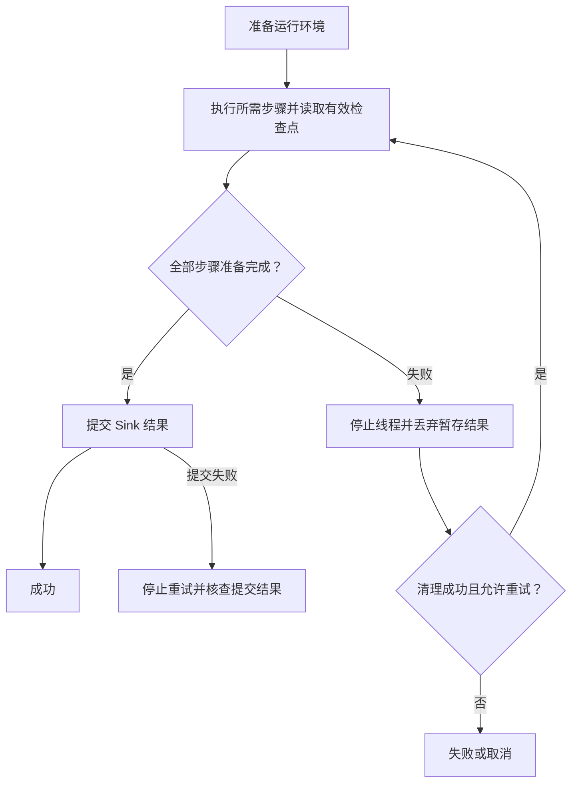

# Job 执行策略与故障处理

[English](execution-policy.md)

执行策略与 Job 定义分开提供：

```yaml
max_retries: 1
timeout_seconds: 1800
resources:
  tmp_size_mb: 512
  memory_mb: 1024
```

`max_retries` 为 0–10 的整数，默认 0，表示额外执行尝试次数，不是算子内部的独立重试次数；没有检查点时，每次尝试执行所需步骤并读取有效检查点。`timeout_seconds` 为 1–86400 的整数，不能超过宿主上限；多次尝试共享执行时间预算。Union 会在启动执行前准备全部参与节点的环境；环境准备使用启动配置中的独立超时，不占用执行时间预算。未知策略键会被拒绝。

## 失败与取消

任意步骤失败都会停止整个尝试。必须等旧工作线程全部停止、所有 Sink 暂存结果被丢弃，才能开始重试。重试使用新的尝试标识；有效的显式检查点替代其生产步骤及已覆盖的上游计算，未覆盖分支重新打开输入并执行。没有检查点时全部步骤重新执行。取消、超时、无效配置、授权失败、清理失败，以及提交开始后的失败，都不会自动重试。



输入格式插件和阻塞式算子可以使用临时文件或内存完成解析、排序、Join 和聚合；这些工作区不是恢复检查点。执行历史保存元数据和尝试标识。手动重跑需要重新提交保存的 Job 及已解析变量，不恢复旧进程、不复用中间输出。可复现性还需要稳定的输入版本、固定的算子版本以及可控的随机性。

## 显式输出检查点

默认使用流式连接。通过独立执行策略选择需要保存的步骤输出端口：

```yaml
max_retries: 2
checkpoints:
  sort_step: [result]
  another_step: [output_a, output_b]
```

省略 `checkpoints` 或使用 `{}` 时不保留中间流。未知步骤、未连接端口、重复端口和空列表均被拒绝。生产步骤增量写入选定流，只有处理成功、输出正常结束后，才将这些端口一起提交。选定端口的下游在提交后开始读取；其他端口保持流式连接。含检查点的 Job 禁用进程融合。算子和 Job YAML 无需增加检查点专用代码或字段。

重试前停止所有旧线程并丢弃 Sink 暂存。只有全部已连接输出均被完整检查点覆盖时，才可跳过该生产步骤；未覆盖的输入分支重新计算。只选择部分输出可以形成完整流边界，但不能在重试中跳过生产步骤。多端口并发读取并保留背压。同一生产步骤的流式输出和检查点输出不能在下游重新汇合，否则会形成有界流等待环；策略校验会拒绝这种配置，应同时为该生产步骤的其他相关输出设置检查点。超额、损坏和取消会明确失败；不完整产物绝不复用，也不因此增加 fan-out 能力。

在产生检查点的独立宿主或 DACP 工作节点配置：

```yaml
checkpoint_store:
  provider: file
  settings:
    directory: /var/lib/xstream/checkpoints
    max_bytes: 1073741824
    max_checkpoint_bytes: 268435456
```

目录由管理员控制，Job 策略不能指定宿主路径。默认每个存储 1 GiB、每个生产步骤的检查点 256 MiB，包含 Arrow File 开销；正整数配额在写入时检查。一个目录只允许一个宿主写入。`file` 实现位于 `xstream-plugin-execution-file`，通过 `META-INF/services/xstream.execution.CheckpointStoreProvider` 发现。将插件 JAR 及依赖安装到 `plugin_directory`，或加入嵌入程序 classpath。

公共契约为 `CheckpointStoreProvider`、`CheckpointStore`、`CheckpointWriter` 和 `CheckpointData`。写入器接收原始 `OperatorFrame`，完整端口集合原子提交；未提交写入器关闭时清理暂存。数据句柄持有文件租约，关闭前不能删除。插件负责配额、完整性和校验；核心负责执行身份、取消、授权和清理。文件实现使用 Arrow IPC File **封套**存放原始编码帧，完整保留帧头、字典、科学结构、批次边界和载荷字节，不压平成普通 records；文件使用 SHA-256 校验。该封套是内部存储，不是新增公共 DataView。

产物仅属于同一次 Job 执行及其内部尝试，最终成功、失败或取消后删除，宿主启动时清理残留。不创建 Dataset，不提供跨执行 replay、进程状态恢复或重启恢复。`items` 检查点保存引用而非被引用内容，读取可复现性仍需稳定或带版本的源 Item。Sort 内部临时文件不会自动成为检查点。

## 最终结果与 Sink 生命周期

`client_sink` 标记返回给调用程序的流，是 Job 中的结果出口；应用程序的 `ResultSink` 实现接收、丢弃和发布。`JobEngine.runToSink` 在处理过程中调用 `accept(frame)`，尝试失败时调用 `onDiscard(cause)`，只在全部步骤准备完成且外部 Sink 提交后调用 `onComplete()`。参见[嵌入引擎与结果收集](embedding_zh.md)。

底层 `JobEngine.run` 回调会暴露暂定数据帧；重试时会收到 `attempt_failed`，接收方必须丢弃此前尝试的数据和端口状态。DACP 结果客户端请求自动重试时必须显式提供重试回调。某个端口的 `end` 帧本身不能证明整个 Job 已成功。

自定义 Sink 在 `process` 中暂存，在 `onComplete(context)` 中发布，在 `onDiscard(context,cause)` 中清理。SDK Sink 的隔离运行时会保持存活，等待协调器决定。Source、Transform 不应在处理过程中发布外部副作用。参见[Sink 生命周期](sink-lifecycle_zh.md)。

多个 Sink 的提交不构成分布式事务。提交失败时，已提交结果及失败 Sink 的不确定结果会保留，只丢弃尚未开始提交的 Sink；Job 失败且不自动重试。请使用幂等外部键和核对机制。进程崩溃或宿主终止无法保证回调，外部暂存数据还需要过期清理策略。正常回调使用独立的 30 秒控制超时；未收到丢弃成功确认时禁止重试。因此清理阶段可能超过执行超时。

## 容器临时空间与内存

执行策略支持每个执行单元的资源请求，单位为 MiB：

```yaml
resources:
  tmp_size_mb: 2048
  memory_mb: 4096
```

默认 `/tmp` 为 512 MiB，容器总内存为 1024 MiB。`/tmp` 仍是私有、不可执行的 tmpfs，实际用量计入容器内存。`tmp_size_mb` 必须严格小于 `memory_mb`，并为程序与 Arrow 缓冲留出足够内存。增加容量不会预分配内存，也不保证整机总容量充足。独立进程各自获得限制；融合步骤共享其执行单元的一份限制。宿主机格式读取暂存，以及原生程序副本所在的 `/operator-work` tmpfs 属于独立空间，不受此配置影响。本功能不意味着磁盘工作区或磁盘配额。

请求适用于本地、融合、重试及 Union 下发执行。生效策略包含解析后的默认值。未知配置、非整数及超范围值在执行前被拒绝。`tmp_size_mb` 范围为 1–1048576，`memory_mb` 为 128–1048576，同时受下述宿主上限限制。耗尽 tmpfs 容量通常导致程序写入失败，耗尽总内存可能触发 OOM。

管理员在节点/独立引擎启动配置中设置上限：

```yaml
execution_resources:
  max_tmp_size_mb: 8192
  max_memory_mb: 16384
```

以上为默认的单容器请求上限，不是整机预留或全局配额。管理员上限最低分别为 512 和 1024 MiB，以容纳默认请求；两项最高均为 1048576 MiB。Union 准备阶段由成员在启动前验证请求，超限直接失败，不静默缩减。Job 不能指定宿主路径或新增挂载。应结合实际机器容量设置上限及任务并发。

## 执行单元选择

在引擎或 DACP 节点配置中设置 `operator_fusion`，默认 `auto`：

```yaml
operator_fusion: auto  # isolated | fused | auto
```

- `isolated`：各步骤采用独立执行单元。
- `fused`：优先合并兼容的步骤组，不比较估计代价。运行时与依赖兼容性、执行器支持、Sink 边界、重试和检查点仍限制合并；不兼容的步骤保持隔离。
- `auto`：对兼容候选组比较结构代价估计。首轮模型将每个避免启动的进程计为节省 100 个代价单位，每条内部边计为节省 1 个单位；每增加一条扇入或扇出分支，计入 `100 × 候选步骤数 + 内部边数` 个并行度风险单位。仅选择连通、线性且估计净收益为正的候选组。这些是未经标定的相对单位，不是毫秒，也不代表实际速度预测。选择过程不采样数据、不执行算子，暂未建模输入数据量、工作集内存和历史性能。

配置同时作用于本地 Job 和节点端 Union 子 Job。合并决策记录原因，本地候选组还记录 `structural_v1` 估计及低置信度；不满足兼容条件时保留具体原因。当前启用自动重试或显式检查点时，即使选择 `fused`，仍保持隔离执行边界。此配置属于引擎／节点启动配置，不属于单个 Job 的执行策略。配置值必须是上述三个模式字符串之一。
