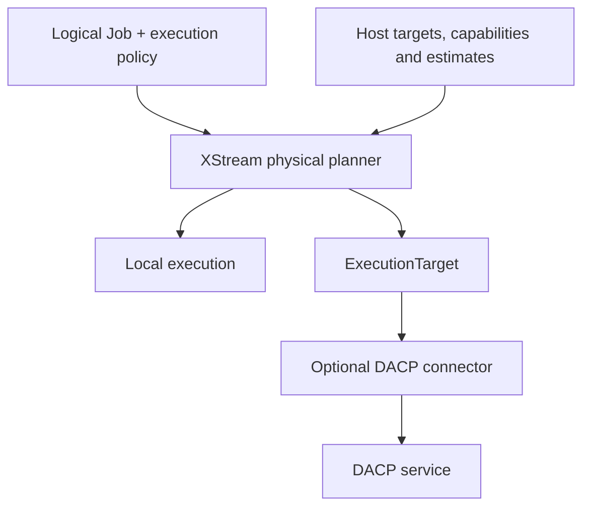

# Execution targets and physical planning

XStream owns Job execution and protocol-independent planning. A host supplies its DataCatalog and available execution targets. DACP provides a remote data and execution service, implemented through an optional connector. The local engine runs with XStream execution and data plugins.

## Independent capabilities

`RemoteItemProvider` reads remote Item streams. `ExecutionTarget` submits a Job and returns an `ExecutionHandle` with a result stream, status and cancellation. Read permission never implies Job submission permission. A configured remote Item URI does not automatically register an execution target.

`ExecutionTarget`, `ExecutionTargetProvider`, `RemoteItemProvider`, `ExecutionRequest`, `ExecutionStatus`, `TargetDescription`, `PlacementOptimizer` and `GraphPlacement` live in `xstream-execution-api`, under `xstream.execution`. `LocalExecutionTarget` wraps an embedded JobEngine. `DacpExecutionTarget` is in `connectors/xstream-dacp-client`, outside engine compilation dependencies.



## Runner configuration

Default execution is local. Local context reads need no connector. To read DACP Items or use a DACP execution target, install `xstream-dacp-client`, `xstream-dacp-protocol` and their runtime dependencies in the host classpath or `plugin_directory`. Include dependency JARs not supplied by the host; do not duplicate XStream public API JARs. A plain Runner distribution does not bundle this connector.

```yaml
plugin_directory: /opt/xstream/plugins
nodes:
  - url: dacp://compute.example.org:18861
    ca: /etc/xstream/ca.crt
    token_file: /etc/xstream/reader.token
execution_targets:
  - name: east
    provider: dacp
    settings:
      url: dacp://compute.example.org:18861
      ca: /etc/xstream/ca.crt
      token_file: /etc/xstream/runner.token
      startup_millis: 100
      transfer_bytes_per_second: 100000000
      estimated_input_bytes: 67108864
      estimated_output_bytes: 1048576
```

`nodes` configures the DACP data adapter. `execution_targets` independently configures computation. Names are host-local references, not public dataset names. Credentials stay in host configuration, never in Job YAML or physical-plan records. The byte estimates are host-supplied estimates for the selected target's source-side region in this Job, not measured sizes or inferred schemas. Configure estimates appropriate to the workload; inaccurate values can produce a slower plan.

## Execution policy

Submit this as the Runner's fourth argument, after a variables file (use `{}` when no variables are needed):

```yaml
placement:
  mode: auto
  targets: [east]
  objective: latency
materialization:
  allowed: false
  default: stream
```

`placement.mode` is `local` (default) or `auto`. `targets`, if present, restricts the host's configured target names and grants no extra authority. An empty list permits no remote target. `objective` is `latency` (default) or `transfer`.

The planner first excludes unreachable, unavailable or unauthorized targets, then constructs a local candidate and eligible closed source-side remote regions. Remote regions must contain a processing step and have no local input dependencies or local/source operator references. Each target owns URI localization; core never assumes that a URI host is an execution node. Remote reads become that target's `context:` paths only after the connector confirms the mapping.

The optimizer compares estimated transferred bytes and startup/network latency. Missing input or output estimates retain local execution; it does not invent selectivity. Costs and the chosen candidate are recorded under `planning` in execution history. This is a bounded candidate strategy, not exhaustive global optimization. CPU cost prediction, arbitrary remote placement and runtime replanning are not implemented. Compatible steps still use the existing execution-unit/fusion mechanism.

Any selected materialization boundary, or explicit replay, retains the original local graph and persistence ownership. Remote regions stream their outputs into bounded local queues. Retries belong to the originating engine; receiving local engines are requested to execute locally without independent retries or output materialization. A remote failure propagates without automatic local rerun. Cancellation closes the result stream and cancels unfinished computation. Handle `status()` tracks the live subscription; it is not a durable disconnected Job lookup API.

## Extension registration

Provide public no-argument provider classes implementing `ExecutionTargetProvider` and/or `RemoteItemProvider`. Register independently:

```text
META-INF/services/xstream.execution.ExecutionTargetProvider
META-INF/services/xstream.execution.RemoteItemProvider
```

For DACP their contents are `xstream.connector.dacp.DacpExecutionTargetProvider` and `xstream.connector.dacp.DacpRemoteItemProvider`, respectively. Providers validate private settings. Hosts own target closure; PluginEnvironment owns discovered providers. Each submission returns a caller-owned handle. Close unfinished handles to cancel; consume successful streams to completion, then close. Check cancellation and release partially acquired resources when opening fails. Borrowed Arrow batches remain scoped to their callbacks; frame payloads remain bounded.

Contract tests include no-connector local execution, local-target lifecycle, capability denial, alternate optimization objectives, generic graph placement, remote-region routing, failed-attempt output reset and cancellation. Run `(cd xstream-engine && sbt test)` and `(cd connectors/xstream-dacp-client && sbt test)`.

## DACP and Union

DACP exposes `dacp.capabilities` with separate `service` and current-caller `permissions` objects. The connector uses this query before planning/submission; every actual service invocation still authorizes normally. Anonymous callers can inspect metadata but cannot submit Jobs. A target can reject a particular Job because of operators, dependencies, capacity or policy even when generic submission permission is granted.

Union owns membership, namespace mapping, credentials, observations and its member stream-routing protocol. Its host resolves public source names and provides topology/capacity inputs to XStream's `GraphPlacement`; Generic step ranking is implemented by XStream. Member dispatch is implemented by the DACP service adapter. The Runner's closed-region cost strategy and Union's constrained graph placement use common optimization contracts but have different host constraints; the Runner does not implement member-to-member transfers.

The DACP service and optional connector share `xstream-dacp-protocol` for Flight clients, certificates, traffic accounting and Arrow view transport. These implementations are maintained in the transport module; the generic API defines protocol-independent contracts.

## Designer scope

Designer only creates and edits logical Jobs, browses catalogs, resolves variables for authoring, validates designs, previews schemas/samples and imports/exports YAML. It neither invokes the physical planner nor displays physical plans, placements or execution results. Runner history and DACP/Union dashboards own execution information.
