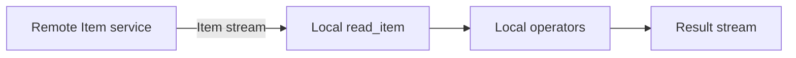

# Local execution and remote data

XStream executes every step of a Job in its local engine. `context:/dataset/item` addresses the host JVM’s DataCatalog. A `read_item` with a remote `dacp:` URI reads that Item as a stream; downstream operators execute locally. Remote reads do not grant or imply permission to submit Jobs.



## Remote Item plugins

`RemoteItemProvider` and `RemoteItemRequest` belong to `xstream.execution`. Install the optional `xstream-dacp-client` connector, `xstream-dacp-protocol` and their runtime dependencies in the host classpath or `plugin_directory`. A plain Runner distribution does not bundle this connector. Do not duplicate host-provided XStream API JARs.

```yaml
nodes:
  - url: dacp://node-a.example.org:18861
    ca: /etc/dacp/ca.crt
    token_file: /etc/dacp/node-a.token
```

A plugin implements `RemoteItemProvider`, validates its own settings and registers its public no-argument implementation in `META-INF/services/xstream.execution.RemoteItemProvider`. The DACP implementation is `xstream.connector.dacp.DacpRemoteItemProvider`. `supports(uri)` selects the adapter; `open` returns a caller-owned `FrameSource`. Close partially opened resources on failure, honor cancellation and use bounded frame payloads. PluginEnvironment discovers and closes providers.

## Execution ownership

| Component | Responsibility |
| --- | --- |
| XStream | Local execution units, streaming, fusion, cancellation, timeout, retries and materialization/replay |
| DACP client | Connect to a remote DACP server and submit, consume, cancel or replay a Job |
| DACP server | Authorize requests and execute accepted Jobs in an embedded local XStream engine sharing its DataCatalog |
| Union | Resolve public datasets, choose member placements and dispatch member subjobs; automatic compute pushdown is confined to Union |
| Designer | Edit logical Jobs, browse the selected context, infer structures/samples and export YAML |

For explicit remote execution, use the DACP SDK or Shell to connect to node A and submit the complete Job to A. `context:` then refers to A’s catalog. Local XStream execution policies contain `materialization`, `max_retries` and `timeout_seconds`.

## Designer Target

Target defaults to **Local** and offers the configured `nodes`. Selecting A makes the **In-context catalog** show A’s directory; A is omitted from other catalog roots. Selecting an Item there generates `context:/dataset/item`. Other roots generate full DACP URIs. The selector belongs to the current browser session, does not execute or submit a Job, and is not a placement field in exported Job YAML. Submit that YAML to the selected service using DACP. Ordinary schema workers run locally on the Designer server; context metadata and samples come from the selected target.

Tests cover local execution, remote reads feeding local downstream operators, rejected placement policies, target selection and credential isolation. Run `(cd xstream-engine && sbt test)`, `(cd xstream-designer && sbt test)` and `(cd connectors/xstream-dacp-client && sbt test)`.

Target changes require opening the change dialog and explicitly confirming the selection. Jobs can store `designer.target` as `local` or a DACP origin. Loading that design target asks for confirmation against configured nodes; an unavailable target is never contacted. The field is authoring metadata ignored by execution. See [Designer Target](../xstream-designer/README.md#confirming-and-remembering-target).
