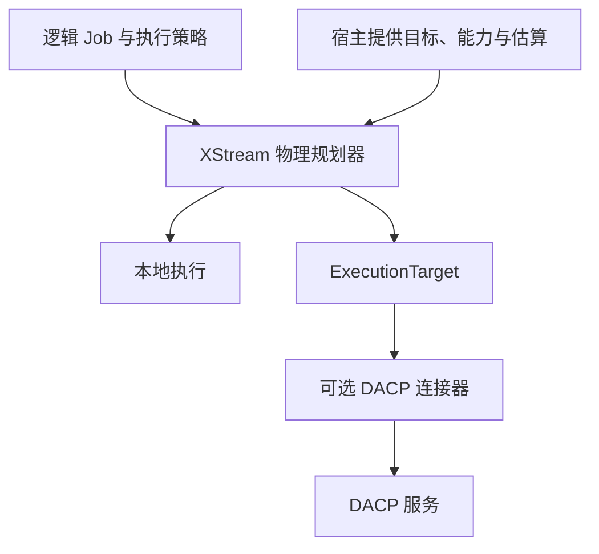

# 执行目标与物理规划

XStream 负责 Job 执行及与协议无关的规划。宿主提供 DataCatalog 和可用执行目标。DACP 通过可选连接器提供远程数据与执行服务。本地引擎通过 XStream 执行和数据插件运行。

## 相互独立的能力

`RemoteItemProvider` 读取远程 Item 流。`ExecutionTarget` 提交 Job，返回支持结果流、状态和取消的 `ExecutionHandle`。读取权限不等于提交 Job 的权限。配置远程 Item URI 不会自动注册执行目标。

`ExecutionTarget`、`ExecutionTargetProvider`、`RemoteItemProvider`、`ExecutionRequest`、`ExecutionStatus`、`TargetDescription`、`PlacementOptimizer` 和 `GraphPlacement` 位于 `xstream-execution-api` 的 `xstream.execution` 包。`LocalExecutionTarget` 包装内嵌 JobEngine。`DacpExecutionTarget` 位于 `connectors/xstream-dacp-client`，不属于引擎编译依赖。



## Runner 配置

默认本地执行。读取本地 context 不需要连接器。读取 DACP Item 或使用 DACP 执行目标时，将 `xstream-dacp-client`、`xstream-dacp-protocol` 及运行依赖安装到宿主 classpath 或 `plugin_directory`。加入宿主尚未提供的依赖 JAR，不要重复安装 XStream 公共 API JAR。基础 Runner 分发包不捆绑连接器。

```yaml
plugin_directory: /opt/xstream/plugins
nodes:
  - url: dacp://compute.example.org:18861
    ca: /etc/xstream/ca.crt
    token_file: /etc/xstream/reader.token
execution_targets:
  - name: east
    provider: dacp
    settings:
      url: dacp://compute.example.org:18861
      ca: /etc/xstream/ca.crt
      token_file: /etc/xstream/runner.token
      startup_millis: 100
      transfer_bytes_per_second: 100000000
      estimated_input_bytes: 67108864
      estimated_output_bytes: 1048576
```

`nodes` 配置 DACP 数据适配器，`execution_targets` 独立配置计算。名称是宿主内的引用，不是公开数据集名称。凭据只保存在宿主配置，不进入 Job YAML 或物理计划记录。字节数是宿主针对本 Job 中该目标源端区域提供的估算，不是实际测量或结构推导结果。必须按工作负载设置；错误估算可能选出更慢的计划。

## 执行策略

作为 Runner 的第四个参数提交，前面需要变量文件（没有变量时使用 `{}`）：

```yaml
placement:
  mode: auto
  targets: [east]
  objective: latency
materialization:
  allowed: false
  default: stream
```

`placement.mode` 为 `local`（默认）或 `auto`。提供 `targets` 时，只能缩小宿主配置的目标范围，不授予额外权限。空列表表示不允许远程目标。`objective` 为 `latency`（默认）或 `transfer`。

规划器先排除不可达、不可用或无权限的目标，再构建本地候选和符合条件的远程源端封闭区域。远程区域必须包含处理步骤，不能依赖本地输入或引用本地/源码算子。目标自身负责 URI 本地化；核心不将 URI 主机直接认作执行节点。只有连接器确认映射后，远程读取才改为该目标的 `context:` 路径。

优化器比较估算传输字节数与启动、网络延迟。缺少输入或输出估算时保留本地执行，不虚构选择率。成本与选中候选写入执行历史的 `planning`。这是有限候选策略，不是穷举全局优化。尚未实现 CPU 成本预测、任意远程放置和运行中重新规划。兼容步骤通过执行单元/融合机制执行。

选择了任一物化边界或显式重放时，保留原始本地图和持久化所有权。远程区域将输出流送入有界本地队列。重试由发起引擎协调；接收端本地引擎收到本地执行要求，不独立重试或物化输出。远程失败直接传播，不自动本地重跑。取消会关闭结果流并取消未完成计算。句柄 `status()` 跟踪当前订阅，不是断开后查询持久 Job 的接口。

## 扩展注册

提供公开无参构造器的 provider 类，实现 `ExecutionTargetProvider` 和/或 `RemoteItemProvider`，分别注册：

```text
META-INF/services/xstream.execution.ExecutionTargetProvider
META-INF/services/xstream.execution.RemoteItemProvider
```

DACP 对应文件内容分别为 `xstream.connector.dacp.DacpExecutionTargetProvider` 和 `xstream.connector.dacp.DacpRemoteItemProvider`。提供器校验私有设置。宿主负责关闭目标，PluginEnvironment 负责发现的提供器。每次提交返回由调用方持有的句柄，关闭未完成句柄即取消；成功流应消费完成再关闭。打开失败时释放部分资源，并检查取消状态。借用的 Arrow 批次只在回调中有效；帧载荷保持有界。

契约测试包括无连接器本地执行、本地目标生命周期、权限拒绝、不同优化目标、通用图放置、远程区域路由、失败尝试输出重置及取消。执行 `(cd xstream-engine && sbt test)` 和 `(cd connectors/xstream-dacp-client && sbt test)`。

## DACP 与 Union

DACP 提供 `dacp.capabilities`，分别返回 `service` 与当前调用身份的 `permissions`。连接器在规划/提交前查询，每次实际服务调用仍照常授权。匿名身份可以查看元数据，但不能提交 Job。即使具备通用提交权限，也可能因算子、依赖、容量或策略无法执行具体 Job。

Union 管理成员、命名空间映射、凭据、观测信息及成员流路由协议。其宿主解析公开源名称，将拓扑和容量交给 XStream 的 `GraphPlacement`；通用步骤排名由 XStream 实现。成员分发由 DACP 服务适配器实现。Runner 的封闭区域成本策略与 Union 的受约束图放置复用公共优化契约，但宿主约束不同；Runner 不实现成员间直接传输。

DACP 服务与可选连接器共用 `xstream-dacp-protocol` 中的 Flight 客户端、证书、流量统计和 Arrow 视图传输实现。这些实现由传输模块统一维护，通用 API 定义协议无关的契约。

## Designer 边界

Designer 只负责逻辑 Job 创建编辑、目录浏览、设计时变量解析、设计校验、结构/样例预览及 YAML 导入导出，不调用物理规划器，也不展示物理计划、执行位置或执行结果。执行信息由 Runner 历史和 DACP/Union 看板展示。
