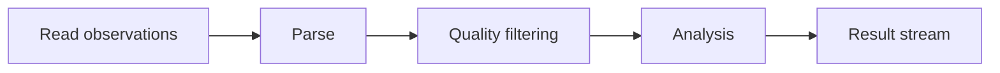
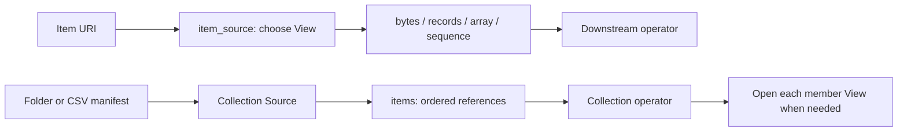

# Frequently asked questions

[中文](faq_zh.md)

- [1. Which workloads suit XStream compared with workflow engines such as Airflow?](#1-which-workloads-suit-xstream-compared-with-workflow-engines-such-as-airflow)
- [2. How should I understand XStream's logical filesystem?](#2-how-should-i-understand-xstreams-logical-filesystem)
- [3. How do Item, View and stream relate, and what does an operator actually process?](#3-how-do-item-view-and-stream-relate-and-what-does-an-operator-actually-process)
- [4. How can a XStream Job read local files, and what does `context:` refer to?](#4-how-can-a-xstream-job-read-local-files-and-what-does-context-refer-to)
- [5. How do I define an Item collection (itemset) data source from a folder or CSV manifest?](#5-how-do-i-define-an-item-collection-itemset-data-source-from-a-folder-or-csv-manifest)
- [6. How is the Job Designer Target list configured?](#6-how-is-the-job-designer-target-list-configured)
- [7. Is schema inference available anonymously?](#7-is-schema-inference-available-anonymously)
- [8. What are operator roles, implementation types and executors, and how do I choose and develop one?](#8-what-are-operator-roles-implementation-types-and-executors-and-how-do-i-choose-and-develop-one)
- [9. How do I define, develop and run inline operators in a Job, and can I submit them remotely?](#9-how-do-i-define-develop-and-run-inline-operators-in-a-job-and-can-i-submit-them-remotely)
- [10. How does a custom operator process an `items` reference stream?](#10-how-does-a-custom-operator-process-an-items-reference-stream)
- [11. Can I configure multiple operator repositories, and how are duplicate operators resolved?](#11-can-i-configure-multiple-operator-repositories-and-how-are-duplicate-operators-resolved)
- [12. Why use an operator repository when inline operators are simpler?](#12-why-use-an-operator-repository-when-inline-operators-are-simpler)
- [13. How do port Views differ from schemas, and why does a port remain variable after inference?](#13-how-do-port-views-differ-from-schemas-and-why-does-a-port-remain-variable-after-inference)
- [14. Why does Designer reject a connection, and can variable ports consume arbitrary content?](#14-why-does-designer-reject-a-connection-and-can-variable-ports-consume-arbitrary-content)
- [15. Does streaming guarantee no disk writes and no out-of-memory failures?](#15-does-streaming-guarantee-no-disk-writes-and-no-out-of-memory-failures)
- [16. How do I choose isolated, fused or automatic execution units? Is fusion always faster?](#16-how-do-i-choose-isolated-fused-or-automatic-execution-units-is-fusion-always-faster)
- [17. How does a failed step retry, and where should I place checkpoints?](#17-how-does-a-failed-step-retry-and-where-should-i-place-checkpoints)
- [18. How do client_sink and custom Sinks confirm success? May I publish data as it arrives?](#18-how-do-client_sink-and-custom-sinks-confirm-success-may-i-publish-data-as-it-arrives)
- [19. How do I increase temporary space? Is tmp_size_mb a disk quota?](#19-how-do-i-increase-temporary-space-is-tmp_size_mb-a-disk-quota)
- [20. Are saved Jobs and checkpoints sufficient to reproduce identical results later?](#20-are-saved-jobs-and-checkpoints-sufficient-to-reproduce-identical-results-later)

## 1. Which workloads suit XStream compared with workflow engines such as Airflow?

XStream is a dataflow-oriented workflow execution engine. It is particularly useful when data processing is the main workload, applications need early results, or execution must be embedded in another application.

| Scenario | What XStream provides |
|---|---|
| Interactive scientific analysis | Parameterized Jobs, visual authoring, schema inference and bounded output previews |
| Multi-step data transformation | Stream connections between parsing, filtering, transformation and aggregation steps, reducing intermediate file handoffs |
| Cross-language algorithm composition | Named ports and a shared Arrow data contract for Scala, Java, Python and other supported executors |
| Complex files and scientific data | Item/View access to ordinary files, archive members and structured scientific data |
| Embedded analysis | A local engine that JVM applications can embed directly |
| Reusable analysis services | Parameterized Jobs composed of operators that avoid modifying external business state |

A typical pipeline is:



When operators process data incrementally, downstream steps can begin before upstream output is complete. Compatible steps can also share an execution unit. Sorting, some joins and global aggregations may still buffer substantial data; streaming and process fusion do not guarantee a speedup for every workload.

Airflow is particularly useful for scheduled workflows that coordinate external systems: periodic extraction, waiting for upstream services, updating databases, triggering other platforms, historical backfills and notifications. Its strengths include scheduling, integrations and operational tooling. Airflow does not require file-based data exchange; its XCom mechanism is designed for small values, while tasks can use external storage or compute systems for larger data. See the official [Airflow introduction](https://airflow.apache.org/docs/apache-airflow/stable/), [XCom documentation](https://airflow.apache.org/docs/apache-airflow/stable/core-concepts/xcoms.html) and [backfill documentation](https://airflow.apache.org/docs/apache-airflow/stable/core-concepts/backfill.html).

XStream is therefore a useful foundation for scientific analysis, interactive analysis applications and embedded cross-language data pipelines. Its engine executes steps locally; remote Item access uses data connectors, and DACP/Union supplies remote Job invocation and cross-node collaboration. Continuous stream processing with time windows and durable state recovery requires further capabilities.

The systems can work together: Airflow schedules and supervises an analysis Job, while XStream executes its internal data-processing pipeline. For measured results and their limits, see the [workflow performance comparison](orchestration-llm-benchmark.md).

## 2. How should I understand XStream's logical filesystem?

XStream organizes and accesses data through a **unified logical catalog**, abstracting its physical storage and file formats. It is a data-resource namespace rather than an operating-system filesystem or a mounted disk.

```text
DataCatalog
└── Dataset
    ├── Data Item
    └── Folder Item
        └── Child Item
```

A DataCatalog discovers Datasets; each Dataset provides a logical Item tree. For example, assuming the corresponding backend and format plugins are installed:

| Logical address | Possible backing resource |
|---|---|
| `context:/science/observations.csv` | A local CSV file |
| `context:/science/archive.zip/labels/a.csv` | A member inside a ZIP, without manual extraction |
| `context:/science/climate.nc/temperature` | A variable inside a NetCDF file |
| A table Item exposed by a database Dataset | A database table or configured query result |

The logical path is not necessarily a physical file path. Archive children and scientific variables need not exist as separate files. Plugins determine which resources and structures are exposed.

**An Item identifies a resource; a View defines how to read it.** A CSV Item can expose `bytes` for the original file and `records` for parsed rows. Scientific Items can expose `array` while preserving multidimensional structure. Reading a supported View produces an Arrow stream for downstream operators. Inspect advertised capabilities rather than assuming every Item supports every View.

Hierarchy and readability are separate: folder Items support browsing through `list()`. A ZIP root has `kind: folder` and `views: [bytes, items]`: `bytes` returns the original ZIP and `items` streams its member references without reading their content. An internal archive folder supports `items`, while an individual member supports its own advertised views. Folder `records` is rejected.

`context:` refers to the DataCatalog bound to the current execution environment, not an arbitrary local disk path. A remote DACP URI accesses a remote catalog through a connector. Together, logical Items, explicit Views and streams let a Job handle files, archive members, scientific variables and database resources without implementing a separate storage reader in each operator.

See the [data model](data-model.md), [file formats and containers](file-formats.md), [DataView examples](data-view-examples.md) and [local-file FAQ](#4-how-can-a-xstream-job-read-local-files-and-what-does-context-refer-to).

## 3. How do Item, View and stream relate, and what does an operator actually process?

An **Item** identifies a logical resource; a **View** selects a supported representation of that resource; opening the View produces an **Arrow stream**. Steps exchange streams through named ports, rather than passing host filesystem paths.



| Representation | What the operator consumes |
|---|---|
| `bytes` | Incremental byte chunks, for example original ZIP or TIFF bytes |
| `records` | Batches of typed rows, for example parsed CSV records |
| `array` | Scientific arrays with their dimensions and structure preserved |
| `sequence` | Biological sequence data in the declared scientific schema |
| `items` | Ordered Item references and metadata; member contents are opened lazily |

A stream contains ordered frames/batches; `array` describes its data representation, not a requirement to load everything into one in-memory array. Each port declares supported representations. An SDK operator processes that declared stream; a command/script adapter can bind bytes to stdin/stdout or temporary files. Materializing files inside an adapter does not change the inter-step stream contract.

`item_source` selects the View in its parameters. Collection Sources output `items`; a collection-aware operator can traverse them and open member Views with the SDK. Collection iteration is internal to that operator, not a Job-level map/reduce instruction. See [data model](data-model.md), [View examples](data-view-examples.md) and [Item reference streams](items-stream.md).

## 4. How can a XStream Job read local files, and what does `context:` refer to?

Publish the directory through the engine's DataCatalog, then read its Items with `item_source@1.0`. For example, save this engine configuration as `engine.yaml`:

```yaml
datasets:
  local:
    provider: directory
    source:
      root: /data
```

Save this Job as `read-local.yaml` to read `/data/input.csv` as records:

```yaml
name: Read local CSV
steps:
  - id: read
    operator: item_source@1.0
    inputs: {}
    params:
      uri: context:/local/input.csv
      view: records
  - id: client_sink
    operator: client_sink@1.0
    inputs:
      result: read
```

Run it using the installed launcher:

```bash
xstream-runner engine.yaml read-local.yaml
```

`context:` refers to the DataCatalog bound to the engine executing the Job. Here, `local` is the Dataset name and `/input.csv` is the Item path within that Dataset. The engine process must have permission to read `/data/input.csv`. Relative filesystem roots resolve against the process working directory.

When the same Job runs on a remote server, `context:` refers to that server's catalog, not files on the submitting computer. In Designer, Local means the Designer server's catalog, not the browser visitor's filesystem. Designer configures its local catalog under `local_catalog.datasets`; the standalone runner uses top-level `datasets` as above.

For original file bytes, set `view: bytes`. The `records` View requires a format plugin that supports records, such as CSV. `item_source` accepts catalog Item addresses rather than arbitrary filesystem paths such as `/data/input.csv` or `file:///data/input.csv`. Publishing a directory makes its files available through the catalog; it does not automatically mount that host directory into operator containers. Operators consume the streams connected to their input ports.

See the [quick start](quickstart.md), [data model](data-model.md) and [local execution guide](xstream.md).

## 5. How do I define an Item collection (itemset) data source from a folder or CSV manifest?

Use the `items` representation: an ordered stream of Item references, rather than a new Dataset provider or a mathematical Set. It preserves order and duplicates. Publish the underlying files in a catalog, for example in the runner's `engine.yaml`:

```yaml
datasets:
  science:
    provider: directory
    source:
      root: /srv/science
```

For files under `/srv/science/labels`, use a folder Source:

```yaml
name: Inspect an Item collection
steps:
  - id: list
    operator: folder_items_source@1.0
    inputs: {}
    params: {uri: 'context:/science/labels', recursive: true}
  - id: inspect
    operator: item_byte_count@1.0
    inputs: {source: 'list:result'}
    params: {}
  - id: receive
    operator: client_sink@1.0
    inputs: {result: 'inspect:result'}
```

Alternatively, save `/srv/science/manifest.csv`:

```csv
uri,sample_id,role
labels/001.txt,001,label
labels/001.tfw,001,world
```

Replace the `list` step with:

```yaml
id: list
operator: csv_items_source@1.0
inputs: {}
params: {uri: 'context:/science/manifest.csv', uri_column: uri}
```

The folder Source lists direct children by default; `recursive: true` includes descendants, including folder references. The CSV Source turns each row into a reference, resolves relative paths against the manifest's logical parent and preserves other columns in metadata. Both output references without eagerly reading member contents. `item_byte_count` opens each supported bytes View lazily and skips folders without bytes; pairing label/world files by `sample_id` belongs to a custom downstream operator.

Configure Designer's local datasets under `local_catalog.datasets`; `context:` always refers to the execution host's catalog. Install the approved Source, Transform and Sink packages and their Runtimes through the configured operator repository. Remote Item URIs also require the corresponding data connector and connection configuration. See [Item operator examples](../examples/operators/item-sources/README.md) and [Item reference streams](items-stream.md).

## 6. How is the Job Designer Target list configured?

The Designer always provides **Local**. Administrators add remote Targets through `nodes` in the Designer startup YAML; a Target may be an ordinary DACP node or a Union service.

```yaml
local_catalog:
  datasets:
    weather:
      provider: directory
      source:
        root: /srv/weather

nodes:
  - url: dacp://union.example.org:19860
    ca: /etc/xstream/ca.crt
    token_file: /etc/xstream/union.token
  - url: dacp://node-a.example.org:18861
    ca: /etc/xstream/ca.crt
    token_file: /etc/xstream/node-a.token
```

Replace the addresses and paths with deployment values. `local_catalog` supplies the Designer's local data catalog; `nodes` supplies the available remote connections. CA and token files are read by the Designer server and are not sent to the browser. Store only the token value in `token_file`, not a complete credential JSON response. Use an upstream account authorized for schema/sample requests; listing public metadata alone does not grant execution permissions.

Edit the configuration file passed to the Designer at startup, restart the Designer, then reload the browser:

```bash
xstream-designer /etc/xstream/designer.yaml
```

Visitors select an administrator-configured Target through **Target: … → Change… → Use selected target**; they cannot enter arbitrary server addresses or credentials.

Selecting a Target changes **Target catalog** and the context used for schema and output-sample inference. An Item chosen from that catalog uses `context:/dataset/item`; an Item from another catalog uses its full remote URI. The selected Target is omitted from the other catalog roots to avoid duplicate entries. Switching Target requires reviewing context Item paths because the same path can mean different data on different targets.

The optional `designer.target` field saves the design context with exported YAML. It does not submit a Job, route execution or grant permissions. Job submission is a separate operation; the execution target's catalog must match the Job's `context:` references.

See the [Designer guide](designer-guide.md) and [Designer configuration reference](../xstream-designer/README.md).

## 7. Is schema inference available anonymously?

The Designer website requires no visitor login, and inference for the local Target runs on the Designer server. Remote DACP node and Union inference APIs require `job:execute`; ordinary accounts typically need the `runner` role. Designer uses the `token_file` configured in `nodes` to access upstream services on behalf of visitors, without asking them to enter a token or sending it to the browser.

A public Designer therefore does not make the remote inference API anonymous. Catalogs and metadata can be read anonymously; inference and output samples can execute operator code, read data and consume resources, and remain subject to upstream permission checks.

## 8. What are operator roles, implementation types and executors, and how do I choose and develop one?

These are independent choices, not competing classifications:

| Dimension | Options | Meaning |
|---|---|---|
| Graph `role` | `source`, `transform`, `sink` | Produces streams without inputs; consumes and produces streams; consumes streams without outputs |
| Integration `type` | `sdk`, `command`, `script` | SDK program, existing executable, or script |
| `executor` | `jvm`, `python`, `command`, `container` | Launcher/protocol inside the configured Runtime container |
| Definition location | Public repository, local library, Job-local `operators` | Distribution and selection of the definition |

| Development approach | What to provide |
|---|---|
| SDK (`jvm` / `python`) | Scala/Java or Python processing code, input/output contracts, parameters, structure inference and bounded samples; provide build/dependency declarations |
| Command | Existing tool, Runtime with its dependencies, argument mapping and bytes stdin/stdout or file bindings; the adapter supplies the stream bridge |
| Script | Interpreter plus embedded source or a script file, arguments and bytes bindings; no SDK import is needed for the script itself |
| Custom container executor | Image entrypoint implementing the operator process/inference protocol; placing an arbitrary CLI in an image alone does not implement this protocol |

Scala is preferred for new SDK operators; Java and Python are supported. Choose a role and port contracts first, then implementation and Runtime. Test empty/multi-batch inputs, output structure, parameters, inference, samples, cancellation and resource cleanup. File bindings use quota-controlled temporary storage; generic command adapters do not execute commands for sample inference. Every executor runs in a container.

`item_source@1.0` is a Source; `client_sink@1.0` is an explicit Sink returning results to the caller. Both come from the operator repository. A role does not determine implementation language. Start with the [complete operator authoring guide](operator-authoring.md), [Scala endpoints](../examples/operators/scala-endpoints/README.md), [dependency environments](dependency-environments.md) and [submission guide](operator-submission.md).

## 9. How do I define, develop and run inline operators in a Job, and can I submit them remotely?

For local development, put definitions in the Job's top-level `operators` mapping and select one with `operator: {inline: name}`. Use `sdk` for a Scala/Java JAR or Python SDK program, `command` for an executable, or `script` for embedded/local script source.

Configure a preinstalled Runtime in `engine.yaml` (alongside the Dataset configuration used by this Job):

```yaml
inline_runtimes:
  python_tools:
    image: xstream/operator-python:1.0
    executor: python
```

The image must contain `/usr/local/bin/python`, PyArrow and any script dependencies. A complete Job using stdin/stdout bindings is:

```yaml
name: Local uppercase
operators:
  upper:
    type: script
    role: transform
    runtime: python_tools
    interpreter: /usr/local/bin/python
    script:
      source: |
        import sys
        while chunk := sys.stdin.buffer.read(65536):
            sys.stdout.buffer.write(chunk.upper())
    inputs:
      source: {view: bytes, binding: stdin}
    outputs:
      result: {view: bytes, binding: stdout, format: text}
steps:
  - id: read
    operator: item_source@1.0
    inputs: {}
    params: {uri: 'context:/files/input.txt', view: bytes}
  - id: upper
    operator: {inline: upper}
    inputs: {source: 'read:result'}
    params: {}
  - id: receive
    operator: client_sink@1.0
    inputs: {result: 'upper:result'}
```

Run `xstream-runner engine.yaml job.yaml`. Publish a `files` Dataset containing `input.txt` and configure the repository/cache supplying `item_source` and `client_sink`. Local program paths resolve against the Job directory; referenced files are staged privately, and cancellation/cleanup remain framework-managed. Programs run in the configured containers, not unrestricted host processes.

**DACP nodes and Union reject Jobs containing `operators`, including unused definitions.** To run remotely, publish operators for public approval and replace inline references with `name@version`. Designer supports inline YAML and local inference using its configured `inline_runtimes`; select Local. See [inline operators](inline-operators.md) for SDK entrypoints, command mappings, script files, limits and registration, and [local libraries](local-operators.md) for reusable local packages.

## 10. How does a custom operator process an `items` reference stream?

Declare `representations: [items]` on the input port. This processing code traverses references and metadata without opening member contents:

```scala
def process(ctx: OperatorContext): Unit = {
  val output = ctx.bytesOutput("result", "text")
  ctx.input("source").foreachItem { item =>
    output.write(s"${item.uri}\t${item.kind}\n".getBytes("UTF-8"))
  }
}
```

To read content, call `ctx.openItem(item, "bytes") { stream => … }` inside the callback. It returns an incremental Arrow stream; the framework owns cleanup, authorization and cancellation. Do not collect the entire collection into a Map/Set without explicit count and memory bounds. Pairing rules belong to the operator, not implicit Job execution.

See [Item operator examples](../examples/operators/item-sources/README.md) for compilable Sources and a Transform, and [Item reference streams](items-stream.md) for the contract.

## 11. Can I configure multiple operator repositories, and how are duplicate operators resolved?

Runner and Designer both accept repository base URLs in startup configuration:

```yaml
remote_operator_library_urls:
  - https://operators.example.org
  - https://science-operators.example.org
```

Designer merges their public catalogs for the operator palette and Chat context; local schema/sample inference resolves packages from the same list. Different versions remain available to existing Jobs, while the palette normally shows the latest version per name. The same `name@version` from multiple repositories uses the first configured repository that provides it. Keep the ordering consistent across Designer and execution hosts; do not publish different implementations under the same identity.

Repository configuration is server-side; browser requests cannot replace the list. Restart after editing startup configuration. An unavailable/invalid catalog fails the Designer catalog request rather than silently presenting an incomplete inventory. Package resolution proceeds to the next repository only when an operator is absent; connection, integrity and validation failures remain errors. Verified package manifests and blobs can be reused from cache. Remote Target execution uses that server's own repository configuration, so install the same required operators there. See [operator packages and cache](operator-packaging.md).

## 12. Why use an operator repository when inline operators are simpler?

Inline operators are convenient for local experiments: keep a script, command mapping or SDK program next to the Job and run it immediately in an administrator-configured Runtime. A local library also supports reuse across local Jobs.

A repository provides shared versioned identities, declared ports/parameters/examples, build and dependency environments, approval, source/provenance information, trust metadata and verified downloads. Other users and execution hosts can obtain the same approved package instead of copying private scripts and paths.

Remote DACP nodes and Union accept publicly approved operators and reject inline/local definitions. This gives server administrators a defined code publication boundary; approval is not a guarantee that code is harmless, and container isolation, authorization and resource limits still apply. Develop locally, test the stream contract, then [submit for review](operator-submission.md) when sharing or remote execution is needed. See [local operators](local-operators.md) and [inline operators](inline-operators.md).

## 13. How do port Views differ from schemas, and why does a port remain variable after inference?

A View determines stream representation, such as `bytes`, `records`, `array` or `items`. A schema describes an invocation's concrete structure, such as record field names and data types.

Each operator port declares one fixed View or `variable` when its interface cannot fix one. Inference can determine an invocation's fields or concrete representation without changing the public port declaration, so a variable port retains its variable icon. `variable` is not a wire format: an opened stream must use one concrete View. A fixed records port may still have an unknown field schema. See [operator port Views](operator-ports.md).

## 14. Why does Designer reject a connection, and can variable ports consume arbitrary content?

Two fixed ports must have matching Views. For example, `bytes` cannot directly connect to `records`; use a parsing or conversion operator. A `variable` declaration at either end permits wiring but does not guarantee data compatibility. Inference and execution still validate the concrete representation.

A variable output producing records cannot feed a bytes-only input. Declaration metadata must also finish loading before a connection can be created. Inspect port hover descriptions, operator parameters and inference results to distinguish View incompatibility from record field incompatibility. See [operator port Views](operator-ports.md).

## 15. Does streaming guarantee no disk writes and no out-of-memory failures?

Streaming supports incremental consumption and backpressure, and complete intermediate results are not retained by default. It does not guarantee zero disk use or constant memory. Format plugins may extract temporary files, command adapters may bind files, and sort, Join or global aggregation operators may buffer data. Explicit checkpoints retain selected complete output streams.

Individual Arrow batch sizes and operator buffers also affect memory. Developers should bound batches and buffers, close readers promptly, and design scratch storage or spilling for blocking algorithms. Configure runtime container resources and concurrency as well. See [Arrow streams](arrow-streams.md) and [execution policies](execution-policy.md).

## 16. How do I choose isolated, fused or automatic execution units? Is fusion always faster?

Set the engine or DACP node startup configuration:

```yaml
operator_fusion: auto  # isolated | fused | auto
```

`isolated` uses separate execution units; `fused` prefers compatible groups; default `auto` uses conservative structural cost estimates. Matching languages are insufficient: Runtime, dependencies, executor support and boundary constraints must also match. This setting is not a per-Job execution policy field.

Fusion can reduce startup and interprocess transfer costs, but can increase resource contention or reduce parallelism. The current automatic model uses neither measured latency, input size nor a working-set memory model, so it cannot guarantee the fastest plan. Automatic retries or explicit checkpoints currently retain isolated execution boundaries. See [operator fusion](operator-fusion.md).

## 17. How does a failed step retry, and where should I place checkpoints?

Automatic retries are disabled by default. Set additional attempts in the separate execution policy and optionally select an expensive step's output ports:

```yaml
max_retries: 2
checkpoints:
  sort_step: [result]
```

`sort_step` must exist and `result` must be a connected output. The execution host must configure checkpoint storage. A selected output is completely saved and committed before downstream consumption starts. Without checkpoints, retries execute the whole Job again. Valid checkpoints can replace covered upstream work; other branches recompute. A producer can be skipped only when every connected output is covered.

Old workers must stop and staging must be discarded before retrying. Cancellation, timeout, authorization/configuration errors, cleanup failure and failures after commit begins are not automatically retried. Checkpoints are not automatically selected and do not guarantee recovery of lost nodes. See [execution policies and recovery](execution-policy.md).

## 18. How do client_sink and custom Sinks confirm success? May I publish data as it arrives?

`client_sink` is the explicit endpoint returning streams to the caller. The application's `ResultSink` implements reception: `accept(frame)` receives provisional data, `onDiscard(cause)` discards a failed attempt, and `onComplete()` accepts the successful whole-Job result. Retry-aware receivers must not mix data from different attempts.

A custom SDK Sink stages in `process`, publishes in `onComplete(context)` after coordinator approval, and cleans in `onDiscard(context,cause)`. A port end or one completed step does not prove whole-Job success. Multiple Sink commits are not a distributed atomic transaction; external publication needs idempotency keys and reconciliation after failure. See [embedding and result collection](embedding.md) and [Sink lifecycle](sink-lifecycle.md).

## 19. How do I increase temporary space? Is tmp_size_mb a disk quota?

Request per-execution-unit capacity in the separate execution policy, for example:

```yaml
resources:
  tmp_size_mb: 2048
  memory_mb: 4096
```

`tmp_size_mb` controls the container's `/tmp` tmpfs capacity, not a disk-backed workspace or host disk quota. Actual usage counts toward container memory; it must be strictly less than `memory_mb`, leaving room for the program and Arrow buffers. Isolated units each receive their limit; fused steps share one unit's limit.

Requests remain subject to administrator `execution_resources` ceilings. Raising a container limit does not reserve host capacity. Exhausting temporary capacity causes write failures; exhausting total memory can cause OOM termination. Host format-reader staging and checkpoint storage are separate resources. See [container temporary space and memory](execution-policy.md#container-temporary-space-and-memory).

## 20. Are saved Jobs and checkpoints sufficient to reproduce identical results later?

Job YAML alone is insufficient. Retain resolved variables, stable or versioned inputs, pinned operators and dependency environments, and control randomness, clocks and external services. Content at the same URI can change.

Current checkpoints support internal retries within one Job execution and are removed at terminal completion; they are not a long-term archive across executions. Checkpointing an `items` stream saves references without freezing member content. For long-term replay, separately archive input versions, execution information and results, then submit a new Job. A result hash can detect content changes but cannot by itself prove an analysis method or conclusion correct. See [execution policies and recovery](execution-policy.md) and [execution history](execution-history.md).
