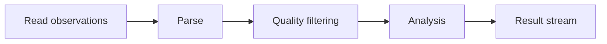

# Frequently asked questions

[中文](faq_zh.md)

## 1. How is the Job Designer Target list configured?

The Designer always provides **Local**. Administrators add remote Targets through `nodes` in the Designer startup YAML; a Target may be an ordinary DACP node or a Union service.

```yaml
local_catalog:
  datasets:
    weather:
      provider: directory
      source:
        root: /srv/weather

nodes:
  - url: dacp://union.example.org:19860
    ca: /etc/xstream/ca.crt
    token_file: /etc/xstream/union.token
  - url: dacp://node-a.example.org:18861
    ca: /etc/xstream/ca.crt
    token_file: /etc/xstream/node-a.token
```

Replace the addresses and paths with deployment values. `local_catalog` supplies the Designer's local data catalog; `nodes` supplies the available remote connections. CA and token files are read by the Designer server and are not sent to the browser. Store only the token value in `token_file`, not a complete credential JSON response. Use an upstream account authorized for schema/sample requests; listing public metadata alone does not grant execution permissions.

Edit the configuration file passed to the Designer at startup, restart the Designer, then reload the browser:

```bash
xstream-designer /etc/xstream/designer.yaml
```

Visitors select an administrator-configured Target through **Target: … → Change… → Use selected target**; they cannot enter arbitrary server addresses or credentials.

Selecting a Target changes **Target catalog** and the context used for schema and output-sample inference. An Item chosen from that catalog uses `context:/dataset/item`; an Item from another catalog uses its full remote URI. The selected Target is omitted from the other catalog roots to avoid duplicate entries. Switching Target requires reviewing context Item paths because the same path can mean different data on different targets.

The optional `designer.target` field saves the design context with exported YAML. It does not submit a Job, route execution or grant permissions. Job submission is a separate operation; the execution target's catalog must match the Job's `context:` references.

See the [Designer guide](designer-guide.md) and [Designer configuration reference](../xstream-designer/README.md).

## 2. Is schema inference available anonymously?

The Designer website requires no visitor login, and inference for the local Target runs on the Designer server. Remote DACP node and Union inference APIs require `job:execute`; ordinary accounts typically need the `runner` role. Designer uses the `token_file` configured in `nodes` to access upstream services on behalf of visitors, without asking them to enter a token or sending it to the browser.

A public Designer therefore does not make the remote inference API anonymous. Catalogs and metadata can be read anonymously; inference and output samples can execute operator code, read data and consume resources, and remain subject to upstream permission checks.

## 3. How can a XStream Job read local files, and what does `context:` refer to?

Publish the directory through the engine's DataCatalog, then read its Items with `read_item@1.0`. For example, save this engine configuration as `engine.yaml`:

```yaml
datasets:
  local:
    provider: directory
    source:
      root: /data
```

Save this Job as `read-local.yaml` to read `/data/input.csv` as records:

```yaml
name: Read local CSV
steps:
  - id: read
    operator: read_item@1.0
    inputs: {}
    params:
      uri: context:/local/input.csv
      view: records
outputs:
  result: read
```

Run it using the installed launcher:

```bash
xstream-runner engine.yaml read-local.yaml
```

`context:` refers to the DataCatalog bound to the engine executing the Job. Here, `local` is the Dataset name and `/input.csv` is the Item path within that Dataset. The engine process must have permission to read `/data/input.csv`. Relative filesystem roots resolve against the process working directory.

When the same Job runs on a remote server, `context:` refers to that server's catalog, not files on the submitting computer. In Designer, Local means the Designer server's catalog, not the browser visitor's filesystem. Designer configures its local catalog under `local_catalog.datasets`; the standalone runner uses top-level `datasets` as above.

For original file bytes, set `view: bytes`. The `records` View requires a format plugin that supports records, such as CSV. `read_item` accepts catalog Item addresses rather than arbitrary filesystem paths such as `/data/input.csv` or `file:///data/input.csv`. Publishing a directory makes its files available through the catalog; it does not automatically mount that host directory into operator containers. Operators consume the streams connected to their input ports.

See the [quick start](quickstart.md), [data model](data-model.md) and [local execution guide](xstream.md).

## 4. Which workloads suit XStream compared with workflow engines such as Airflow?

XStream is a dataflow-oriented workflow execution engine. It is particularly useful when data processing is the main workload, applications need early results, or execution must be embedded in another application.

| Scenario | What XStream provides |
|---|---|
| Interactive scientific analysis | Parameterized Jobs, visual authoring, schema inference and bounded output previews |
| Multi-step data transformation | Stream connections between parsing, filtering, transformation and aggregation steps, reducing intermediate file handoffs |
| Cross-language algorithm composition | Named ports and a shared Arrow data contract for Scala, Java, Python and other supported executors |
| Complex files and scientific data | Item/View access to ordinary files, archive members and structured scientific data |
| Embedded analysis | A local engine that JVM applications can embed directly |
| Reusable analysis services | Parameterized Jobs composed of operators that avoid modifying external business state |

A typical pipeline is:



When operators process data incrementally, downstream steps can begin before upstream output is complete. Compatible steps can also share an execution unit. Sorting, some joins and global aggregations may still buffer substantial data; streaming and process fusion do not guarantee a speedup for every workload.

Airflow is particularly useful for scheduled workflows that coordinate external systems: periodic extraction, waiting for upstream services, updating databases, triggering other platforms, historical backfills and notifications. Its strengths include scheduling, integrations and operational tooling. Airflow does not require file-based data exchange; its XCom mechanism is designed for small values, while tasks can use external storage or compute systems for larger data. See the official [Airflow introduction](https://airflow.apache.org/docs/apache-airflow/stable/), [XCom documentation](https://airflow.apache.org/docs/apache-airflow/stable/core-concepts/xcoms.html) and [backfill documentation](https://airflow.apache.org/docs/apache-airflow/stable/core-concepts/backfill.html).

XStream is therefore a useful foundation for scientific analysis, interactive analysis applications and embedded cross-language data pipelines. Its engine executes steps locally; remote Item access uses data connectors, and DACP/Union supplies remote Job invocation and cross-node collaboration. Continuous stream processing with time windows and durable state recovery requires further capabilities.

The systems can work together: Airflow schedules and supervises an analysis Job, while XStream executes its internal data-processing pipeline. For measured results and their limits, see the [workflow performance comparison](orchestration-llm-benchmark.md).

## 5. How should I understand XStream's logical filesystem?

XStream organizes and accesses data through a **unified logical catalog**, abstracting its physical storage and file formats. It is a data-resource namespace rather than an operating-system filesystem or a mounted disk.

```text
DataCatalog
└── Dataset
    ├── Data Item
    └── Folder Item
        └── Child Item
```

A DataCatalog discovers Datasets; each Dataset provides a logical Item tree. For example, assuming the corresponding backend and format plugins are installed:

| Logical address | Possible backing resource |
|---|---|
| `context:/science/observations.csv` | A local CSV file |
| `context:/science/archive.zip/labels/a.csv` | A member inside a ZIP, without manual extraction |
| `context:/science/climate.nc/temperature` | A variable inside a NetCDF file |
| A table Item exposed by a database Dataset | A database table or configured query result |

The logical path is not necessarily a physical file path. Archive children and scientific variables need not exist as separate files. Plugins determine which resources and structures are exposed.

**An Item identifies a resource; a View defines how to read it.** A CSV Item can expose `bytes` for the original file and `records` for parsed rows. Scientific Items can expose `array` while preserving multidimensional structure. Reading a supported View produces an Arrow stream for downstream operators. Inspect advertised capabilities rather than assuming every Item supports every View.

Hierarchy and readability are separate: folder Items support browsing through `list()`, but ordinary folders have no readable Views. A ZIP root can legitimately be `kind: folder` with `views: [bytes]`: its bytes View returns the original ZIP file, while its children expose internal resources. Internal folders without a bytes View are not readable, and requesting records on a folder is rejected.

`context:` refers to the DataCatalog bound to the current execution environment, not an arbitrary local disk path. A remote DACP URI accesses a remote catalog through a connector. Together, logical Items, explicit Views and streams let a Job handle files, archive members, scientific variables and database resources without implementing a separate storage reader in each operator.

See the [data model](data-model.md), [file formats and containers](file-formats.md), [DataView examples](data-view-examples.md) and [local-file FAQ](#3-how-can-a-xstream-job-read-local-files-and-what-does-context-refer-to).
