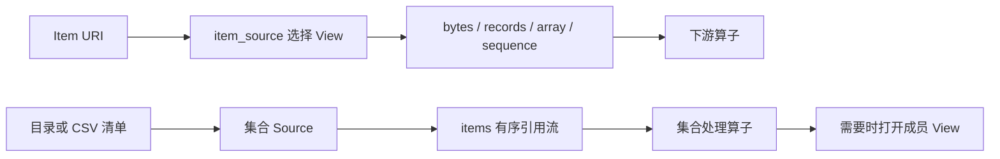

# 常见问题

[English](faq.md)

- [1. 与 Airflow 等工作流引擎相比，XStream 更适合哪些场景？](#1-与-airflow-等工作流引擎相比xstream-更适合哪些场景)
- [2. 如何理解 XStream 的逻辑文件系统？](#2-如何理解-xstream-的逻辑文件系统)
- [3. 如何理解 Item、View 和 stream 的关系？算子最终处理什么数据？](#3-如何理解-itemview-和-stream-的关系算子最终处理什么数据)
- [4. 如何在 XStream Job 中读取本地文件？`context:` 指向哪里？](#4-如何在-xstream-job-中读取本地文件context-指向哪里)
- [5. 如何通过目录或 CSV 清单定义 Item 集合（itemset）数据源？](#5-如何通过目录或-csv-清单定义-item-集合itemset数据源)
- [6. Job Designer 的 Target 列表如何设置？](#6-job-designer-的-target-列表如何设置)
- [7. 结构推导可以匿名访问吗？](#7-结构推导可以匿名访问吗)
- [8. 算子的角色、实现类型和执行器有什么区别？如何选择并开发算子？](#8-算子的角色实现类型和执行器有什么区别如何选择并开发算子)
- [9. 如何在 Job 中定义、开发和运行 inline 算子？可以提交到远程节点吗？](#9-如何在-job-中定义开发和运行-inline-算子可以提交到远程节点吗)
- [10. 自定义算子如何处理 `items` 引用流？](#10-自定义算子如何处理-items-引用流)
- [11. 可以配置多个算子仓库吗？同名同版本算子如何选择？](#11-可以配置多个算子仓库吗同名同版本算子如何选择)
- [12. inline 算子更简便，为什么还需要算子仓库？两者分别适合什么场景？](#12-inline-算子更简便为什么还需要算子仓库两者分别适合什么场景)

## 1. 与 Airflow 等工作流引擎相比，XStream 更适合哪些场景？

XStream 是面向数据流的工作流执行引擎，尤其适合以数据处理为主体、希望尽早获得结果，或者需要将执行能力嵌入应用的场景。

| 场景 | XStream 提供的能力 |
|---|---|
| 交互式科学分析 | 带参数的 Job、图形化编制、结构推导和有大小限制的输出预览 |
| 多步骤数据转换 | 解析、筛选、转换、聚合之间通过流连接，减少中间文件交接 |
| 跨语言算法组合 | 通过具名端口和统一的 Arrow 数据契约连接 Scala、Java、Python 等受支持执行器 |
| 复杂文件与科学数据处理 | 通过 Item/View 访问普通文件、归档成员和结构化科学数据 |
| 应用内嵌分析 | JVM 应用可以直接嵌入本地引擎 |
| 可复用的分析服务 | 将避免修改外部业务状态的算子组合成带参数 Job |

典型处理链路如下：


当算子支持增量处理时，下游可以在上游输出完成前开始计算；兼容步骤也可以共享执行单元。排序、某些 Join 和全局聚合仍可能缓存大量数据；流传递和进程合并并不保证每种工作负载都加速。

Airflow 尤其适合协调外部系统的调度工作流，例如定期抽取、等待上游服务、更新数据库、触发其他平台、历史补跑和发送通知，其优势包括调度、系统集成与运维工具。Airflow 不要求通过文件交换数据：XCom 面向少量值，大数据可以由任务通过外部存储或计算系统处理。参见官方的 [Airflow 介绍](https://airflow.apache.org/docs/apache-airflow/stable/)、[XCom 文档](https://airflow.apache.org/docs/apache-airflow/stable/core-concepts/xcoms.html)和[历史补跑文档](https://airflow.apache.org/docs/apache-airflow/stable/core-concepts/backfill.html)。

因此，XStream 适合作为科学数据分析、交互式分析应用以及可嵌入的跨语言数据流水线的基础。引擎在本地执行步骤，远程 Item 访问通过数据连接器实现，DACP/Union 提供远程 Job 调用与跨节点协作。支持时间窗口和持久状态恢复的持续流处理还需要进一步建设。

两者可以配合使用：Airflow 负责安排和管理分析 Job 的执行，XStream 负责其内部的数据处理流水线。实际性能及适用边界参见[工作流性能对比](orchestration-llm-benchmark_zh.md)。

## 2. 如何理解 XStream 的逻辑文件系统？

XStream 通过**统一的逻辑数据目录**组织和访问数据，屏蔽数据实际存储的位置及文件格式。它是数据资源命名空间，而不是操作系统的磁盘文件系统或挂载磁盘。

```text
DataCatalog
└── Dataset
    ├── 普通数据 Item
    └── folder Item
        └── 子 Item
```

DataCatalog 发现各 Dataset，每个 Dataset 提供一棵逻辑 Item 树。例如，在安装了对应后端和格式插件的情况下：

| 逻辑地址 | 实际可能对应的资源 |
|---|---|
| `context:/science/observations.csv` | 本地 CSV 文件 |
| `context:/science/archive.zip/labels/a.csv` | ZIP 内部文件，无需用户手动解压 |
| `context:/science/climate.nc/temperature` | NetCDF 内部变量 |
| 数据库 Dataset 暴露的表格 Item | 数据库表或配置的查询结果 |

逻辑路径不一定是物理文件路径。压缩包成员和科学数据变量不必作为独立文件存在；具体暴露哪些资源及内部结构，由插件决定。

**Item 表示资源，View 表示读取方式。** CSV Item 可以提供原始文件字节的 `bytes` 视图，以及解析后表格记录的 `records` 视图；科学数据 Item 可以提供保留多维结构的 `array` 视图。读取受支持的 View 后，得到供下游算子处理的 Arrow 数据流。应检查资源声明的能力，不能假定所有 Item 都支持所有 View。

层级结构与读取能力相互独立：folder Item 可以通过 `list()` 浏览。ZIP 根项声明 `kind: folder`、`views: [bytes, items]`：`bytes` 返回原始 ZIP，`items` 输出其中成员的引用，不读取成员内容。归档内部目录支持 `items`，普通成员则支持各自声明的视图。folder 请求 `records` 会被拒绝。

`context:` 指向当前执行环境绑定的 DataCatalog，不是任意本地磁盘路径；远程 DACP URI 则通过连接器访问远程数据目录。这套设计将文件、压缩包成员、科学数据变量和数据库资源统一为逻辑 Item、明确的 View 以及数据流，使 Job 不必为每种存储方式分别实现读取逻辑。

参见[数据模型](data-model_zh.md)、[文件格式与容器](file-formats_zh.md)、[DataView 示例](data-view-examples_zh.md)，以及本页第 4 条本地文件访问问答。

## 3. 如何理解 Item、View 和 stream 的关系？算子最终处理什么数据？

**Item** 标识逻辑数据资源，**View** 选择资源支持的读取表示，打开 View 得到 **Arrow 数据流**。步骤通过具名端口交换流，而不是传递主机文件系统路径。



| 表示 | 算子消费的内容 |
|---|---|
| `bytes` | 增量字节块，例如原始 ZIP 或 TIFF 字节 |
| `records` | 有类型的记录批次，例如 CSV 解析后的行 |
| `array` | 保留维度和结构的科学数组 |
| `sequence` | 按声明的科学结构表示的生物序列 |
| `items` | 有序 Item 引用及元数据，成员内容延迟打开 |

流由有序 frame/批次组成；`array` 表示数据的表示形式，并不要求将所有数据加载到一个内存数组中。各端口声明支持的表示。SDK 算子处理声明的数据流，命令/脚本适配器可将 bytes 绑定到 stdin/stdout 或临时文件。适配器内部物化文件，不改变步骤间的流契约。

`item_source` 通过参数选择 View。集合 Source 输出 `items`，集合处理算子可遍历引用，再通过 SDK 打开成员 View。集合迭代发生在该算子内部，不是 Job 层级的 map/reduce 指令。参见[数据模型](data-model_zh.md)、[View 示例](data-view-examples_zh.md)和 [Item 引用流](items-stream_zh.md)。

## 4. 如何在 XStream Job 中读取本地文件？`context:` 指向哪里？

先通过引擎的 DataCatalog 发布目录，再使用 `item_source@1.0` 读取其中的 Item。例如，将以下引擎配置保存为 `engine.yaml`：

```yaml
datasets:
  local:
    provider: directory
    source:
      root: /data
```

将以下 Job 保存为 `read-local.yaml`，以记录形式读取 `/data/input.csv`：

```yaml
name: Read local CSV
steps:
  - id: read
    operator: item_source@1.0
    inputs: {}
    params:
      uri: context:/local/input.csv
      view: records
  - id: client_sink
    operator: client_sink@1.0
    inputs:
      result: read
```

使用已安装的启动命令执行：

```bash
xstream-runner engine.yaml read-local.yaml
```

`context:` 指向执行该 Job 的引擎所绑定的 DataCatalog。这里的 `local` 是 Dataset 名称，`/input.csv` 是该 Dataset 内的 Item 路径。引擎进程必须具有读取 `/data/input.csv` 的权限。相对文件系统根目录按照进程工作目录解析。

同一份 Job 在远程服务器执行时，`context:` 指向该服务器的数据目录，而非提交者电脑上的文件。在 Designer 中，Local 指 Designer 服务器的数据目录，而非浏览器访客的文件系统。Designer 的本地目录配置位于 `local_catalog.datasets` 下，独立 runner 则使用上述顶层 `datasets` 配置。

如需读取原始文件字节，将 `view` 设置为 `bytes`。`records` 视图需要支持记录读取的格式插件，例如 CSV。`item_source` 接收数据目录中的 Item 地址，不直接接收 `/data/input.csv` 或 `file:///data/input.csv` 等任意文件系统路径。发布目录使其中的文件可以通过数据目录访问，不会自动将该主机目录挂载到算子容器内；算子通过输入端口接收相连的数据流。

参见[快速入门](quickstart_zh.md)、[数据模型](data-model_zh.md)和[本地执行指南](xstream_zh.md)。

## 5. 如何通过目录或 CSV 清单定义 Item 集合（itemset）数据源？

使用 `items` 表示：它是有序 Item 引用流，不是新的 Dataset provider，也不是数学意义的 Set，保留顺序和重复项。先将底层文件发布到数据目录，例如在 runner 的 `engine.yaml` 中配置：

```yaml
datasets:
  science:
    provider: directory
    source:
      root: /srv/science
```

对于 `/srv/science/labels` 下的文件，使用目录 Source：

```yaml
name: Inspect an Item collection
steps:
  - id: list
    operator: folder_items_source@1.0
    inputs: {}
    params: {uri: 'context:/science/labels', recursive: true}
  - id: inspect
    operator: item_byte_count@1.0
    inputs: {source: 'list:result'}
    params: {}
  - id: receive
    operator: client_sink@1.0
    inputs: {result: 'inspect:result'}
```

也可以保存 `/srv/science/manifest.csv`：

```csv
uri,sample_id,role
labels/001.txt,001,label
labels/001.tfw,001,world
```

将 `list` 步骤替换为：

```yaml
id: list
operator: csv_items_source@1.0
inputs: {}
params: {uri: 'context:/science/manifest.csv', uri_column: uri}
```

目录 Source 默认只列出直接子项；`recursive: true` 包括后代项及目录引用。CSV Source 将每行解析为引用，相对路径以清单的逻辑父目录为基准，其他列保留到元数据中。两者只输出引用，不预先读取成员内容。`item_byte_count` 按需打开成员支持的 bytes View，跳过不支持 bytes 的目录；按 `sample_id` 配对标签文件与世界文件等规则由下游自定义算子实现。

Designer 的本地数据集配置在 `local_catalog.datasets` 下，`context:` 始终指执行主机的数据目录。通过配置的算子仓库安装已审批的 Source、Transform、Sink 包及 Runtime。远程 Item URI 还需要对应的数据连接器和连接配置。参见 [Item 算子示例](../examples/operators/item-sources/README_zh.md)和 [Item 引用流](items-stream_zh.md)。

## 6. Job Designer 的 Target 列表如何设置？

Designer 固定提供 **Local**。管理员通过 Designer 启动 YAML 中的 `nodes` 增加远程 Target；目标可以是普通 DACP 节点，也可以是 Union 服务。

```yaml
local_catalog:
  datasets:
    weather:
      provider: directory
      source:
        root: /srv/weather

nodes:
  - url: dacp://union.example.org:19860
    ca: /etc/xstream/ca.crt
    token_file: /etc/xstream/union.token
  - url: dacp://node-a.example.org:18861
    ca: /etc/xstream/ca.crt
    token_file: /etc/xstream/node-a.token
```

将地址和路径替换为部署中的实际值。`local_catalog` 提供 Designer 本地数据目录，`nodes` 提供可选的远程连接。CA 和 Token 文件由 Designer 服务端读取，不发送给浏览器。`token_file` 中只保存 Token 值，不保存完整的凭据 JSON 响应。上游账号须具有结构推导和样例请求所需权限；能查看公开元数据并不表示具有执行权限。

修改启动 Designer 时传入的配置文件，重启 Designer，然后刷新浏览器：

```bash
xstream-designer /etc/xstream/designer.yaml
```

访客通过 **Target: … → Change… → Use selected target** 选择管理员预先配置的目标，不能在界面中随意输入服务器地址或凭据。

选择 Target 后，**Target catalog** 和结构、输出样例推导使用的上下文随之变化。从该目录选择的 Item 使用 `context:/dataset/item`；从其他目录选择的 Item 使用完整远程 URI。已选 Target 不再重复出现在其他目录根节点中。切换 Target 后须检查上下文 Item 路径，因为同一路径在不同目标上可能对应不同数据。

导出 YAML 中可选的 `designer.target` 保存设计上下文，不会提交 Job、决定执行路由或授予权限。Job 提交是独立操作，实际执行目标的数据目录须与 Job 中的 `context:` 引用对应。

参见[设计器指南](designer-guide_zh.md)和 [Designer 配置参考](../xstream-designer/README_zh.md)。

## 7. 结构推导可以匿名访问吗？

Designer 网页本身无需用户登录，本地 Target 的推导由 Designer 服务端本地执行。远程 DACP 节点或 Union 的结构推导接口要求 `job:execute` 权限，普通账号通常需要 `runner` 角色。Designer 通过 `nodes` 中配置的 `token_file` 代表访客访问上游，访客无需输入 Token，Token 也不会传给浏览器。

因此，网页访客无需登录不等于远程服务允许匿名推导。公开目录与元数据可以匿名读取，结构推导和输出样例可能运行算子代码、读取数据并占用资源，遵循远程服务的权限检查。

## 8. 算子的角色、实现类型和执行器有什么区别？如何选择并开发算子？

以下是相互独立的选择维度，不是互斥的算子分类：

| 维度 | 选项 | 含义 |
|---|---|---|
| 图中 `role` | `source`、`transform`、`sink` | 无输入并产生流；消费并产生流；消费流且无输出 |
| 接入 `type` | `sdk`、`command`、`script` | SDK 程序、已有可执行工具或脚本 |
| `executor` | `jvm`、`python`、`command`、`container` | 配置的 Runtime 容器中的启动方式与协议 |
| 定义位置 | 公开仓库、本地算子库、Job 的 `operators` | 定义的分发与选择方式 |

| 开发方式 | 开发者提供什么 |
|---|---|
| SDK（`jvm` / `python`） | Scala/Java 或 Python 处理代码、输入输出契约、参数、结构推导及有界样例，并提供构建与依赖声明 |
| Command | 已有工具、含依赖的 Runtime、参数映射及 bytes 的 stdin/stdout 或文件绑定，适配器提供流桥接 |
| Script | 解释器、内嵌源码或脚本文件、参数与 bytes 绑定；脚本本身不必导入 SDK |
| 自定义 container 执行器 | 镜像入口实现算子处理与推导协议，仅将任意 CLI 放入镜像不代表实现了该协议 |

新 SDK 算子优先采用 Scala，同时支持 Java 和 Python。先确定角色与端口契约，再选择实现方式和 Runtime。验证空输入、多批次输入、输出结构、参数、推导、样例、取消及资源清理。文件绑定使用受配额控制的临时存储；通用命令适配器不会执行命令来获取样例。所有执行器都在容器内运行。

`item_source@1.0` 是 Source，`client_sink@1.0` 是向调用方返回结果的显式 Sink，两者都从算子仓库获取。角色不决定实现语言。请从[完整算子开发指南](operator-authoring_zh.md)、[Scala 端点示例](../examples/operators/scala-endpoints/README_zh.md)、[依赖环境](dependency-environments_zh.md)和[提交指南](operator-submission_zh.md)入手。

## 9. 如何在 Job 中定义、开发和运行 inline 算子？可以提交到远程节点吗？

本地开发时，在 Job 顶层 `operators` 中定义算子，步骤通过 `operator: {inline: name}` 引用。Scala/Java JAR 或 Python SDK 程序选择 `sdk`，可执行工具选择 `command`，内嵌或本地脚本选择 `script`。

在 `engine.yaml` 中配置已预装的 Runtime（同时配置本 Job 使用的数据集）：

```yaml
inline_runtimes:
  python_tools:
    image: xstream/operator-python:1.0
    executor: python
```

镜像需包含 `/usr/local/bin/python`、PyArrow 和脚本依赖。下面是通过 stdin/stdout 绑定的完整 Job：

```yaml
name: Local uppercase
operators:
  upper:
    type: script
    role: transform
    runtime: python_tools
    interpreter: /usr/local/bin/python
    script:
      source: |
        import sys
        while chunk := sys.stdin.buffer.read(65536):
            sys.stdout.buffer.write(chunk.upper())
    inputs:
      source: {view: bytes, binding: stdin}
    outputs:
      result: {view: bytes, binding: stdout, format: text}
steps:
  - id: read
    operator: item_source@1.0
    inputs: {}
    params: {uri: 'context:/files/input.txt', view: bytes}
  - id: upper
    operator: {inline: upper}
    inputs: {source: 'read:result'}
    params: {}
  - id: receive
    operator: client_sink@1.0
    inputs: {result: 'upper:result'}
```

执行 `xstream-runner engine.yaml job.yaml`。需发布包含 `input.txt` 的 `files` 数据集，并配置提供 `item_source` 和 `client_sink` 的仓库/缓存。本地程序路径相对 Job 目录解析；引用文件进入私有暂存区，取消和清理由框架管理。程序在配置的容器中运行，不是任意主机进程执行。

**DACP 节点和 Union 拒绝包含 `operators` 的 Job，即使定义未被使用。** 远程执行前需将算子提交公开审批，再改为 `name@version` 引用。Designer 支持 inline YAML，并通过其配置的 `inline_runtimes` 进行本地推导，需选择 Local。SDK 入口、命令映射、脚本文件、限制和注册方式见 [inline 算子](inline-operators_zh.md)；跨本地 Job 复用的方式见[本地算子库](local-operators_zh.md)。

## 10. 自定义算子如何处理 `items` 引用流？

在输入端口声明 `representations: [items]`。下例的业务代码只遍历引用与元数据，不读取成员内容：

```scala
def process(ctx: OperatorContext): Unit = {
  val output = ctx.bytesOutput("result", "text")
  ctx.input("source").foreachItem { item =>
    output.write(s"${item.uri}\t${item.kind}\n".getBytes("UTF-8"))
  }
}
```

需要内容时，在回调内部通过 `ctx.openItem(item, "bytes") { stream => … }` 读取指定 View。返回的是可增量消费的 Arrow 流，框架负责关闭、授权与取消。不要把整个集合收集到 Map/Set，除非显式设置数量和内存上限。多个文件的配对规则由算子定义，不由 Job 隐式执行。

完整可编译的 Source 与 Transform 见 [Item 算子示例](../examples/operators/item-sources/README_zh.md)，数据契约见 [Item 引用流](items-stream_zh.md)。

## 11. 可以配置多个算子仓库吗？同名同版本算子如何选择？

Runner 和 Designer 都在启动配置中接收仓库基础地址列表：

```yaml
remote_operator_library_urls:
  - https://operators.example.org
  - https://science-operators.example.org
```

Designer 合并这些仓库的公开目录，用于算子列表和 Chat 上下文，本地结构/样例推导也从同一列表解析包。已有 Job 可以使用不同版本，列表通常只显示每个名称的最新版本。多个仓库都提供同一 `name@version` 时，选择配置顺序中最先提供该算子的仓库。Designer 和执行主机应保持顺序一致，不要使用同一身份发布不同实现。

仓库列表属于服务端配置，浏览器请求不能替换；修改后需重启。目录不可用或不合法时，Designer 的目录请求会失败，不会静默展示不完整清单。解析算子包时，仅当仓库缺少该算子才继续查找下一仓库；连接、完整性与验证错误仍会报错。已验证的包清单和内容可以从缓存复用。远程 Target 使用该服务器自己的仓库配置，需在其上安装同样的必要算子。参见[算子包与缓存](operator-packaging_zh.md)。

## 12. inline 算子更简便，为什么还需要算子仓库？两者分别适合什么场景？

inline 适合本地试验：将脚本、命令映射或 SDK 程序放在 Job 旁边，在管理员配置的 Runtime 中直接运行。本地算子库也支持跨本地 Job 复用。

仓库提供共享的版本化身份、端口/参数/示例声明、构建与依赖环境、审批、源码与来源信息、可信度元数据及可验证的下载。其他用户和执行主机可以获取同一已审批包，而不必复制私有脚本和路径。

远程 DACP 节点和 Union 接受公开审批算子，拒绝 inline/本地定义，从而为服务端建立明确的代码发布边界。审批不保证代码无害，仍需容器隔离、授权和资源限制。先本地开发、验证流契约，需要共享或远程执行时再[提交审批](operator-submission_zh.md)。参见[本地算子库](local-operators_zh.md)和 [inline 算子](inline-operators_zh.md)。
