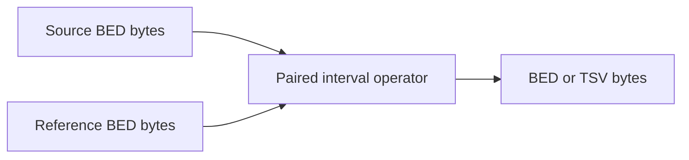

# Galaxy streaming operator adapters

[中文](galaxy-operators_zh.md)

The example repository provides 200 distinct Galaxy operators; the extension families are listed below. Exact public versions and tested artifact hashes are recorded in the [catalog audit](../examples/operators/galaxy/verification-public-catalog.json). Each uses Arrow bytes inputs (`source`, and `reference` for paired adapters) and a `result` bytes output; no filesystem path or intermediate file is required. A stream interface does not imply constant memory: whole-stream sorting and reversal use bounded buffers; biological tools may buffer one bounded record. All normalized text output uses LF and JVM Unicode lexical order where sorting is involved.

| Operator | Purpose | Supported scope |
| --- | --- | --- |
| `galaxy_reverse_lines@1.0` | Reverse the order of newline-separated text records. | Newline records only; a bounded 8 MiB-character buffer is required. No custom separators. |
| `galaxy_number_lines@1.0` | Number nonempty text lines with configurable starting number, increment and alignment. | Empty lines are unnumbered. Logical-page escape sequences are treated as literal text. |
| `galaxy_sort_lines@1.0` | Stable sort of text rows using a selected tab-separated key. | One full-field sort key; numeric mode requires finite decimal/scientific values. No locale, random or human-size sorting. Bounded 8 MiB-character row buffer. |
| `galaxy_sort_fields@1.0` | Sort the tab-separated fields within each row alphabetically. | As upstream, strips surrounding row whitespace before sorting fields. |
| `galaxy_unique_lines@1.0` | Sort text lines and retain one occurrence of each comparison key. | Whole line or one selected field; stable representative, bounded 8 MiB-character buffer. Header lines pass unchanged. |
| `galaxy_unique_consecutive@1.0` | Collapse adjacent equal text records, optionally counting or selecting duplicate groups. | Only consecutive duplicates are grouped; no arbitrary field skipping or blank-delimited grouping. |
| `galaxy_unfold_column@1.0` | Expand a delimited list in one tab-separated field into multiple rows. | Literal nonempty separator; at most 10000 output rows and 16 MiB estimated characters per input row. Fixes upstream last-column newline handling. |
| `galaxy_replace_text_in_column@1.0` | Replace literal text within one tab-separated field. | Literal matching only: no regular expressions, shell commands, sed programs or replacement backreferences. Case-insensitive matching is locale-independent. Missing selected columns fail. |
| `galaxy_replace_text_in_line@1.0` | Replace literal text within complete lines. | Literal matching only: no regular expressions, shell commands, sed programs or replacement backreferences. Case-insensitive matching is locale-independent. Missing selected columns fail. |
| `galaxy_find_and_replace@1.0` | Replace literal text within complete lines. | Literal matching only: no regular expressions, shell commands, sed programs or replacement backreferences. Case-insensitive matching is locale-independent. Missing selected columns fail. |
| `galaxy_grep_lines@1.0` | Select lines containing a literal search string, with optional inversion and case folding. | Literal text search; no regex, context-line expansion or HTML output. |
| `galaxy_arrange_columns@1.0` | Reorder table columns by their header names, optionally discarding unselected columns. | Unique header names and requested names are required. Ragged rows and unknown headers fail. |
| `galaxy_add_line@1.0` | Add a literal header or footer line to a text stream. | Existing data lines are normalized to LF; this avoids concatenating a footer onto an unterminated final row. |
| `galaxy_recurring_lines@1.0` | Generate a configured line repeatedly after draining the input stream. | One explicit repetition group, bounded 16 MiB output expansion; input is drained, not used to infer repetitions. |
| `galaxy_remove_columns_by_header@1.0` | Remove named table columns or keep only the named columns. | Tab-delimited UTF-8; optional leading-character stripping on first header field. Retains source column order. Unknown requested headers fail. |
| `galaxy_sort_columns_by_header@1.0` | Alphabetically reorder table columns by header, optionally pinning one column first. | Zero sorts every column; otherwise a one-based column stays first. Headers must be unique. |
| `galaxy_add_input_name@1.0` | Add an input label as a new table column, with optional header and prepending. | The input label is explicit configuration; no local path or filename is required. |
| `galaxy_fixed_width_to_tabular@1.0` | Convert explicitly configured fixed-width fields into trimmed tab-separated columns. | Explicit character widths only; no automatic boundary detection, FORTRAN descriptors, reports or encoding conversion. Long rows or unpadded short rows fail. |
| `galaxy_colorspace_to_fasta@1.0` | Convert FASTA-like SOLiD color-space sequences to nucleotide FASTA. | A/C/G/T primer followed only by 0..3; wrapped sequence lines accepted. Buffers at most one 8 MiB-character sequence. |
| `galaxy_split_paired_reads@1.0` | Extract one mate from concatenated equal-length paired FASTQ records. | Select mate 1 or 2; validates four-line FASTQ, optional matching + title, equal sequence/quality lengths and even sequence length. No silent truncation. An empty + title remains empty so emitted FASTQ remains valid. |
| `galaxy_pileup_interval@1.0` | Collapse consecutive pileup positions meeting a minimum depth into BED-like sequence intervals. | One-based pileup to zero-based half-open intervals. Configurable columns cover six-column, legacy ten-column and custom rows. Active interval limited to 8 MiB bases; blank lines are skipped rather than terminating all input. |
| `galaxy_divide_pg_snp@1.0` | Expand one or two pgSnp alleles, frequencies and scores into separate columns. | Rows with more than two alleles are skipped. Homozygous second allele is N or the configured reference column; extra input columns are retained. |
| `galaxy_vcf_to_pgsnp@1.0` | Convert called VCF SNP genotypes to pgSnp allele counts. | Zero selects all samples; otherwise use a one-based VCF column >=10. Only single-base A/C/G/T SNPs with PASS or missing FILTER are converted. GT position, haploidy, phased calls and all allele indices are handled; missing alleles ignored. |
| `galaxy_reverse_complement@1.0` | Reverse-complement FASTA nucleotide sequences using the IUPAC alphabet. | FASTA input/output only; DNA or RNA IUPAC symbols, case preserved, invalid characters rejected. One sequence buffered up to 8 MiB characters. |
| `galaxy_translate@1.0` | Translate nucleotide FASTA to protein FASTA with the standard genetic code. | Standard code table 1, FASTA only. Ambiguous complete codons emit X; terminal partial codons fail. CDS requires ATG start, terminal stop and no internal stop; final stop omitted. Alternate genetic codes are not advertised. |
| `galaxy_codon_count@1.0` | Count all 64 unambiguous DNA codons over FASTA sequences in frame zero. | Input lengths must be multiples of three. Only A/C/G/T codons are accepted; output is deterministic lexicographic codon/count TSV, including zero counts. |
| `galaxy_base_distribution@1.0` | Report per-sequence A/C/G/T counts, sequence length and GC fraction. | FASTA input. GC denominator includes ambiguous symbols; zero-length records use GC fraction zero. Output CG% is the upstream fraction, not a percentage. |
| `galaxy_find_subsequences@1.0` | Find IUPAC nucleotide motifs in FASTA and emit zero-based half-open BED6 locations. | Uses reverse complement for reverse-strand search, correcting the upstream complement-only bug. Overlapping hits are consistently included. Maximum one million candidate comparisons per record times pattern length is bounded to 64 million. |
| `galaxy_fasta_stats@1.0` | Compute scaffold, contig and base-composition summary statistics from FASTA. | Statistics TSV output only, no separate gap BED. N-runs split contigs; internal N-runs count as gaps. Uses standard N50 threshold >= half, correcting upstream strict-greater edge. At most 100000 sequences/contigs and one 8 MiB-character record. |
| `galaxy_motif_flank_counts@1.0` | Count motif-bearing windows upstream and downstream of each indel. | Input has an odd number of tab-separated windows with literal indel in the middle. Motifs are literal case-insensitive DNA strings configured by name=sequence or sequence. Output is row-major then motif order to stream without replaying input; upstream uses motif-major order. Regex motifs are not supported. |

## Develop, verify and run

```bash
cd examples/operators/galaxy
python3 extend-catalog.py
python3 make-catalog.py
sbt package 'Test/runMain xstream.galaxy.ExtendedSafetyCheck'
python3 verify-extended.py --only reverse_complement --report verification-reverse-complement.json
cd ../../..
xstream-engine/target/universal/stage/bin/xstream-runner examples/operators/galaxy/engine.yaml examples/operators/galaxy/jobs-extended/reverse_complement.yaml
```

Use Python with PyArrow and PyYAML installed and Docker access to the configured shared JVM image. Every `jobs-extended/<name>.yaml` has a corresponding `data/extended/<name>.txt`. The full example includes input loading; the repository detail page presents only the current operator step. Parameters, defaults, complete examples and exact regression expectations are in `extra-specs.json`. `extend-catalog.py` regenerates contracts, fixtures and example Jobs. Zero-copy or fully streaming behavior is not claimed for global sorting/reversal or per-record sequence processing.

## Provenance and review

Original reviewed sources, XML definitions, fixtures and license notices are retained under `upstream-extended/{devteam,community,iuc}/`. `upstream-extended-manifest.json` records repository URLs, pinned revisions and SHA-256 hashes. Adaptations deliberately expose a documented subset where upstream features require executable expressions, external programs, replay or additional files. Unsupported options are rejected; these packages are not drop-in replacements for every upstream command line. Source-only repository publication builds a thin Scala JAR against `jvm-arrow@2.1`, tests that artifact using chunked Arrow IPC plus inference/preview, then approves it. The administrator trust score is an assessment, not a safety guarantee.

## Compose and audit published tools

The [sequence pipeline](../examples/operators/galaxy/job-extended-pipeline.yaml) decodes SOLiD colors, computes a reverse complement, measures the sequence and appends an explicit input label. Its output is `seq1\t4\trun1\n`.


Run from the XStream repository root after publication:

```bash
xstream-engine/target/universal/stage/bin/xstream-runner \
  examples/operators/galaxy/engine-extended.yaml \
  examples/operators/galaxy/job-extended-pipeline.yaml
python3 examples/operators/galaxy/verify-extended-jobs.py
python3 examples/operators/galaxy/audit-publication.py --url http://127.0.0.1:8820
```

[Public catalog audit](../examples/operators/galaxy/verification-public-catalog.json) checks 200 distinct names, exact versions, complete port/parameter documentation, usage examples, anonymously downloadable source/artifact hashes, entrypoint classes and embedded license notices. The recorded audit also matches every artifact to its passed repository-build test report. [Extended Job checks](../examples/operators/galaxy/verification-extended-jobs.json) compare each of the 180 extension Jobs with independently specified fixture output. [Pipeline verification](../examples/operators/galaxy/verification-extended-pipeline.json) covers composition with the original FASTA length adapter. The [safety report](../examples/operators/galaxy/verification-safety.json) records four passing safety suites; `ExtendedSafetyCheck` exercises 2039 cases, including cancellation, I/O failures, invalid UTF-8, line limits, upstream golden fixtures and malformed biological input. Administrator trust scores do not replace these supported-scope and resource limits.

## Coordinate and publication-format adapters

These adapters preserve text data and use Arrow bytes transport. GFF3 hierarchy is explicitly rejected by the flat Circos converters. They do not render plots or require Python/Biopython at execution.

| Operator | Purpose and scope |
| --- | --- |
| `galaxy_circos_karyotype_fasta@1.0` | Generate Circos chromosome definitions from FASTA sequence lengths. FASTA text; sequence IDs must be unique. Colors are indexed from zero. No image rendering. |
| `galaxy_circos_karyotype_lengths@1.0` | Generate Circos chromosome definitions from a sequence-length table. Unquoted tab-separated ID and positive length; unlike upstream, malformed rows fail explicitly. |
| `galaxy_circos_tiles_bed@1.0` | Convert BED intervals to Circos tile records. BED3 or BED6+; zero-based half-open coordinates. Extra BED fields are ignored. |
| `galaxy_circos_text_bed@1.0` | Convert labeled BED intervals to Circos text records. BED6+ required; zero-based half-open coordinates. Extra BED fields are ignored. |
| `galaxy_circos_tiles_gff3@1.0` | Convert flat GFF3 features to sorted Circos tile records. Flat GFF3 only: Parent hierarchies are rejected rather than flattened. Input chromosome order is preserved; features sort by start. One-based inclusive GFF becomes zero-based half-open. Up to 100000 rows and 8 MiB characters. |
| `galaxy_circos_text_gff3@1.0` | Convert named flat GFF3 features to sorted Circos text records. Flat GFF3 only; Parent hierarchies rejected. Features without the selected attribute are skipped. Coordinates converted to zero-based half-open; at most 100000 rows and 8 MiB characters. |
| `galaxy_remove_terminal_stop_codons@1.0` | Remove trailing standard-code stop codons from nucleotide FASTA. NCBI translation table 1 only; uppercase normalization and U-to-T conversion. All terminal stops removed; partial terminal codons retained. At most 8 MiB characters per sequence. |
| `galaxy_windowmasker_to_bed@1.0` | Convert WindowMasker inclusive intervals to BED4. Text interval mode only. Zero-based inclusive input becomes half-open BED; global wm_N labels begin at zero. |
| `galaxy_count_gff_features@1.0` | Count valid feature records in a GFF stream. Counts syntactically valid nine-column GFF records, not logical exon groups. Malformed rows fail rather than silently skipping. FASTA sections are rejected. |
| `galaxy_resize_coordinate_window@1.0` | Resize GFF intervals around their midpoint or existing boundaries. Nine-column GFF; uses a common chromosome-length parameter rather than a chromosome-length file. Midpoint uses floor division; comments skipped, malformed rows rejected. |

## Interval, FASTQ, sequence and table analysis

All interfaces remain `source` → `result` Arrow bytes streams. FASTQ is four-line nucleotide text with matching sequence/quality lengths and optional plus titles; color-space and operator-internal compression are not supported. Interval tools accept positive-length zero-based half-open BED; malformed rows fail. Text readers reject malformed UTF-8, enforce a 1 MiB-character line limit, and poll cancellation. Sequence algorithms have a 64-million-visit comparison budget per sequence where applicable.

| Operator | Purpose | Supported scope |
| --- | --- | --- |
| `galaxy_bed_sort@1.0` | Sort BED records lexically by chromosome and numerically by start. | Stable start sort, no genome-order file. Buffer at most 100000 rows or 8 MiB characters. BED input is zero-based half-open with positive interval length. Comments are skipped; invalid records fail. |
| `galaxy_bed_merge@1.0` | Merge sorted overlapping or nearby BED intervals. | Sorted input required, output BED3. Distance zero merges book-ended intervals; no strand or extra-column aggregations. BED input is zero-based half-open with positive interval length. Comments are skipped; invalid records fail. |
| `galaxy_bed_cluster@1.0` | Assign connected-component IDs to sorted BED intervals. | Sorted input required, global IDs start at one; unstranded mode, original columns retained. BED input is zero-based half-open with positive interval length. Comments are skipped; invalid records fail. |
| `galaxy_bed_spacing@1.0` | Append the distance from each BED interval to its predecessor. | Sorted input required. First interval per chromosome uses dot; any overlap uses -1; touching uses zero. BED input is zero-based half-open with positive interval length. Comments are skipped; invalid records fail. |
| `galaxy_bed_slop@1.0` | Extend BED intervals with chromosome-boundary clipping. | Integer base distances and optional strand awareness. Chromosome lengths are explicit parameters, not a local file. BED input is zero-based half-open with positive interval length. Comments are skipped; invalid records fail. |
| `galaxy_bed_flank@1.0` | Emit left and right flanking intervals around each BED feature. | Left flank then right flank; zero-length flanks omitted. Integer distances, optional strand awareness, explicit chromosome lengths. BED input is zero-based half-open with positive interval length. Comments are skipped; invalid records fail. |
| `galaxy_bed_complement@1.0` | Emit genome intervals not covered by BED features. | Sorts and unions input, reports all configured chromosomes in parameter order. Buffer at most 100000 rows or 8 MiB characters. BED input is zero-based half-open with positive interval length. Comments are skipped; invalid records fail. |
| `galaxy_bed_genome_coverage@1.0` | Compute run-length encoded BED coverage as bedGraph. | BED interval coverage, no BAM/CIGAR or split blocks. Emits bedGraph rather than histograms. At most 100000 rows or 8 MiB characters, plus two events per interval. BED input is zero-based half-open with positive interval length. Comments are skipped; invalid records fail. |
| `galaxy_interval_overlap@1.0` | Append signed overlap or distance between two intervals on each row. | Coordinates are taken from configured columns on the same row; chromosome identity is the caller responsibility, matching upstream. Positive overlap, zero touching, negative separation. Comments are skipped; invalid records fail. |
| `galaxy_expand_columns@1.0` | Expand synchronized comma-separated lists across selected table columns. | UTF-8 TSV, no BED coordinate interpretation. Columns must be unique and increasing; no Cartesian product. At most 10000 expansions and 16 MiB estimated output per row. Comments are skipped; invalid records fail. |
| `galaxy_group_table@1.0` | Aggregate consecutive tabular groups using a numeric or textual operation. | One grouping key and one value column. Input must group equal keys consecutively; no automatic global sorting. Text aggregation bounded to 8 MiB characters and 100000 values per group. Comments are skipped; invalid records fail. |
| `galaxy_fastq_to_tabular@1.0` | Convert FASTQ titles, sequences and quality strings to TSV. | Title tabs become spaces; short descriptions are padded to exactly the requested width. Four-line nucleotide FASTQ only, at most 1 MiB characters per line; sequence and quality lengths and optional + titles must match. No color-space or compression inside the operator. |
| `galaxy_tabular_to_fastq@1.0` | Build validated FASTQ records from selected TSV columns. | Malformed rows fail instead of being silently skipped. Output Phred+33. Four-line nucleotide FASTQ only, at most 1 MiB characters per line; sequence and quality lengths and optional + titles must match. No color-space or compression inside the operator. |
| `galaxy_fastq_mask_quality@1.0` | Mask FASTQ bases selected by a quality-score comparison. | ASCII Phred+33. Quality strings are retained unchanged. Four-line nucleotide FASTQ only, at most 1 MiB characters per line; sequence and quality lengths and optional + titles must match. No color-space or compression inside the operator. |
| `galaxy_fastq_filter_quality@1.0` | Filter FASTQ reads by length and count of out-of-range qualities. | ASCII Phred+33, whole-read ranges only; no generated Python predicates or per-window expressions. Four-line nucleotide FASTQ only, at most 1 MiB characters per line; sequence and quality lengths and optional + titles must match. No color-space or compression inside the operator. |
| `galaxy_fastq_join_mates@1.0` | Concatenate adjacent paired FASTQ reads into one read. | Adjacent /1 and /2 mates with equal base IDs, either order; no identifier-indexed second input. Unmatched or misordered pairs fail. Does not reverse-complement mate 2. Four-line nucleotide FASTQ only, at most 1 MiB characters per line; sequence and quality lengths and optional + titles must match. No color-space or compression inside the operator. |
| `galaxy_fastq_deinterlace@1.0` | Select paired or unpaired mate records from interleaved FASTQ. | Slash /1 and /2 IDs only. Matches mates regardless of adjacency using a bounded 8 MiB-character / 100000-read buffer. Duplicate full IDs fail; original first-pair encounter order is preserved. Four-line nucleotide FASTQ only, at most 1 MiB characters per line; sequence and quality lengths and optional + titles must match. No color-space or compression inside the operator. |
| `galaxy_fastq_groom@1.0` | Convert FASTQ quality encoding and normalize the plus line. | Sanger Phred+33, Illumina Phred+64, Solexa log-odds+64; scores are rounded and clipped to the output convention. Existing titles must agree; no automatic repair. Four-line nucleotide FASTQ only, at most 1 MiB characters per line; sequence and quality lengths and optional + titles must match. No color-space or compression inside the operator. |
| `galaxy_fastq_quality_stats@1.0` | Summarize per-position FASTQ quality quartiles and nucleotide counts. | Normalized TSV columns documented by the header, not the upstream report layout. Linear-interpolated quartiles, ASCII Phred+33, at most 10000 positions; fixed 94-bin quality histograms avoid retaining reads. Four-line nucleotide FASTQ only, at most 1 MiB characters per line; sequence and quality lengths and optional + titles must match. No color-space or compression inside the operator. |
| `galaxy_seqtk_comp@1.0` | Compute nucleotide, ambiguity, CpG and substitution-class composition. | Full sequences only; no BED subset. CpG counts both contributing positions, including C/Y and G/R ambiguity contexts. FASTA text only unless explicitly stated; one sequence is limited to 8 MiB characters. Output is LF-normalized and unwrapped. |
| `galaxy_seqtk_listhet@1.0` | List one-based positions of two-allele IUPAC nucleotide codes. | Only two-base ambiguity symbols qualify; original character case is retained. FASTA text only unless explicitly stated; one sequence is limited to 8 MiB characters. Output is LF-normalized and unwrapped. |
| `galaxy_seqtk_cutN@1.0` | Split FASTA sequences at scored N-rich tracts. | Scored forward/backward N-tract extension; no gap-only channel. Output names use one-based inclusive segment endpoints. Leading gaps are removed consistently. FASTA text only unless explicitly stated; one sequence is limited to 8 MiB characters. Output is LF-normalized and unwrapped. |
| `galaxy_seqtk_randbase@1.0` | Resolve two-allele IUPAC ambiguities using a reproducible random choice. | Only two-allele symbols are resolved; other ambiguity symbols remain. JVM RNG intentionally differs from seqtk drand48; case preserved. FASTA text only unless explicitly stated; one sequence is limited to 8 MiB characters. Output is LF-normalized and unwrapped. |
| `galaxy_seqtk_sample@1.0` | Reservoir-sample a bounded number of FASTA records. | Single-pass count-based sampling; no fraction or two-pass mode. JVM RNG differs from seqtk. Reservoir output order; total retained characters limited to 8 MiB. FASTA text only unless explicitly stated; one sequence is limited to 8 MiB characters. Output is LF-normalized and unwrapped. |
| `galaxy_seqtk_subseq@1.0` | Extract configured half-open sequence regions from FASTA. | Coordinates are zero-based half-open, names contain one-based inclusive endpoints. Out-of-bounds matching regions fail; absent sequence IDs produce no output. Regions are emitted in input sequence order then configuration order. FASTA text only unless explicitly stated; one sequence is limited to 8 MiB characters. Output is LF-normalized and unwrapped. |
| `galaxy_seqtk_seq@1.0` | Normalize FASTA case, wrapping and sequence-selection criteria. | Subset of seqtk seq: case normalization, comments, minimum length, ambiguous-sequence removal and wrapping. No region masks, quality transformation or random subsampling. FASTA text only unless explicitly stated; one sequence is limited to 8 MiB characters. Output is LF-normalized and unwrapped. |
| `galaxy_seqtk_hety@1.0` | Estimate heterozygosity in sliding nucleotide windows. | seqtk sliding-window labeling: later rows start at the previous emission boundary, even for overlapping windows. Two-base IUPAC codes are heterozygous; three/four-base codes uncallable. No division by zero; at most 64 million window-base visits. FASTA text only unless explicitly stated; one sequence is limited to 8 MiB characters. Output is LF-normalized and unwrapped. |
| `galaxy_seqtk_telo@1.0` | Identify terminal telomere-repeat tracts from FASTA. | Terminal motif rotations with seqtk 5-prime/3-prime scoring and reverse-complement search. Motif length 1..31; BED4 contains sequence length, no profile channel. FASTA text only unless explicitly stated; one sequence is limited to 8 MiB characters. Output is LF-normalized and unwrapped. |
| `galaxy_seqtk_trimfq@1.0` | Trim FASTQ by maximum quality-score segment or fixed end distances. | Four-line nucleotide FASTQ with Phred+33. Maximum scoring segment and best-quality fixed-window fallback; fully trimmed records are omitted rather than empty FASTQ. FASTA text only unless explicitly stated; one sequence is limited to 8 MiB characters. Output is LF-normalized and unwrapped. |
| `galaxy_seqtk_dropse@1.0` | Remove unmatched reads from an adjacent-pair FASTQ stream. | Four-line FASTQ, Phred+33. Adjacent equal IDs or equal IDs after removing /digit form pairs, matching seqtk. A displaced or unmatched record is discarded; no global mate search. FASTA text only unless explicitly stated; one sequence is limited to 8 MiB characters. Output is LF-normalized and unwrapped. |
| `galaxy_seqtk_fqchk@1.0` | Report per-position FASTQ composition, average quality and error quality. | Four-line FASTQ, Phred+33, at most 10000 positions. seqtk probability floor for Q0..Q3; exact -10log10(mean error), without the upstream small smoothing term; normalized table omits the summary preamble and q=0 histogram mode. FASTA text only unless explicitly stated; one sequence is limited to 8 MiB characters. Output is LF-normalized and unwrapped. |
| `galaxy_transpose_table@1.0` | Transpose a rectangular TSV matrix. | Strict rectangular, unquoted UTF-8 TSV; empty cells preserved. At most 8 MiB characters and 100000 rows; no split files. |
| `galaxy_reverse_columns@1.0` | Reverse column order within each TSV row. | Unquoted UTF-8 TSV; rows may have different widths. Preserves empty fields, without reversing row order. |
| `galaxy_numeric_summary@1.0` | Summarize a numeric TSV column with descriptive statistics. | One global column, no grouping. Reports count/sum/min/max/mean/median/population and sample SD in a normalized table, not the datamash CLI layout. Finite magnitudes <=1e100, at most 100000 values. |
| `galaxy_annovar_replace_na@1.0` | Replace NA values in columns classified as numeric. | Matches upstream header-inclusive numeric/string voting, with known numeric headers 1000g2012apr_all and esp6500si_all. Numeric ties choose numeric. Rectangular TSV buffered up to 8 MiB characters and 100000 rows. |
| `galaxy_gff_to_bedgraph@1.0` | Convert GFF feature intervals to zero-valued bedGraph rows. | Nine-column GFF; one-based inclusive to zero-based half-open. Corrects upstream end-minus-one error; preserves the inclusive end as the BED exclusive endpoint. Malformed records fail. |
| `galaxy_circos_gc_skew@1.0` | Compute windowed FASTA GC skew as bedGraph. | FASTA nucleotide input, bedGraph text rather than upstream BigWig. (G-C)/(G+C), zero when denominator is zero. Final interval clipped to sequence length; one sequence up to 8 MiB characters. |
| `galaxy_correlation_matrix@1.0` | Compute Pearson or Spearman pairwise column correlations. | Strict finite numeric rows, no NA imputation or Kendall method. Rectangular output, six decimals. Constant columns reject undefined correlation. At most 100000 rows, 16 columns and 8 MiB-character buffer. |
| `galaxy_circos_cytobands@1.0` | Convert RGB BED9 bands into Circos band definitions. | BED9+ with validated 0..255 RGB triplets. Uses inline RGB values so the bytes result is self-contained, unlike upstream separate stderr color definitions. Malformed rows fail. |
| `galaxy_category_totals@1.0` | Sum positive criterion values by configured element categories. | First TSV row contains criterion names only; following rows contain an element ID then numeric values. Only positive values contribute. Unknown members fail; each member belongs to exactly one category; at most 128 criteria and 128 configured categories. |

### Verification and provenance

`extended-regressions.json` includes upstream golden cases and malformed-input cases. `upstream-golden-cases.json` records outputs produced by the pinned seqtk and BEDTools reference programs; `upstream-dependencies-manifest.json` records the actual seqtk and Galaxy sequence utility source hashes and licenses in addition to Galaxy wrappers. Every published thin JAR is built by the repository and tested over real chunked Arrow IPC before approval. The publication audit matches public downloads to their artifact test hashes. The complete engine-job report covers the 180 extension examples.


[Composed pipeline verification](../examples/operators/galaxy/verification-pipelines.json) also checks the five-step FASTQ quality pipeline and the four-step interval coverage pipeline against their expected output. All example YAML uses explicit inputs and contains no aliases.

To replay the original reference outputs, build seqtk and BEDTools at the revisions in `upstream-golden-cases.json`, then run:

```bash
cd examples/operators/galaxy
python3 verify-upstream-reference.py --seqtk /path/to/seqtk --bedtools /path/to/bedtools
```

## VCF variant stream adapters

These adapters consume uncompressed UTF-8 VCF bytes streams and produce VCF or TSV bytes streams. They independently implement documented BCFtools subsets, without BCF, indexing or arbitrary filter expressions. Records allow at most 1024 samples and ploidy eight; phase is preserved and malformed input fails. Pinned source evidence, the MIT license option and hashes are retained under `upstream-dependencies/bcftools/`.

| Operator | Function |
| --- | --- |
| `galaxy_vcf_list_samples` | List VCF sample names in header order. |
| `galaxy_vcf_genotype_dosage` | Compute alternate-allele dosage from GT calls. |
| `galaxy_vcf_missing_to_ref` | Replace missing genotype alleles with reference alleles. |
| `galaxy_vcf_fill_allele_counts` | Recalculate INFO AN and per-ALT AC from GT calls. |
| `galaxy_vcf_variant_counts` | Count VCF samples, sites and variant classes. |
| `galaxy_vcf_select_samples` | Select VCF sample columns by explicit names. |
| `galaxy_vcf_rename_samples` | Rename VCF samples using explicit name pairs. |
| `galaxy_vcf_remove_annotations` | Remove selected INFO annotations and declarations. |
| `galaxy_vcf_filter_quality` | Apply a soft minimum-QUAL filter to VCF records. |
| `galaxy_vcf_set_missing_genotypes` | Set called genotypes to missing while preserving ploidy. |
| `galaxy_vcf_fix_ploidy` | Convert GT calls to a requested constant ploidy. |
| `galaxy_vcf_genotype_table` | Extract sample genotypes into long-form TSV. |

Dosage is the total count of all nonreference alleles, with `.` for any missing allele, rather than upstream per-ALT output. Sample selection and GT changes do not recalculate INFO counts; chain `galaxy_vcf_fill_allele_counts` when needed. Ploidy conversion changes GT only and does not remap PL/GL. Runnable examples are `examples/operators/galaxy/jobs-extended/vcf_*.yaml`; see `extra-specs.json` for parameters and exact scope.

## SAM alignment stream adapters

Inputs are SAM text bytes streams, without BAM files or indexes. Mapped records must match the `@SQ` reference dictionary; coordinates, CIGAR, sequence lengths and qualities are validated. Sorting, grouping and coverage use bounded buffers; depth output is capped at one million positions.

| Operator | Function |
| --- | --- |
| `galaxy_sam_flagstat` | Count alignment flag categories with QC-pass/fail totals. |
| `galaxy_sam_reference_counts` | Count mapped and unmapped segments by reference. |
| `galaxy_sam_depth` | Compute per-position depth from aligned CIGAR blocks. |
| `galaxy_sam_coverage` | Summarize reference breadth and mean depth. |
| `galaxy_sam_alignment_stats` | Summarize primary alignment lengths and mapping quality. |
| `galaxy_sam_sort` | Sort SAM records by coordinates or query name. |
| `galaxy_sam_collate` | Group SAM records sharing the same query name. |
| `galaxy_sam_to_fastq` | Export primary SAM sequences to FASTQ in original orientation. |
| `galaxy_sam_reheader` | Replace SAM metadata while preserving the reference dictionary. |
| `galaxy_sam_calmd` | Recalculate MD and NM tags against an explicit reference. |

Coverage counts M/=/X, ignores D/N, filters FLAG 0x704, and counts overlapping mates independently. Flag statistics use normalized TSV; query-name sorting is lexical and collation preserves first-seen name order. `sam_calmd` accepts an explicit small reference parameter, without files, N skips or BAQ. `sam_reheader` requires an identical reference dictionary. Exact parameters, formats, resource limits and examples are in `extra-specs.json` and `jobs-extended/sam_*.yaml`. Native samtools/BCFtools oracle inputs, commands and outputs are preserved in `upstream-variant-alignment-cases.json`; native binaries are test tools, not runtime dependencies.

## Two-input interval analysis

These operators have `source` query intervals and `reference` features as separate Arrow bytes input ports. Outputs are BED or TSV bytes streams. Coordinates are positive-length, zero-based half-open intervals. Each execution input is capped at 8 MiB bytes; parsed buffers allow at most 8 MiB characters and 100000 rows. Query × reference comparisons are capped at 16000000. The two-stream interface uses explicitly bounded buffers rather than constant memory.

| Operator | Function |
| --- | --- |
| `galaxy_bed_intersect` | Emit pairwise clipped overlaps between two BED streams. |
| `galaxy_bed_subtract` | Subtract a union of reference intervals from each query interval. |
| `galaxy_bed_window` | Report query/reference pairs within a genomic window. |
| `galaxy_bed_closest` | Report all nearest same-chromosome reference features per query. |
| `galaxy_bed_coverage` | Report overlap count and covered query bases. |
| `galaxy_bed_map` | Aggregate a numeric reference column over query overlaps. |
| `galaxy_bed_annotate` | Annotate queries with reference overlap count and coverage fraction. |
| `galaxy_bed_jaccard` | Compute base-pair Jaccard similarity of two interval sets. |

Closest preserves all minimum-distance ties; book-ended intervals have distance one. Jaccard unions intervals within each set first and defines empty/empty as zero. `bed_map` supports sum, mean, min and max, with `.` for missing overlaps. These tools do not expand BED12 blocks, consume BAM or filter strands. Runnable two-input Jobs are in `jobs-extended/bed_*.yaml`; native oracle evidence is `upstream-paired-interval-cases.json`.



## Two-input sequence processing

| Operator | source / reference | Behavior |
| --- | --- | --- |
| `galaxy_seqtk_mergefa` | FASTA / FASTA | IUPAC unions of equal-length sequences with matching IDs and order; uppercase only when both inputs are uppercase; emits IDs only. |
| `galaxy_seqtk_mergepe` | FASTQ / FASTQ | Interleaves corresponding mates; checks names after /1 or /2 removal and equal record counts; normalizes plus lines to +. |
| `galaxy_seqtk_mutfa` | FASTA / mutation TSV | Columns are ID, one-based position, ignored field and replacement IUPAC base; rejects duplicate mutations, unknown IDs and out-of-range coordinates. |

Each execution input is capped at 8 MiB bytes, and parsing allows at most 8 MiB characters and 100000 records. These are explicit seqtk subsets: mergefa accepts FASTA union mode only, mergepe four-line FASTQ only, and mutfa does not accept FASTQ. Replay saved two-input native oracle cases with `verify-paired-reference.py --bedtools /path/to/bedtools --seqtk /path/to/seqtk`.

## Genomic intervals and sequence views

| Operator | Inputs and behavior |
| --- | --- |
| `galaxy_bed12_to_bed6` | source BED12; expands discrete BED6 blocks, validating count, order, lengths and containment. |
| `galaxy_bed_extract_fasta` | source BED, reference FASTA; extracts subsequences, optionally reverse-complementing BED6 minus strands. |
| `galaxy_bed_mask_fasta` | source FASTA, reference BED; masks covered bases with N or lowercase, retaining complete titles. |
| `galaxy_bed_nucleotide_content` | source BED, reference FASTA; reports AT/GC fractions, ACGTN/other counts and length. |
| `galaxy_bed_union_bedgraph` | Two BED4 inputs; shared segmentation with original values, default missing filler 0; rejects within-input overlaps. |
| `galaxy_bed_multi_intersect` | Two BED3+ inputs; reports membership segments, set counts and presence flags; omits gaps absent from both sets. |

Coordinates are zero-based half-open. Each execution input is capped at 8 MiB bytes; parsing allows at most 8 MiB characters and 100000 lines or records. FASTA IDs must be unique and intervals must lie within reference lengths. Composition fractions use the full subsequence length as denominator, count ambiguous IUPAC bases as other, and use headerless six-decimal output. Exact scopes and runnable examples are in each contract and `jobs-extended/`; native BEDTools oracle evidence is `upstream-genome-cases.json`.

## EMBOSS sequence processing

These independent Scala implementations follow pinned Galaxy `emboss_5` wrappers. Inputs are FASTA bytes streams; outputs are normalized FASTA or TSV bytes streams, without invoking native EMBOSS. They implement explicit subsets; other upstream formats and CLI options are outside these contracts. Each sequence is capped at 8 MiB characters, with at most 100000 records. Region parameters use one-based inclusive coordinates and reject out-of-range values.

| Operator | Function |
| --- | --- |
| `galaxy_emboss_biosed` | Replace literal sequence motifs in FASTA. |
| `galaxy_emboss_checktrans` | Report stop-codon markers in translated protein FASTA. |
| `galaxy_emboss_cutseq` | Remove a specified inclusive sequence region. |
| `galaxy_emboss_degapseq` | Remove alignment gap characters from FASTA. |
| `galaxy_emboss_descseq` | Replace or append FASTA description text. |
| `galaxy_emboss_extractseq` | Concatenate configured inclusive sequence regions. |
| `galaxy_emboss_getorf` | Translate stop-delimited ORFs in forward reading frames. |
| `galaxy_emboss_maskseq` | Mask configured FASTA coordinate ranges. |
| `galaxy_emboss_notseq` | Exclude FASTA records by exact identifiers. |
| `galaxy_emboss_nthseq` | Select one FASTA sequence by ordinal. |
| `galaxy_emboss_shuffleseq` | Shuffle residues reproducibly within each FASTA record. |
| `galaxy_emboss_skipseq` | Skip initial FASTA sequence records. |
| `galaxy_emboss_splitter` | Split sequences into overlapping FASTA windows. |
| `galaxy_emboss_textsearch` | Find literal text in FASTA identifiers and descriptions. |
| `galaxy_emboss_trimest` | Trim exact terminal poly-A tails from nucleotide FASTA. |
| `galaxy_emboss_trimseq` | Trim ambiguous N residues at nucleotide sequence ends. |
| `galaxy_emboss_transeq` | Translate six standard-code reading frames. |
| `galaxy_emboss_fuzzpro` | Find protein motifs with bounded substitution mismatches. |
| `galaxy_emboss_compseq` | Count observed k-mer composition in each DNA sequence. |
| `galaxy_emboss_freak` | Compute windowed frequency of selected nucleotide residues. |

Important scopes: getorf is forward-only, standard-code, stop-to-stop and emits frame order, omitting partial terminal codons. transeq defines reverse frames as offsets 0/1/2 of the reverse complement, differing from native EMBOSS reverse-frame numbering, and omits partial terminal codons. fuzzpro supports letters, X wildcards and substitution mismatches, without PROSITE expressions or indels. trimest handles exact 3′ poly-A only; trimseq handles terminal N only. compseq emits observed ACGT words only, excluding ambiguous windows from the denominator. shuffleseq uses an explicit JVM seed and differs from native EMBOSS RNG; splitter avoids repeating a tail already covered by the final full window. Parameters, budgets and runnable examples are in `extra-specs.json` and `jobs-extended/emboss_*.yaml`.

Native EMBOSS 6.6.0 oracle inputs, commands and outputs are preserved in `upstream-emboss-cases.json`, with explicit formatting, ORF-order, reverse-frame and partial-codon normalization. Native binaries are local test references and are not distributed with these operators.

## Protein properties and processing

Inputs are FASTA bytes streams containing nonempty sequences of the standard 20 amino acids; ambiguity codes, stop markers and gaps are rejected. Each sequence is capped at 8 MiB characters and there are at most 100000 records. Properties use normalized TSV; digestion and back-translation produce FASTA.

| Operator | Function |
| --- | --- |
| `galaxy_emboss_pepstats` | Summarize protein mass, charge, pI and composition properties. |
| `galaxy_emboss_iep` | Calculate protein isoelectric point using Henderson-Hasselbalch charge. |
| `galaxy_emboss_charge` | Calculate protein charge at a configured pH. |
| `galaxy_emboss_hmoment` | Calculate sliding Eisenberg hydrophobic moments. |
| `galaxy_emboss_pepwindow` | Calculate sliding Kyte-Doolittle protein hydropathy. |
| `galaxy_emboss_pepinfo` | Report per-residue mass and hydrophobicity properties. |
| `galaxy_emboss_antigenic` | Compute Kolaskar-Tongaonkar seven-residue antigenic propensity. |
| `galaxy_emboss_digest` | Generate complete trypsin digestion peptides. |
| `galaxy_emboss_backtranseq` | Construct a deterministic standard-code DNA encoding for a protein. |
| `galaxy_emboss_oddcomp` | Find protein windows meeting specified composition thresholds. |

Charge and pI use Henderson–Hasselbalch with both termini: pKa N-terminus7.5, C-terminus3.6, C8.5, D3.9, E4.1, H6.5, K10.8, R12.5 and Y10.1. pI uses bisection over pH0–14. `ph_x100: 700` means pH7. Mass sums average residue masses plus18.01528 Da water; reduced extinction is5500×W+1490×Y. Hydrophobicity uses Kyte–Doolittle and Eisenberg consensus tables.

`antigenic` reports Kolaskar–Tongaonkar seven-residue propensity only, without biologically validated epitope calls. `digest` uses a zero-missed-cleavage K/R rule unless the next residue is P. `backtranseq` chooses the lexically first standard codon, without host preference optimization. `oddcomp` accepts residue count thresholds, without upstream pair-composition files. See contracts for exact limits and examples. Five native EMBOSS pI cases are preserved in `upstream-protein-cases.json` and validated with tolerance matching upstream four-decimal precision.

## Pairwise DNA alignment

| Operator | Function |
| --- | --- |
| `galaxy_emboss_needle` | Compute global affine-gap pairwise DNA alignment. |
| `galaxy_emboss_water` | Compute local affine-gap pairwise DNA alignment. |
| `galaxy_emboss_diffseq` | Report substitution and indel blocks from global DNA alignment. |
| `galaxy_emboss_dottup` | Find all exact word matches between two DNA sequences. |
| `galaxy_emboss_dotmatcher` | Find similar sequence windows using a bounded dot-plot score. |
| `galaxy_emboss_wordmatch` | Find maximal exact common DNA substrings. |
| `galaxy_emboss_merger` | Assemble two DNA sequences at their longest exact suffix-prefix overlap. |

Exactly one nonempty ACGT FASTA per input. Global/local alignment uses Gotoh, gap(k)=open+(k−1)×extend, with penalized global terminal gaps and at most one million DP cells. Alignment outputs FASTA with score and one-based coordinates; differences use zero-based event offsets. Word/dot adapters emit normalized TSV with comparison and100000-hit limits. Merger requires an exact forward overlap, without mismatch consensus. Ten native EMBOSS score cases are preserved in `upstream-alignment-cases.json`.

## DNA motifs and codons

| Operator | Function |
| --- | --- |
| `galaxy_emboss_palindrome` | Find exact inverted repeats with bounded intervening loops. |
| `galaxy_emboss_equicktandem` | Locate maximal exact tandem repeats of primitive DNA units. |
| `galaxy_emboss_fuzznuc` | Search nucleotide IUPAC motifs allowing bounded substitutions. |
| `galaxy_emboss_fuzztran` | Search a protein motif across all six translated DNA frames. |
| `galaxy_emboss_cpgreport` | Summarize CpG abundance and observed-to-expected ratio. |
| `galaxy_emboss_cpgplot` | Call CpG-rich islands from thresholded sliding windows. |
| `galaxy_emboss_newcpgseek` | Find CpG-rich segments using a resettable dinucleotide score walk. |
| `galaxy_emboss_syco` | Measure synonymous codon diversity for each encoded amino acid. |
| `galaxy_emboss_wobble` | Compute sliding third-codon-base composition. |
| `galaxy_emboss_cai` | Calculate codon adaptation from explicitly provided relative weights. |

Nonempty ACGT FASTA, up to one million bases per sequence. Searches allow at most64 million comparisons and100000 hits. Palindrome finds exact inverted stems; equicktandem finds exact primitive repeats. Fuzznuc allows substitutions only; fuzztran searches standard-code six frames and omits partial codons. CpG O/E=count×length/(C×G), zero for a zero denominator. Cpgplot merges accepted complete windows; newcpgseek rewards adjacent CG by cpg_score, otherwise subtracts1, resetting nonpositive scores. Syco reports synonymous-codon Shannon entropy; wobble compares selected bases at position3 versus1+2; cai takes the geometric mean of explicit caller weights, excluding stops. These three require lengths divisible by3. Documented subsets exclude full native pattern syntax, smoothing and graphical output.

## Codon distribution comparison

| Operator | Function |
| --- | --- |
| `galaxy_emboss_codcmp` | Compare two coding sequences by normalized codon distributions. |

Exactly one ACGT coding sequence per input, lengths divisible by3 and at most one million bases each. Compares64-codon frequencies including stops using symmetric Jensen–Shannon divergence in bits; not a complete native codon-usage file comparator.

## Statistical analysis

| Operator | Function |
| --- | --- |
| `galaxy_linear_regression` | Fit multivariate ordinary least-squares regression with an intercept. |
| `galaxy_partial_r_square` | Measure each predictor contribution conditional on all other predictors. |
| `galaxy_pca` | Compute centered covariance principal-component scores. |
| `galaxy_histogram` | Count numeric observations in fixed-width histogram bins. |
| `galaxy_scatterplot` | Render paired numeric observations into a standalone SVG scatter plot. |
| `galaxy_logistic_regression` | Fit binary logistic regression with ridge-stabilized IRLS. |
| `galaxy_statistical_hypothesis_testing` | Perform a two-sided one-sample Student t test. |

Strict headerless numeric TSV, at most10000 rows,128 columns and8 MiB characters; finite values with magnitude<=1e12, missing values rejected. Regression includes intercept, at most16 predictors, reorthogonalized QR and rank checks; partial R² drops one predictor at a time. PCA uses centered sample covariance and Jacobi eigenvectors, sorted by eigenvalue with largest loading nonnegative. Logistic regression standardizes predictors, applies L2 regularization and damped Newton; nonconvergence after100 steps fails, no VIF. The t test uses sample variance and incomplete-beta tails, requiring positive variance. Histogram final bins include their upper edge; scatterplot emits script-free SVG. Normalized numeric/SVG outputs replace native R diagnostic PDFs and do not expose all upstream options.

## Table joins

| Operator | Function |
| --- | --- |
| `galaxy_join_files_by_id` | Join two tables by exact ID with bounded output. |
| `galaxy_join_files_on_column_fuzzy` | Join numeric table keys within an absolute tolerance. |

Two headerless rectangular TSV inputs, each capped at100000 rows,128 columns and8 MiB characters; output capped at100000 rows and16 MiB characters. Exact joins retain both keys, fill missing values with dots and expand duplicate-key matches; full joins append unmatched references. Fuzzy means absolute numeric tolerance, not edit distance, with at most16 million comparisons; nearest ties select the first reference row. No ppm mode.

## DNA insertion

| Operator | Function |
| --- | --- |
| `galaxy_emboss_pasteseq` | Insert one DNA sequence at a specified boundary of another. |

Exactly one nonempty ACGT FASTA per input, up to one million bases each. Position counts consumed source bases; zero prepends. Out-of-range positions fail. Source title is retained.

## Codon-preserving alignment

| Operator | Function |
| --- | --- |
| `galaxy_emboss_tranalign` | Project aligned proteins into a codon-preserving nucleotide alignment. |

Inputs must have identical unique ID sets. Source is complete frame1 standard-code DNA; reference is aligned protein with dash gaps. Every nongap residue must match its source codon translation; each gap becomes three dashes. Each input is limited to one million total characters and10000 records; all aligned proteins must have equal width; no ORF search or alternative translation tables.

## Protein presentation

| Operator | Function |
| --- | --- |
| `galaxy_emboss_octanol` | Calculate sliding Wimley-White octanol and interface transfer energies. |
| `galaxy_emboss_pepwheel` | Render a protein sequence as an SVG helical wheel. |

Standard20-residue FASTA. Octanol uses factual EMBOSS Ewhite-wimley table values (charged D/E, neutral H) and emits complete-window mean octanol/interface/difference in kcal/mol, with100000 residues per record and100000 total windows. Pepwheel accepts one1–36-residue protein, producing400×400 SVG with configurable angular advance; no native graphics or embedded input scripts.

## Additional reference checks

`verification-variant-alignment-reference.json` records27 BCFtools/SAMtools native cases; `verification-paired-reference.json` records39 BEDTools/seqtk paired cases; `verification-scientific-reference.json` records46 genome, EMBOSS sequence/protein/alignment and nucleotide native cases. Reproduce the latter with `python3 verify-scientific-reference.py --bedtools /path/to/bedtools --emboss-root /path/to/emboss-prefix` from the Galaxy example directory. Native binaries are test tools and are not packaged or called by operators. `upstream-numerical-cases.json` contains30 independent NumPy/SciPy comparisons for least squares, partial R², PCA, logistic regression and t tests; `generate-numerical-reference.py` regenerates these deterministic cases using NumPy and SciPy. `ExtendedSafetyCheck` validates all expected normalized results. The7 composed Jobs in `verification-pipelines.json` cover cross-package stream chains, including paired inputs, genotype normalization, sequence edits, codon projection and joined regression.
