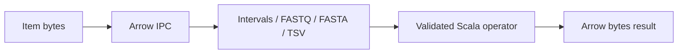
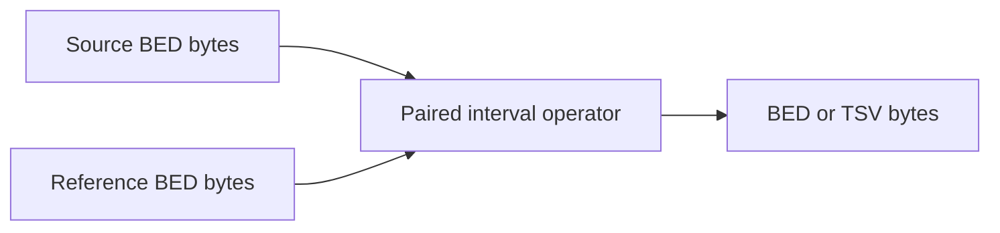

# Galaxy 流式算子适配器

[English](galaxy-operators.md)

示例仓库已公开发布 200 个不同的 Galaxy 算子，以下按主题列出 180 个扩展适配器。[目录核验](../examples/operators/galaxy/verification-public-catalog.json)记录确切的公开版本及已测试产物哈希。每个算子使用 Arrow bytes 输入（`source`，双输入适配器还有 `reference`）和 `result` bytes 输出，不要求文件系统路径或中间文件。流式接口不代表恒定内存：全流排序、反转采用有界缓冲，生物序列算子可能缓冲一条有界记录。规范化文本输出采用 LF；涉及排序时采用 JVM Unicode 字典顺序。

| 算子 | 用途 | 支持范围 |
| --- | --- | --- |
| `galaxy_reverse_lines@1.0` | 反转文本行顺序 | 仅换行分隔；最多缓存 8 MiB 字符和 100000 行；不支持自定义分隔符。 |
| `galaxy_number_lines@1.0` | 为非空文本行编号 | 支持起点、正增量、宽度及 ln/rn/rz 对齐；空行不编号，逻辑分页转义按普通文本处理。 |
| `galaxy_sort_lines@1.0` | 按指定字段稳定排序 | 仅一个完整字段作为键；支持升降序、忽略大小写和表头。数值须为有限十进制或科学计数；不提供本地化、随机或人类可读单位排序。最多缓存 8 MiB 字符及 100000 行。 |
| `galaxy_sort_fields@1.0` | 逐行排序各列 | 与上游一致，先清理行首尾空白，再按字典顺序排序制表分隔的字段。 |
| `galaxy_unique_lines@1.0` | 排序并去重 | 整行或单列为键，保留稳定代表值；支持数值和大小写选项及表头。最多缓存 8 MiB 字符和 100000 行。 |
| `galaxy_unique_consecutive@1.0` | 合并连续重复行 | 可输出次数，或仅保留重复组/单次组；只合并相邻记录，不支持跳过字段或空行分组。 |
| `galaxy_unfold_column@1.0` | 展开一列中的列表 | 非空字面分隔符；每行最多展开 10000 行、估计 16 MiB 字符。修正末列换行处理。 |
| `galaxy_replace_text_in_column@1.0` | 替换指定列的文本 | 仅字面匹配，支持忽略大小写、首次替换、跳过表头；缺失列报错。不支持正则、反向引用或程序。 |
| `galaxy_replace_text_in_line@1.0` | 替换整行文本 | 仅字面匹配，支持忽略大小写、首次替换、跳过表头；不支持正则、sed 程序或替换反向引用。 |
| `galaxy_find_and_replace@1.0` | 查找并替换文本 | 仅字面匹配，支持忽略大小写、首次替换、跳过表头；不执行 Perl、正则或命令。 |
| `galaxy_grep_lines@1.0` | 筛选包含指定文本的行 | 支持反选和忽略大小写；仅字面搜索，不提供正则、上下文行或 HTML 输出。 |
| `galaxy_arrange_columns@1.0` | 按表头重排列 | 可丢弃未选列；表头及选择列表须唯一；未知列名或不齐整的行报错。 |
| `galaxy_add_line@1.0` | 添加首行或尾行 | 字面文本；已有行统一为 LF，避免末行无换行时与尾行粘连。 |
| `galaxy_recurring_lines@1.0` | 重复生成指定文本行 | 显式指定一个重复组；读完输入但不用输入行数推导次数；输出扩展最多 16 MiB 字符。 |
| `galaxy_remove_columns_by_header@1.0` | 按表头删除或保留列 | UTF-8 TSV；可清理首列表头的前缀字符，保持原始列序；未知列名报错。 |
| `galaxy_sort_columns_by_header@1.0` | 按表头字典顺序排列列 | 可将一个从 1 开始的列固定在首位；0 表示排序全部列；表头须唯一。 |
| `galaxy_add_input_name@1.0` | 添加来源标签列 | 显式标签，不依赖文件路径；可设置表头及前置或后置。 |
| `galaxy_fixed_width_to_tabular@1.0` | 定宽文本转表格 | 仅显式字符宽度，可为空缺尾部补空格；长行或未允许补齐的短行报错。不提供自动边界检测、FORTRAN 描述符、报告或编码转换。 |
| `galaxy_colorspace_to_fasta@1.0` | SOLiD 色彩空间转核苷酸 | A/C/G/T 引导碱基，后面只能是 0–3；可保留引导碱基，支持折行。单条序列最多 8 MiB 字符。 |
| `galaxy_split_paired_reads@1.0` | 提取拼接双端 FASTQ 的一端 | 选择 mate 1 或 2；校验四行记录、标题匹配、序列及质量长度相同且为偶数。空 + 标题保持为空，使输出 FASTQ 合法，不静默截断。 |
| `galaxy_pileup_interval@1.0` | 合并满足深度的相邻 pileup 位点 | 输入坐标从 1 开始，输出为从 0 开始的左闭右开区间；可配置列以支持六列、旧十列和自定义布局。活动区间最多 8 MiB 碱基；空行跳过而不中止全流。 |
| `galaxy_divide_pg_snp@1.0` | 拆分 pgSnp 等位基因列 | 超过两个等位基因的行跳过；纯合第二等位基因为 N 或指定参考列，频率/分数补零；附加列保留。 |
| `galaxy_vcf_to_pgsnp@1.0` | VCF SNP 基因型转 pgSnp 计数 | sample_column 为 0 时选全部样本，否则须 >=10；仅处理单碱基 A/C/G/T 且 FILTER 为 PASS 或缺失的 SNP。支持 GT 任意位置、单倍体、相位、所有等位索引；缺失等位忽略。 |
| `galaxy_reverse_complement@1.0` | FASTA 反向互补 | 仅 FASTA；DNA/RNA IUPAC 字母，保持大小写，拒绝错误字符或混合 T/U；单序列最多 8 MiB 字符。 |
| `galaxy_translate@1.0` | 核苷酸 FASTA 翻译为蛋白质 | 仅标准遗传密码表 1；完整模糊密码子输出 X；末尾不足三碱基报错。CDS 要求 ATG 起始、末尾终止且无内部终止，输出去掉末端终止符。可在首个终止处停止。 |
| `galaxy_codon_count@1.0` | 汇总 64 种密码子 | 仅完整 A/C/G/T 密码子、阅读框为 0；长度须为 3 的倍数；按固定字典序输出，包括零计数。 |
| `galaxy_base_distribution@1.0` | 统计各序列碱基组成 | FASTA；GC 分母包括模糊碱基，空序列 GC 为 0。沿用上游 CG% 列名，但数值是六位小数的比例，不是百分数。 |
| `galaxy_find_subsequences@1.0` | 查找核苷酸模体 | FASTA 输入，输出 BED6 左闭右开区间；支持 IUPAC 和双链，反链使用反向互补以修正上游只互补的问题。统一包含重叠命中；每序列比较预算为序列长度×模体长度 <=64000000，每链最多 100000 命中。 |
| `galaxy_fasta_stats@1.0` | 汇总 scaffold、contig 与碱基统计 | 只输出统计 TSV，不另输出 gap BED。N 连续区段切分 contig，内部 N 段计为 gap；N50 使用 >= 阈值，修正上游严格大于的边界。最多 100000 条序列及 contig，单序列最多 8 MiB 字符；可指定 genome_size 计算 NG50。 |
| `galaxy_motif_flank_counts@1.0` | 统计 indel 两侧含模体的窗口 | 输入为奇数个制表分隔窗口，中央须为 indel。模体配置为 sequence 或 name=sequence，按不区分大小写的 DNA 字面串匹配，不支持正则。按输入行、模体次序输出以保持流式；上游为模体优先次序。 |

## 开发、验证和运行

```bash
cd examples/operators/galaxy
python3 extend-catalog.py
python3 make-catalog.py
sbt package 'Test/runMain xstream.galaxy.ExtendedSafetyCheck'
python3 verify-extended.py --only reverse_complement --report verification-reverse-complement.json
cd ../../..
xstream-engine/target/universal/stage/bin/xstream-runner examples/operators/galaxy/engine.yaml examples/operators/galaxy/jobs-extended/reverse_complement.yaml
```

Python 需安装 PyArrow 和 PyYAML，并可通过 Docker 使用配置的共享 JVM 镜像。每个 `jobs-extended/<name>.yaml` 均配有 `data/extended/<name>.txt`。完整示例包含读取输入，仓库详情页只展示当前算子的步骤。参数、默认值、完整示例及回归预期在 `extra-specs.json` 中；`extend-catalog.py` 可重新生成契约、输入与示例 Job。全流排序、反转及逐条序列处理不宣称零拷贝或完全不缓存。

## 来源与审核

已审查的原始源码、XML、样例及许可证保留在 `upstream-extended/{devteam,community,iuc}/`。`upstream-extended-manifest.json` 记录仓库地址、固定版本及 SHA-256。对于依赖可执行表达式、外部程序、重放或附加文件的上游功能，适配器只公开上表声明的子集，未支持选项会被拒绝；这些包不保证替代所有上游命令行功能。仓库仅接收源码，在 `jvm-arrow@2.1` 上构建 Scala 薄 JAR，使用分块 Arrow IPC 及结构推导/预览测试该产物后再审批。管理员可信度属于评估，不是安全保证。

## 组合并核验已发布工具

[序列流水线](../examples/operators/galaxy/job-extended-pipeline.yaml)解码 SOLiD 色彩空间序列，计算反向互补，统计序列长度并附加明确的输入标签。输出为 `seq1\t4\trun1\n`。


发布后从 XStream 项目根目录运行：

```bash
xstream-engine/target/universal/stage/bin/xstream-runner \
  examples/operators/galaxy/engine-extended.yaml \
  examples/operators/galaxy/job-extended-pipeline.yaml
python3 examples/operators/galaxy/verify-extended-jobs.py
python3 examples/operators/galaxy/audit-publication.py --url http://127.0.0.1:8820
```

[公开目录核验](../examples/operators/galaxy/verification-public-catalog.json)检查 200 个不同名称、确切版本、完整端口及参数说明、使用示例、匿名可下载的源码与产物哈希、入口类及内嵌许可声明。已记录的核验还将每个产物与其通过的仓库构建测试报告进行匹配。[扩展 Job 验证](../examples/operators/galaxy/verification-extended-jobs.json)将 180 个扩展 Job 的输出与独立指定的测试期望逐项比较。[流水线验证](../examples/operators/galaxy/verification-extended-pipeline.json)覆盖与原有 FASTA 长度算子的组合。[安全测试报告](../examples/operators/galaxy/verification-safety.json)记录四组安全测试全部通过；`ExtendedSafetyCheck` 检查 2039 个用例，包括取消、I/O 异常、非法 UTF-8、行长度限制、上游标准测试及非法生物信息输入。管理员的可信度评分不能代替这些支持范围及资源限制。

## 坐标与发布格式算子

这些算子保留文本数据，通过 Arrow bytes 流传输。平面 Circos 转换器明确拒绝含 Parent 的 GFF3 层级，不负责绘图，执行时不依赖 Python/Biopython。

| 算子 | 功能与范围 |
| --- | --- |
| `galaxy_circos_karyotype_fasta@1.0` | 从 FASTA 长度生成染色体定义；ID 唯一，最多十万条。 |
| `galaxy_circos_karyotype_lengths@1.0` | 从非引用 TSV 长度表生成染色体定义；长度为正整数。 |
| `galaxy_circos_tiles_bed@1.0` | BED3/BED6+ 转 Circos tile，保留半开区间。 |
| `galaxy_circos_text_bed@1.0` | BED6+ 转 Circos 文本，要求名称、分值及链方向。 |
| `galaxy_circos_tiles_gff3@1.0` | 平面 GFF3 转 tile，按染色体首次出现顺序和起点排序；坐标转半开区间，缓存最多 8 MiB 字符或十万行。 |
| `galaxy_circos_text_gff3@1.0` | 平面 GFF3 转文本，缺少指定属性时跳过；同样限制排序缓存。 |
| `galaxy_remove_terminal_stop_codons@1.0` | 仅标准遗传密码表 1，删除全部末端终止密码子，可选检查内部终止；U 转 T，每条序列最多 8 MiB 字符。 |
| `galaxy_windowmasker_to_bed@1.0` | WindowMasker 文本包含型区间转 BED4 半开区间，全局标签从 wm_0 起。 |
| `galaxy_count_gff_features@1.0` | 计数九列 GFF 特征行；不合并逻辑特征，格式错误失败。 |
| `galaxy_resize_coordinate_window@1.0` | 围绕中点或现有边界扩展 GFF；使用统一染色体长度参数，越界可裁剪、丢弃或报错。 |

## 区间、FASTQ、序列及表格分析

全部接口为 `source` → `result` Arrow bytes 流。FASTQ 使用四行核苷酸文本，序列与质量长度一致，加号行含标题时必须匹配；不支持色彩空间及算子内部解压。区间工具使用正长度、从零开始的半开 BED，非法行报错。读取器拒绝非法 UTF-8，每行最多 1 MiB 字符并检查取消信号；需要逐位置比较的序列算法每条序列最多六千四百万次访问。

| 算子 | 功能及支持范围 |
| --- | --- |
| `galaxy_bed_sort@1.0` | 按染色体字典序及起点稳定排序；不接受基因组顺序文件，最多十万行或 8 MiB 字符缓存。 |
| `galaxy_bed_merge@1.0` | 合并已排序的重叠或邻接区间，distance 指定最大间隔；输出 BED3，不聚合额外字段或链方向。 |
| `galaxy_bed_cluster@1.0` | 为已排序的相连区间附加从 1 开始的全局聚类编号；保留原字段，仅非链特异模式。 |
| `galaxy_bed_spacing@1.0` | 为已排序区间附加与前一区间的距离；每个染色体首条为点号，重叠为 -1，接触为 0。 |
| `galaxy_bed_slop@1.0` | 按整数距离扩展区间并裁剪至染色体边界，可按负链交换左右距离；长度由参数 chromosomes 提供。 |
| `galaxy_bed_flank@1.0` | 依次输出左、右侧翼区间，省略零长度侧翼，可按负链交换距离；长度由参数提供。 |
| `galaxy_bed_complement@1.0` | 对区间排序、合并后输出所有配置染色体上的未覆盖部分；按 chromosomes 参数顺序输出，缓存上限十万行或 8 MiB 字符。 |
| `galaxy_bed_genome_coverage@1.0` | 通过区间事件计算 bedGraph 覆盖深度，可含零覆盖；不处理 BAM/CIGAR 或 BED 分块。最多十万行、8 MiB 字符及每区间两个事件。 |
| `galaxy_interval_overlap@1.0` | 对同一行指定四个坐标列计算有符号重叠量：正数为重叠，零为接触，负数为间距；调用者负责确认染色体一致。 |
| `galaxy_expand_columns@1.0` | 同步展开多个逗号列表列；列号递增且唯一，各列表长度相同，非笛卡尔积；每行最多一万次展开、估算输出不超过 16 MiB 字符。 |
| `galaxy_group_table@1.0` | 按连续单列键分组，对一列进行 sum/mean/min/max/count/collapse/distinct；不全局排序，文本组缓存最多十万值或 8 MiB 字符。 |
| `galaxy_fastq_to_tabular@1.0` | 将 FASTQ 标题、序列及质量串转 TSV；标题中的制表符转空格，分列后不足的描述列补空，最后一列保留剩余描述。 |
| `galaxy_tabular_to_fastq@1.0` | 从指定 TSV 列生成经过验证的 Phred+33 FASTQ；非法行报错，不静默跳过。 |
| `galaxy_fastq_mask_quality@1.0` | 按阈值及 lt/le/eq/ne/ge/gt 比较选择碱基，替换为 N 或转小写；保留 Phred+33 质量串。 |
| `galaxy_fastq_filter_quality@1.0` | 按长度范围及越界质量碱基数过滤完整读段，支持零值关闭长度、质量上限；不执行自定义 Python 条件或窗口表达式。 |
| `galaxy_fastq_join_mates@1.0` | 将相邻且 ID 匹配的 /1、/2 配对读段直接连接，顺序可颠倒；不对第二个读段反向互补，未配对时报错。 |
| `galaxy_fastq_deinterlace@1.0` | 按 /1、/2 ID 匹配读段，可输出 paired1/paired2/single1/single2 中的一路；支持非相邻配对，拒绝重复 ID，缓存最多十万读段或 8 MiB 字符。 |
| `galaxy_fastq_groom@1.0` | 转换 Sanger Phred+33、Illumina Phred+64 及 Solexa 对数优势+64 质量编码，归一化加号行；按目标编码舍入裁剪，不自动修复错误标题。 |
| `galaxy_fastq_quality_stats@1.0` | 输出逐位置的质量极值、均值、线性插值四分位数及碱基计数；采用规范化 TSV 表头，不复刻上游报告列，最多一万位置及每位置 94 档质量直方图。 |
| `galaxy_seqtk_comp@1.0` | 统计 A/C/G/T、二/三/四碱基歧义码、CpG、转换及颠换类别；CpG 对两个贡献位置分别计数，支持 C/Y 与 G/R，不支持 BED 子集。 |
| `galaxy_seqtk_listhet@1.0` | 输出恰含两个等位碱基的 IUPAC 位置，采用从 1 开始的坐标，保留原字符大小写。 |
| `galaxy_seqtk_cutN@1.0` | 按 N 奖励及非 N 惩罚寻找区段，并切分 FASTA；输出名含从 1 开始的包含型端点，统一去掉前导缺口，不提供独立缺口输出。 |
| `galaxy_seqtk_randbase@1.0` | 在二碱基歧义码中可重复随机选一个碱基，保留大小写及其他歧义码；采用显式 seed 的 JVM 随机数，结果不保证与 seqtk drand48 相同。 |
| `galaxy_seqtk_sample@1.0` | 单遍定量蓄水池抽样，使用显式 JVM seed；按蓄水池顺序输出，不提供比例或双遍模式，总保留字符不超过 8 MiB。 |
| `galaxy_seqtk_subseq@1.0` | 从 FASTA 提取 regions 参数指定的 ID:start:end 半开区间；输出名用从 1 开始的包含型端点，越界报错，缺少对应 ID 时无输出。 |
| `galaxy_seqtk_seq@1.0` | 组合大小写、标题注释、最短长度、歧义序列筛选及折行；不包含质量转换、区域掩码或随机抽样。 |
| `galaxy_seqtk_hety@1.0` | 滑动窗口计算二碱基歧义比例并按窗口长度缩放；三/四碱基码不可调用，可屏蔽小写。保留 seqtk 输出边界和末尾剩余区段规则，最多六千四百万次碱基访问。 |
| `galaxy_seqtk_telo@1.0` | 匹配长度 1..31 的无歧义 DNA motif 的循环排列，按 seqtk 两端评分及反向互补规则检测端粒；输出 BED4 的第四列为序列总长，不提供评分轨迹。 |
| `galaxy_seqtk_trimfq@1.0` | 按最大质量评分片段修剪 Phred+33 FASTQ，长度不足时选质量和最大的固定窗口；非零左右裁剪距离覆盖质量模式，完全裁空的读段省略。 |
| `galaxy_seqtk_dropse@1.0` | 从相邻读段流丢弃未配对项；等长相同 ID 或去掉末尾 /数字 后相同的 ID 配对，遵循 seqtk 行为，不全局寻找配偶。 |
| `galaxy_seqtk_fqchk@1.0` | 输出逐位置及 ALL 的碱基比例、平均质量、错误质量及低/高质量比例；Q0..Q3 错误率按 0.5 处理，使用精确 -10log10 平均错误率，无上游微小平滑项。省略前言及 q=0 全档分布，最多一万位置。 |
| `galaxy_transpose_table@1.0` | 严格矩形 UTF-8 TSV 转置，保留空单元格，不使用拆分文件；最多十万行、一万列及 8 MiB 字符。 |
| `galaxy_reverse_columns@1.0` | 逐行反转 TSV 字段次序，保留空字段，允许不同列数，不反转行序。 |
| `galaxy_numeric_summary@1.0` | 对一列输出数量、和、极值、均值、中位数及总体/样本标准差；不分组，规范化 TSV 列，最多十万有限值且绝对值不超过 1e100。 |
| `galaxy_annovar_replace_na@1.0` | 按照包含表头的数值/字符串多数票及两个已知数值表头识别数值列，将其中 NA 替换为 -1；平票按数值，严格矩形，最多十万行或 8 MiB 字符。 |
| `galaxy_gff_to_bedgraph@1.0` | 将九列 GFF 从 1 开始的包含型区间转为零值 bedGraph；纠正上游 end 减 1 问题，非法记录报错。 |
| `galaxy_circos_gc_skew@1.0` | 对 FASTA 的非重叠窗口输出 (G-C)/(G+C)，分母为零时输出零；输出 bedGraph 文本而非上游 BigWig，末区间裁至序列末尾，每序列最多 8 MiB 字符。 |
| `galaxy_correlation_matrix@1.0` | 对指定列计算 Pearson 或平均秩 Spearman 相关矩阵，保留六位小数；不处理 NA 或 Kendall，常数列报错，最多十万行、16 列及 8 MiB 字符。 |
| `galaxy_circos_cytobands@1.0` | 将 BED9+ RGB 条带转 Circos band；验证 RGB 每项 0..255，直接内嵌 RGB 以形成单个完整流，不另向 stderr 输出颜色定义。 |
| `galaxy_category_totals@1.0` | 按 categories 中互不重叠的成员分配，累加各指标的正数；首行为指标名称，后续行为成员及数值，未知成员报错，最多 128 类别及 128 指标。 |

### 验证与来源

`extended-regressions.json` 包含上游黄金样例及非法输入回归。`upstream-golden-cases.json` 保存固定版本 seqtk 与 BEDTools 程序生成的参考结果；`upstream-dependencies-manifest.json` 除 Galaxy 包装器外，还记录实际 seqtk 与 Galaxy 序列工具实现的源码哈希及许可证。每个发布的 thin JAR 均由仓库构建，并在审批前通过真实分块 Arrow IPC 测试；发布审计将匿名下载与通过测试的产物哈希匹配。完整引擎 Job 报告覆盖 180 个扩展示例。



[组合流水线验证](../examples/operators/galaxy/verification-pipelines.json)还覆盖五步骤 FASTQ 质量流水线及四步骤区间覆盖度流水线，并核对期望输出。所有示例 YAML 均显式声明输入，且不包含别名。

若要复核原程序的参考输出，按 `upstream-golden-cases.json` 中的固定版本构建 seqtk 与 BEDTools，再执行：

```bash
cd examples/operators/galaxy
python3 verify-upstream-reference.py --seqtk /path/to/seqtk --bedtools /path/to/bedtools
```

## VCF 变异数据流算子

以下算子处理未压缩的 UTF-8 VCF bytes 流，输出 VCF 或 TSV bytes 流。它们独立实现明确限定的 BCFtools 功能子集，不支持 BCF、索引或任意过滤表达式。每条记录最多 1024 个样本、8 倍体，保留相位；错误数据会被拒绝。上游源码、MIT 许可证和固定版本哈希保留在 `upstream-dependencies/bcftools/`。

| 算子 | 功能 |
| --- | --- |
| `galaxy_vcf_list_samples` | 列出样本 |
| `galaxy_vcf_genotype_dosage` | 计算 GT 非参考等位基因剂量 |
| `galaxy_vcf_missing_to_ref` | 将缺失 GT 等位基因替换为参考值 |
| `galaxy_vcf_fill_allele_counts` | 重新计算 AN 和各 ALT 的 AC |
| `galaxy_vcf_variant_counts` | 统计样本、位点及变异类别 |
| `galaxy_vcf_select_samples` | 按名称选择样本 |
| `galaxy_vcf_rename_samples` | 重命名样本 |
| `galaxy_vcf_remove_annotations` | 删除指定 INFO 注释 |
| `galaxy_vcf_filter_quality` | 按 QUAL 添加软过滤标记 |
| `galaxy_vcf_set_missing_genotypes` | 将 GT 设置为缺失 |
| `galaxy_vcf_fix_ploidy` | 调整固定倍性 |
| `galaxy_vcf_genotype_table` | 输出长表形式的 GT |

剂量输出为所有非参考等位基因的总数，任一缺失等位基因产生 `.`，不同于上游插件逐 ALT 的输出。样本筛选和 GT 修改不会同步修改 INFO 计数，需要时接入 `galaxy_vcf_fill_allele_counts`。调整倍性仅处理 GT，不重映射 PL/GL。可运行示例位于 `examples/operators/galaxy/jobs-extended/vcf_*.yaml`，参数和完整适用范围见 `extra-specs.json`。

## SAM 比对数据流算子

输入为 SAM 文本 bytes 流，不要求 BAM 文件或索引。映射记录必须匹配 `@SQ` 参考字典；校验坐标、CIGAR、序列长度和质量。排序、分组和覆盖度使用有界缓存，深度输出最多一百万个位点。

| 算子 | 功能 |
| --- | --- |
| `galaxy_sam_flagstat` | 按 QC 分组统计 FLAG 类别 |
| `galaxy_sam_reference_counts` | 按参考序列统计映射/未映射记录 |
| `galaxy_sam_depth` | 计算每个位点的深度 |
| `galaxy_sam_coverage` | 汇总参考覆盖广度和平均深度 |
| `galaxy_sam_alignment_stats` | 汇总主要比对的长度及质量 |
| `galaxy_sam_sort` | 按坐标或名称排序 |
| `galaxy_sam_collate` | 按查询名称分组 |
| `galaxy_sam_to_fastq` | 按原始方向导出 FASTQ |
| `galaxy_sam_reheader` | 替换元数据并保留参考字典 |
| `galaxy_sam_calmd` | 根据显式参考重算 MD/NM |

覆盖度计算 M/=/X，忽略 D/N，过滤 FLAG 0x704，重叠的配对独立计数。FLAG 统计使用规范化 TSV；名称排序为字典序，分组保留首次出现的名称顺序。`sam_calmd` 的小型参考由参数显式提供，不访问文件，不支持 N 跳跃或 BAQ。`sam_reheader` 要求新旧参考字典完全一致。详细参数、格式、内存限制及示例见 `extra-specs.json` 和 `jobs-extended/sam_*.yaml`。原生 samtools/BCFtools 对照的输入、命令和输出保存在 `upstream-variant-alignment-cases.json`；这些原生程序仅用于测试，不是运行依赖。

## 双输入区间分析

以下算子具有 `source`（查询区间）和 `reference`（参考区间）两个 Arrow bytes 输入端口；输出为 BED 或 TSV bytes 流。区间为零起点、左闭右开且长度为正。每路执行输入最多 8 MiB bytes，解析缓存最多 8 MiB 字符及 100000 行，查询×参考最多 16000000 次比较。双输入接口不代表恒定内存，这些实现明确使用有界缓存。

| 算子 | 功能 |
| --- | --- |
| `galaxy_bed_intersect` | 输出两两相交的裁剪区间 |
| `galaxy_bed_subtract` | 从每个查询区间减去参考区间并集 |
| `galaxy_bed_window` | 输出指定邻近窗口内的查询/参考对 |
| `galaxy_bed_closest` | 输出同染色体上全部最近参考区间 |
| `galaxy_bed_coverage` | 统计重叠数及被覆盖碱基数 |
| `galaxy_bed_map` | 按重叠关系汇总参考数值列 |
| `galaxy_bed_annotate` | 附加重叠计数及覆盖比例 |
| `galaxy_bed_jaccard` | 计算区间集合的碱基 Jaccard 相似度 |

最近区间保留所有等距离候选；首尾相接的距离为 1。Jaccard 首先求各集合的区间并集，空集对空集定义为 0。`bed_map` 支持 sum、mean、min、max，缺失重叠用 `.`。这些工具不展开 BED12 块，不处理 BAM，也不应用链过滤。可运行双输入 Job 在 `jobs-extended/bed_*.yaml`，原生对照结果在 `upstream-paired-interval-cases.json`。



## 双输入序列处理

| 算子 | source / reference | 行为 |
| --- | --- | --- |
| `galaxy_seqtk_mergefa` | FASTA / FASTA | 相同顺序、ID 和长度的序列按 IUPAC 并集合并；仅两者均大写时结果大写；只输出 ID。 |
| `galaxy_seqtk_mergepe` | FASTQ / FASTQ | 按顺序交织配对，校验去除 /1、/2 后的名称和记录数；加号行规范化为 +。 |
| `galaxy_seqtk_mutfa` | FASTA / 突变 TSV | TSV 列为 ID、一基坐标、忽略列和 IUPAC 替换碱基；拒绝重复、未知 ID 和越界坐标。 |

每路执行输入最多 8 MiB bytes，解析最多 8 MiB 字符和 100000 条记录。这是明确限定的 seqtk 子集：mergefa 仅 FASTA union 模式，mergepe 仅四行 FASTQ，mutfa 不接受 FASTQ。通过 `verify-paired-reference.py --bedtools /path/to/bedtools --seqtk /path/to/seqtk` 可重放保存的双输入原生对照用例。

## 基因组区间与序列视图

| 算子 | 输入及行为 |
| --- | --- |
| `galaxy_bed12_to_bed6` | source BED12；展开为离散 BED6 块，校验块数、顺序、长度及包含关系。 |
| `galaxy_bed_extract_fasta` | source BED、reference FASTA；提取子序列，可按 BED6 负链反向互补。 |
| `galaxy_bed_mask_fasta` | source FASTA、reference BED；覆盖区间替换为 N 或小写，保留完整标题。 |
| `galaxy_bed_nucleotide_content` | source BED、reference FASTA；输出 AT/GC 比例、ACGTN/其他计数及长度。 |
| `galaxy_bed_union_bedgraph` | 两路 BED4；按共同边界分段，各列保留原值，缺失值默认 0，同一路重叠被拒绝。 |
| `galaxy_bed_multi_intersect` | 两路 BED3+；输出分段成员集合、集合数及两路存在标志；不输出两者皆空的间隙。 |

所有坐标为零起点左闭右开。每路执行输入最多 8 MiB bytes，解析缓存最多 8 MiB 字符和 100000 行或记录。FASTA ID 必须唯一，区间必须在参考长度内。组成统计分母为完整子序列长度，歧义 IUPAC 计入其他；输出无表头，比例保留六位小数。格式限制和可运行示例见各算子的契约及 `jobs-extended/`，原生 BEDTools 对照保存在 `upstream-genome-cases.json`。

## EMBOSS 序列处理

以下独立 Scala 实现参照固定版本 Galaxy `emboss_5` 包装器，输入均为 FASTA bytes 流，输出为规范化 FASTA 或 TSV bytes 流，不调用原生 EMBOSS。它们提供表中功能的明确子集；上游其他输出格式和 CLI 参数不在契约内。每条序列最多 8 MiB 字符，最多 100000 条记录。区域参数为一基闭区间，越界直接拒绝。

| 算子 | 功能 |
| --- | --- |
| `galaxy_emboss_biosed` | 替换字面序列模体 |
| `galaxy_emboss_checktrans` | 统计蛋白终止标记 |
| `galaxy_emboss_cutseq` | 删除指定区域 |
| `galaxy_emboss_degapseq` | 删除比对 gap |
| `galaxy_emboss_descseq` | 修改 FASTA 描述 |
| `galaxy_emboss_extractseq` | 按顺序拼接指定区域 |
| `galaxy_emboss_getorf` | 提取正向三框 ORF |
| `galaxy_emboss_maskseq` | 掩码指定区域 |
| `galaxy_emboss_notseq` | 按 ID 排除序列 |
| `galaxy_emboss_nthseq` | 按序号选择序列 |
| `galaxy_emboss_shuffleseq` | 可复现地打乱残基 |
| `galaxy_emboss_skipseq` | 跳过开头序列 |
| `galaxy_emboss_splitter` | 切分重叠窗口 |
| `galaxy_emboss_textsearch` | 搜索标题文本 |
| `galaxy_emboss_trimest` | 修剪精确末端 poly-A |
| `galaxy_emboss_trimseq` | 修剪末端 N |
| `galaxy_emboss_transeq` | 六框翻译 |
| `galaxy_emboss_fuzzpro` | 容许替换错配的蛋白模体搜索 |
| `galaxy_emboss_compseq` | 统计观测到的 DNA k-mer |
| `galaxy_emboss_freak` | 滑窗计算指定碱基比例 |

关键范围：getorf 仅正向、标准密码表、stop-to-stop，按阅读框顺序输出，忽略末尾不完整密码子；transeq 将三条反向框定义为反向互补序列的偏移 0/1/2，与原生 EMBOSS 的反向帧编号不同，忽略末尾不完整密码子。fuzzpro 仅字母、X 通配和替换错配，不支持 PROSITE 表达式或 indel。trimest 仅精确 3′ poly-A，trimseq 仅末端 N。compseq 仅输出实际出现的 ACGT k-mer，歧义窗口不参与分母。shuffleseq 使用明确的 JVM 种子，其随机序列不同于原生 EMBOSS；splitter 不重复输出已包含于最终完整窗口的尾部。各参数、预算和可运行示例见 `extra-specs.json` 及 `jobs-extended/emboss_*.yaml`。

原生 EMBOSS 6.6.0 对照输入、命令和输出保存在 `upstream-emboss-cases.json`，格式、ORF 顺序、反向帧与不完整密码子的差异均明确记录。原生程序仅为本地测试参考，不随算子分发。

## 蛋白性质与处理

输入为非空、标准 20 种氨基酸的 FASTA bytes 流，拒绝歧义残基、停止标记和 gap。每条序列最多 8 MiB 字符，最多 100000 条记录。属性输出为规范化 TSV；酶切和反向翻译输出 FASTA。

| 算子 | 功能 |
| --- | --- |
| `galaxy_emboss_pepstats` | 汇总蛋白质量、疏水性、电荷、pI 和消光系数 |
| `galaxy_emboss_iep` | 按默认 pKa 模型计算等电点 |
| `galaxy_emboss_charge` | 计算指定 pH 下的净电荷 |
| `galaxy_emboss_hmoment` | 计算 Eisenberg 疏水矩 |
| `galaxy_emboss_pepwindow` | 计算 Kyte-Doolittle 滑窗疏水性 |
| `galaxy_emboss_pepinfo` | 列出每个残基的质量与疏水性 |
| `galaxy_emboss_antigenic` | 计算七残基抗原倾向分数 |
| `galaxy_emboss_digest` | 按明确的胰蛋白酶规则完整酶切 |
| `galaxy_emboss_backtranseq` | 为蛋白构造确定的标准密码 DNA 编码 |
| `galaxy_emboss_oddcomp` | 查找满足组成计数阈值的蛋白窗口 |

电荷及 pI 使用 Henderson–Hasselbalch 方程，包含两端基团，pKa 为 N 端7.5、C 端3.6、C8.5、D3.9、E4.1、H6.5、K10.8、R12.5、Y10.1；pI 在 pH0–14 二分求根。`ph_x100: 700` 表示 pH7。质量为平均残基质量加18.01528 Da 的水；还原消光系数为5500×W+1490×Y。疏水性分别采用 Kyte–Doolittle 与 Eisenberg consensus 表。

`antigenic` 仅输出 Kolaskar–Tongaonkar 七残基倾向分数，不给出生物学验证的抗原位点；`digest` 仅 K/R 后切割且下一个残基不是 P 的零漏切模型；`backtranseq` 选择字典序首个标准密码子，不提供物种偏好优化；`oddcomp` 接受残基计数阈值，不读取上游的成对组成文件。详细限制和示例见契约。五组原生 EMBOSS pI 对照保存在 `upstream-protein-cases.json`，按上游四位小数精度进行容差验证。

## 双序列 DNA 比对

| 算子 | 功能 |
| --- | --- |
| `galaxy_emboss_needle` | 全局仿射缺口比对 |
| `galaxy_emboss_water` | 局部仿射缺口比对 |
| `galaxy_emboss_diffseq` | 全局比对差异块 |
| `galaxy_emboss_dottup` | 精确词匹配 |
| `galaxy_emboss_dotmatcher` | 相似窗口匹配 |
| `galaxy_emboss_wordmatch` | 最大精确子串 |
| `galaxy_emboss_merger` | 后缀前缀重叠拼接 |

每路恰好一条非空 ACGT FASTA。全局/局部比对采用 Gotoh，缺口代价 open+(长度−1)×extend，全局两端缺口计罚；动态规划最多一百万格。比对输出 FASTA 及分数、从1开始的坐标；差异输出从0开始的事件偏移。词匹配与点阵匹配输出规范化 TSV，最多十万命中，并有比较预算。merger 只接受精确正向重叠，不做含错共识。十组原生 EMBOSS 仿射分数对照保存在 `upstream-alignment-cases.json`。

## DNA 模体与密码子

| 算子 | 功能 |
| --- | --- |
| `galaxy_emboss_palindrome` | 精确反向重复 |
| `galaxy_emboss_equicktandem` | 原始单元串联重复 |
| `galaxy_emboss_fuzznuc` | 允许替换的 IUPAC 模体搜索 |
| `galaxy_emboss_fuzztran` | 六阅读框蛋白质模体搜索 |
| `galaxy_emboss_cpgreport` | CpG 总体统计 |
| `galaxy_emboss_cpgplot` | 滑动窗口 CpG 岛 |
| `galaxy_emboss_newcpgseek` | CpG 得分游走候选区 |
| `galaxy_emboss_syco` | 同义密码子熵 |
| `galaxy_emboss_wobble` | 第三密码子碱基组成 |
| `galaxy_emboss_cai` | 显式权重密码子适应指数 |

输入为非空 ACGT FASTA，单序列最多一百万碱基。搜索最多六千四百万比较、十万命中。palindrome 为精确反向互补茎，equicktandem 为精确原始周期重复；fuzznuc 仅替换，fuzztran 使用标准密码六框、忽略不完整末端密码子。CpG O/E=CpG数×长度/(C数×G数)，分母零时为零。cpgplot 合并通过阈值的完整滑动窗口；newcpgseek 的相邻 CG 加 cpg_score、其余减1、非正归零。syco 输出同义密码子 Shannon 熵；wobble 输出位置3与位置1+2的所选碱基比例；cai 取使用者显式权重的几何均值，排除终止密码子。后三者要求长度为3的倍数。这些为明确子集，不含上游全部模式语法、平滑模型或图形。

## 密码子分布比较

| 算子 | 功能 |
| --- | --- |
| `galaxy_emboss_codcmp` | 双输入密码子 Jensen–Shannon 散度 |

两路各一条 ACGT 编码序列，长度为3的倍数且各最多一百万碱基。比较含终止密码子的64维频率，输出以bit计的对称 Jensen–Shannon 散度。不是原生密码子使用文件的完整比较器。

## 统计分析

| 算子 | 功能 |
| --- | --- |
| `galaxy_linear_regression` | 多元最小二乘回归 |
| `galaxy_partial_r_square` | 逐项条件偏 R² |
| `galaxy_pca` | 协方差主成分得分 |
| `galaxy_histogram` | 等宽直方图计数 |
| `galaxy_scatterplot` | SVG 散点图 |
| `galaxy_logistic_regression` | 二分类逻辑回归 |
| `galaxy_statistical_hypothesis_testing` | 单样本双侧 Student t 检验 |

严格无表头数值 TSV，最多一万行、128列、8 MiB字符，有限数绝对值不超过1e12。缺失值报错。回归含截距，最多16个解释变量，使用重复正交化并拒绝秩亏；偏R²为逐项剔除比较。PCA 为中心化样本协方差的 Jacobi 分解，按特征值降序、最大载荷非负固定符号。逻辑回归采用标准化变量、L2正则化和阻尼 Newton，100轮未收敛报错，不输出VIF。t检验采用样本方差与不完全beta尾概率，要求正方差。直方图末箱包含上边界；散点图输出无脚本 SVG。均为规范化数值或SVG输出，不提供原生R诊断PDF及所有统计选项。

## 表连接

| 算子 | 功能 |
| --- | --- |
| `galaxy_join_files_by_id` | 按 ID 内连接、左连接或全连接 |
| `galaxy_join_files_on_column_fuzzy` | 绝对数值容差连接 |

两路无表头矩形 TSV，各最多十万行、128列、8 MiB字符；输出最多十万行及16 MiB字符。精确连接保留双方键，空缺填点，重复键展开全部匹配；全连接附加未匹配参考行。fuzzy 为数值绝对容差而非字符串编辑距离，最多一千六百万比较；最近匹配同距取参考输入首项。无ppm模式。

## DNA 插入

| 算子 | 功能 |
| --- | --- |
| `galaxy_emboss_pasteseq` | 将参考 DNA 插入主序列指定边界 |

两路各一条非空 ACGT FASTA，各最多一百万碱基。position 为源序列已消费的碱基数，0表示头部插入；越界报错。输出保留源序列标题。

## 密码子对齐

| 算子 | 功能 |
| --- | --- |
| `galaxy_emboss_tranalign` | 依据蛋白质比对投影核苷酸密码子 |

两路 ID 集合必须完全一致且唯一；源为完整标准码框1 DNA，参考为含横线缺口的蛋白质。每个非缺口残基必须与源密码子翻译一致，缺口变成三个横线。每路最多一百万总字符、一万条序列，参考蛋白质比对宽度须一致；不搜索ORF、不使用其他密码表。

## 蛋白质展示

| 算子 | 功能 |
| --- | --- |
| `galaxy_emboss_octanol` | 滑动窗口转移自由能 |
| `galaxy_emboss_pepwheel` | SVG 螺旋轮图 |

标准20残基 FASTA。octanol 使用 EMBOSS Ewhite-wimley 事实数表（带电D/E、中性H），输出完整窗口的平均octanol、interface及二者差，单位kcal/mol；每序列最多十万残基，总共十万窗口。pepwheel 仅一条1–36残基序列，输出400×400 SVG，通过angle调整螺旋角；不执行原生绘图库或嵌入输入脚本。

## 补充参考对照

`verification-variant-alignment-reference.json` 记录27组 BCFtools/SAMtools 原生对照；`verification-paired-reference.json` 记录39组 BEDTools/seqtk 双输入对照；`verification-scientific-reference.json` 记录46组基因组、EMBOSS 序列、蛋白质、比对及核苷酸原生对照。在 Galaxy 示例目录运行 `python3 verify-scientific-reference.py --bedtools /path/to/bedtools --emboss-root /path/to/emboss-prefix` 可复现后一组。原生二进制仅用于测试，不随算子打包或在算子中调用。`upstream-numerical-cases.json` 包含30组 NumPy/SciPy 独立对照，覆盖最小二乘、偏R²、PCA、逻辑回归及t检验；`generate-numerical-reference.py` 使用 NumPy/SciPy 重新生成固定种子样例。`ExtendedSafetyCheck` 验证全部规范化预期。`verification-pipelines.json` 的7条组合 Job 覆盖跨包流串联，包括双输入、基因型规范化、序列编辑、密码子投影及连接后回归。
