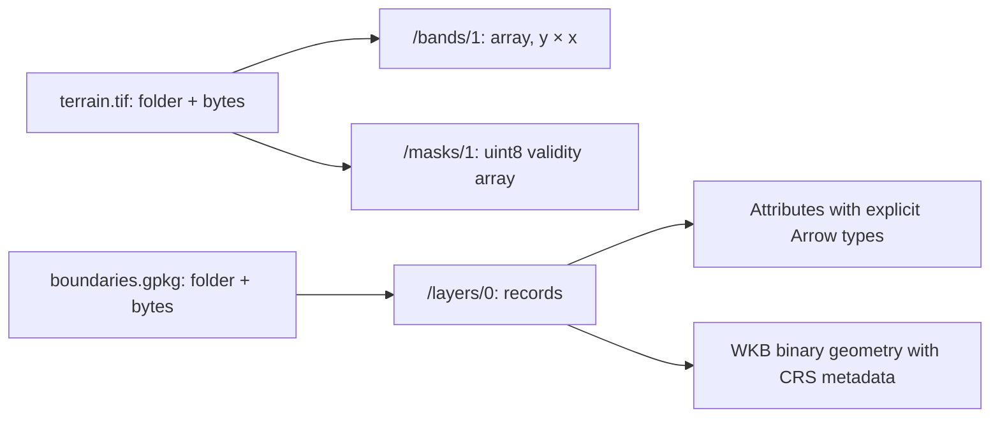

# GDAL format plugins

[中文](gdal-formats_zh.md)

The optional `xstream-data-gdal` plugin family reads single-file geospatial resources through GDAL. It uses the existing `StructuredFileHandler`, array and records contracts; it does not introduce a new View or flatten rasters into rows.

## Representation contract

The root remains a browsable folder with the original `bytes` View. Raster children `/bands/1`, `/bands/2`, etc. expose numeric two-dimensional `array` Views with dimensions `[y, x]` and original-coordinate origin/shape/stride. Values are raw, without applying scale, offset or NoData substitution. Descriptor attributes carry the GDAL driver, CRS WKT, six-element geotransform when available, pixel-coordinate convention, band description, unit, scale, offset and NoData. `/masks/1`, etc. expose uint8 validity arrays: zero is invalid and nonzero is valid. Complex bands are browsable but do not advertise an array View.

Vector children `/layers/0`, `/layers/1`, etc. expose `records` when their attributes and geometries are supported. Layer indices are zero-based; numeric paths avoid ambiguous or unsafe layer-name paths. Source layer names are retained in schema metadata. Attribute names are preserved. Integers, int64, real, string and date/time fields have explicit Arrow types; dates/times remain strings with their native type recorded. Unsupported list or other field types and duplicate/empty names cause the layer to advertise no records View, rather than silently discard fields. Geometries remain WKB binary fields tagged `ARROW:extension:name=ogc.wkb`. CRS WKT and geometry type are attached to each geometry field; layer name, driver and generated FID/geometry field names are in schema metadata. Generated field names avoid collisions with source attributes. No reprojection or geometry flattening occurs. Nulls and empty geometries remain distinct.

This is an Arrow records representation with explicit geometry metadata, not an additional geographic View or a claim of complete GeoArrow interoperability. Generic record consumers can retain binary geometry; spatial operators must understand its encoding and CRS.

## Installation and configuration

On Ubuntu/Debian install the native reader dependencies administratively; the service never installs packages automatically:

```bash
sudo apt-get install python3-gdal
cd xstream-data/xstream-data-reader-process
sbt package
cd ../xstream-data-gdal
sbt package
```

Copy the two generated JARs to the host's `plugin_directory`. The host supplies `xstream-data-core` and the standard array View support; do not copy another version of core into the plugin directory. Restart the host to discover `xstream.data.gdal.GdalRasterFormat` and `xstream.data.gdal.GdalVectorFormat` through `META-INF/services/xstream.data.FormatHandler`. No core registry or client changes are needed. Remove older versions of the same plugin before installation. All plugin JARs must match the host's Scala and XStream API versions.

The reader defaults to `/usr/bin/python3`; administrators can set `XSTREAM_GDAL_PYTHON` to a compatible Python executable with `osgeo.gdal` and `osgeo.ogr`. This is host reader configuration, not an operator Runtime or a user-submitted command. The tested native stack is GDAL 3.8.4 / Python 3.12 on Linux. Other builds require the contract tests before deployment.

```yaml
plugin_directory: /opt/xstream/plugins
datasets:
  geography:
    provider: mixed
    items:
      /terrain.tif:
        file: /srv/geography/terrain.tif
        format: gdal-raster
        options: {chunk_bytes: 65536, max_source_bytes: 1073741824}
      /boundaries.gpkg:
        file: /srv/geography/boundaries.gpkg
        format: gdal-vector
```

`gdal-raster` and `gdal-vector` select readers; they are not file formats. Original driver names remain in stream metadata. Automatic extension detection is supported for the extensions below. GeoJSON stored as `.json` needs explicit `format: gdal-vector`, because ordinary JSON already has its own handler.

| Reader | Enabled GDAL drivers | Extensions |
|---|---|---|
| gdal-raster | GTiff, PNG, JPEG, BMP, GIF, AAIGrid, USGSDEM | tif, tiff, png, jpg, jpeg, bmp, gif, asc, dem |
| gdal-vector | GPKG, GeoJSON, FlatGeobuf | gpkg, geojson, fgb |

Only installed drivers in this allowlist can open files. VRT, remote URLs, database connection strings, multi-file Shapefiles, arbitrary subdatasets and external sidecar discovery are not enabled. Keep source format handlers separate; NetCDF/HDF5/FITS use their dedicated plugins. Supported driver does not mean support for every dataset feature: verify advertised Views.

Read a band or layer with normal `item_source@1.0` parameters:

```yaml
uri: context:/geography/terrain.tif/bands/1
view: array
```

```yaml
uri: context:/geography/boundaries.gpkg/layers/0
view: records
```

## Limits, lifecycle and validation

Options are plugin-owned: `chunk_bytes` defaults to 65536 (8–16777216), `max_source_bytes` to 1073741824 (1 byte–1 TiB), `worker_timeout_seconds` to 60 (1–3600), and `worker_memory_mb` to 512 (128–16384). Unknown options and explicit column overrides are rejected. Vector batches are bounded by the row/buffer budget; a single encoded feature over 1 MiB is rejected. Metadata responses are capped at 32 MiB, with at most 1024 bands/layers. `chunk_bytes` bounds array payloads and is a target for record batches, not a promise that every variable-length feature fits that size.

Both local and remote ByteSources are copied to a private, size-limited temporary snapshot before parsing, preventing drivers from discovering adjacent source files. This costs disk space and startup I/O. No complete raster is collected in JVM memory. GDAL runs read-only in a dedicated process with an address-space limit and bounded IPC. Waits poll cancellation and enforce a response deadline. The staging directory and worker are released on access close, failure, timeout or cancellation; callers must close DatasetAccess leases. Reader stderr is discarded and public failures omit native diagnostics and private source paths. GDAL auxiliary writes, driver autoloading and PROJ network access are disabled.

A worker process is not an OS sandbox or an authorization boundary. Authorization and namespace checks remain host responsibilities; deploy native readers with least privilege and host/container resource controls. The disk cap is per access, not a global concurrent-staging quota. Predicate, projection and row-limit scans use existing Arrow scan semantics rather than native SQL.

```bash
cd xstream-data/xstream-data-gdal
sbt test
```

Tests create fixtures locally for GeoTIFF, PNG, GeoPackage, GeoJSON and FlatGeobuf; they cover georeferencing, masks, strided selections, WKB/CRS, empty layers, repeated limited scans, namespace routing, nonlocal sources, unsupported capabilities, corrupt inputs, staging limits, timeout, cancellation and cleanup. Native tests explicitly skip if Python GDAL is missing. Run them with native dependencies installed before claiming format support.

## From a geospatial file to readable Items



These are example paths within their respective root Items. Band numbering starts at 1; layer numbering starts at 0. Browsing children does not flatten raster pixels into table rows or change the source CRS.
