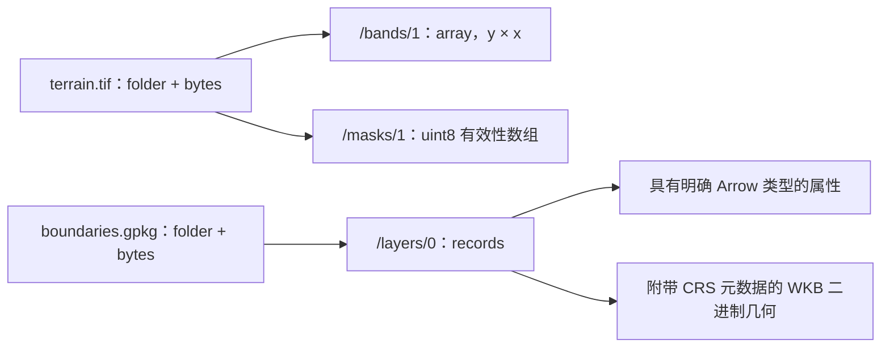

# GDAL 格式插件

[English](gdal-formats.md)

可选的 `xstream-data-gdal` 插件族通过 GDAL 读取单文件地理空间资源。它使用既有 `StructuredFileHandler`、array 和 records 契约，不增加新 View，也不把栅格隐式展平成记录。

## 数据表示契约

根项仍是可浏览的 folder，保留原始 `bytes` 视图。栅格子项 `/bands/1`、`/bands/2` 等提供数值二维 `array` 视图，维度顺序为 `[y, x]`，origin/shape/stride 对应原始坐标。值保留原始编码，不应用 scale、offset，也不替换 NoData。描述属性保留 GDAL 驱动、CRS WKT、可用时的六元素仿射变换、像素坐标约定、波段描述、单位、缩放、偏移及 NoData。`/masks/1` 等提供 uint8 有效性数组：零表示无效，非零表示有效。复数波段可以浏览，但不声明 array 视图。

矢量子项 `/layers/0`、`/layers/1` 等在属性和几何受支持时提供 `records`。图层编号从零开始，使用数字路径避免图层名歧义或不安全路径；原始图层名保留在 schema 元数据中。属性名称保持不变。整数、int64、浮点、字符串、日期和时间字段映射为明确的 Arrow 类型；日期时间保留字符串并记录原生类型。不支持的列表等字段类型以及重复或空字段名，会使图层不声明 records 视图，不会静默丢弃字段。几何保留为 WKB binary 字段，标记 `ARROW:extension:name=ogc.wkb`，每个几何字段附带 CRS WKT 和几何类型。schema 元数据记录图层名、驱动及生成的 FID/几何字段名；生成名称避开原有属性名。不进行隐式重投影或几何展平。空值与空几何保持区别。

这是具有明确几何元数据的 Arrow records 表示，不是新增地理 View，也不承诺完整 GeoArrow 互操作。普通记录消费者可保留二进制几何；空间算子应理解其编码与坐标系。

## 安装与配置

在 Ubuntu/Debian 上由管理员安装原生读取依赖，服务不会自动安装软件包：

```bash
sudo apt-get install python3-gdal
cd xstream-data/xstream-data-reader-process
sbt package
cd ../xstream-data-gdal
sbt package
```

将生成的两个 JAR 放入宿主的 `plugin_directory`。宿主提供 `xstream-data-core` 和标准 array 视图支持，不应把另一版本的 core 复制进插件目录。重启后通过 `META-INF/services/xstream.data.FormatHandler` 发现 `xstream.data.gdal.GdalRasterFormat`、`xstream.data.gdal.GdalVectorFormat`，无需修改核心注册表或客户端。安装前删除同一插件的旧版本；所有插件 JAR 须匹配宿主 Scala 和 XStream API 版本。

读取器默认使用 `/usr/bin/python3`，管理员可以通过 `XSTREAM_GDAL_PYTHON` 指定具备 `osgeo.gdal`、`osgeo.ogr` 的兼容 Python。这是宿主读取器配置，不是算子 Runtime 或用户提交的命令。已测试的原生环境为 Linux、GDAL 3.8.4 / Python 3.12，其他构建部署前应运行契约测试。

```yaml
plugin_directory: /opt/xstream/plugins
datasets:
  geography:
    provider: mixed
    items:
      /terrain.tif:
        file: /srv/geography/terrain.tif
        format: gdal-raster
        options: {chunk_bytes: 65536, max_source_bytes: 1073741824}
      /boundaries.gpkg:
        file: /srv/geography/boundaries.gpkg
        format: gdal-vector
```

`gdal-raster`、`gdal-vector` 是读取器标识，不是文件格式；真实驱动名保留在流元数据中。支持下表扩展名的自动识别；扩展名为 `.json` 的 GeoJSON 需显式指定 `format: gdal-vector`，因为普通 JSON 已有独立处理器。

| 读取器 | 开放的 GDAL 驱动 | 扩展名 |
|---|---|---|
| gdal-raster | GTiff、PNG、JPEG、BMP、GIF、AAIGrid、USGSDEM | tif、tiff、png、jpg、jpeg、bmp、gif、asc、dem |
| gdal-vector | GPKG、GeoJSON、FlatGeobuf | gpkg、geojson、fgb |

只有白名单中且已安装的驱动可以打开文件。未开放 VRT、远程 URL、数据库连接字符串、多文件 Shapefile、任意子数据集和外部伴随文件发现。NetCDF/HDF5/FITS 使用各自独立插件。支持驱动不表示支持其全部数据特性，应检查条目声明的 Views。

通过普通 `read_item@1.0` 参数读取波段或图层：

```yaml
uri: context:/geography/terrain.tif/bands/1
view: array
```

```yaml
uri: context:/geography/boundaries.gpkg/layers/0
view: records
```

## 限制、生命周期与验证

参数由插件校验：`chunk_bytes` 默认 65536（8–16777216），`max_source_bytes` 默认 1073741824（1 字节–1 TiB），`worker_timeout_seconds` 默认 60（1–3600），`worker_memory_mb` 默认 512（128–16384）。拒绝未知参数和显式列覆盖。矢量按行数及缓冲预算分批，单个编码要素超过 1 MiB 时拒绝读取。元数据响应上限 32 MiB，最多 1024 个波段/图层。`chunk_bytes` 限制数组载荷，对记录批次则是目标值，不保证每个变长要素都能放入该大小。

本地和远程 ByteSource 都复制到私有、大小受限的临时快照后解析，避免驱动发现源文件相邻文件；这会产生磁盘开销和启动 I/O。不会把整个栅格收集到 JVM 内存。GDAL 在只读专用进程中运行，限制地址空间及 IPC，等待响应时检查取消并执行超时。访问关闭、失败、超时或取消时释放工作进程和临时目录，调用方必须关闭 DatasetAccess 租约。丢弃读取器 stderr，公开错误不包含原生诊断或私有源路径。禁用 GDAL 辅助文件写入、驱动自动加载和 PROJ 联网。

专用进程不等于操作系统沙箱或授权边界；宿主仍负责授权及命名空间校验。原生读取器应以最小权限及宿主/容器资源限制运行。磁盘上限针对单次访问，不是全局并发暂存配额。谓词、投影、行数限制采用现有 Arrow 扫描语义，不执行原生 SQL。

```bash
cd xstream-data/xstream-data-gdal
sbt test
```

测试在本地生成 GeoTIFF、PNG、GeoPackage、GeoJSON、FlatGeobuf 样本，覆盖地理参考、掩码、跨步切片、WKB/CRS、空图层、重复有限扫描、命名空间路由、非本地来源、不支持能力、损坏输入、暂存上限、超时、取消及清理。缺少 Python GDAL 时原生测试明确跳过；宣称格式支持前应安装原生依赖并完成测试。

## 从地理文件到可读 Item



图中是各根 Item 下的示例路径。波段从 1 编号，图层从 0 编号。展开子项不会将栅格像素展平成表格，也不会改变源坐标参考系。
