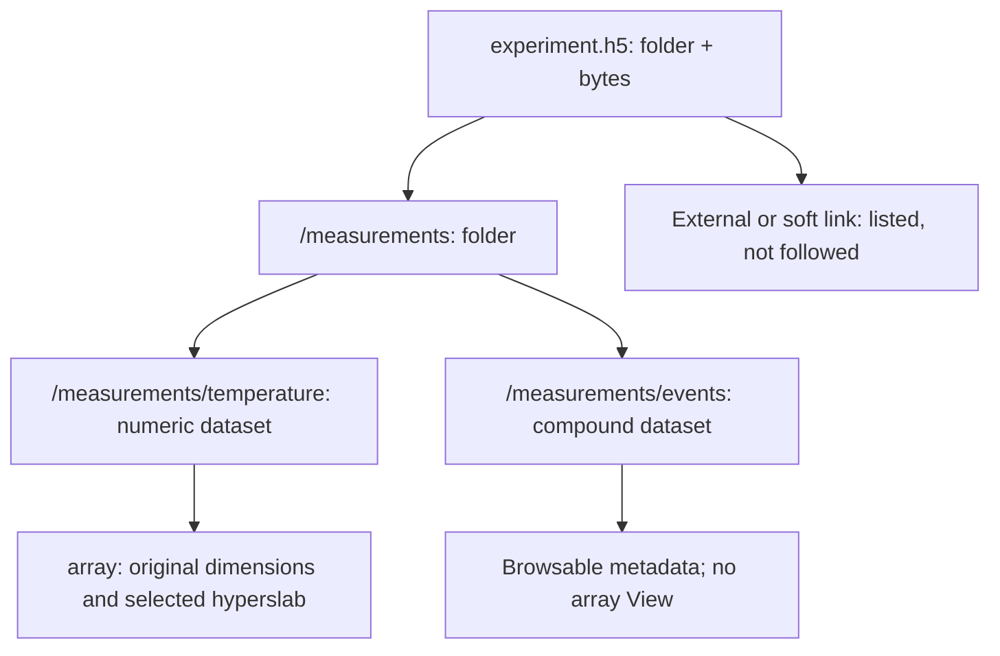

# HDF5 format plugin

[中文](hdf5-formats_zh.md)

The optional `xstream-data-hdf5` plugin preserves HDF5 groups as folder Items and datasets as data Items. The root exposes original bytes. Fixed-width signed/unsigned integers (8/16/32/64 bit) and float32/float64 datasets expose the existing `array` View with original rank, dimensions, hyperslab origin/shape/stride and raw values. Scalars have rank zero; zero-length arrays emit a descriptor without blocks. Compound, string, reference, enum, variable-length, opaque, complex and boolean datasets remain browsable without an array View. HDF5 is a file format; the plugin is independent of the multi-format GDAL library.

Descriptors retain dtype, dataset attributes, containing-group attributes, chunk layout, compression, fill value and dimension labels. Attribute values have explicit dtype and shape metadata; binary strings use Base64. Unsupported reference/compound attribute values are marked unsupported. Large attribute values are marked omitted with their storage size. Parsing limits are explicit and do not imply lossless exposure of all possible HDF5 features.

External and soft links are listed without following them. Hard-linked groups are traversed only once, avoiding cycles; aliases remain browsable entries without repeated descendants. Virtual datasets and externally stored datasets are not readable. External filter plugins are disabled. No implicit flattening, scaling, cross-file access or SWMR live-stream semantics are provided. This is a bounded read-only snapshot reader.

## Installation and configuration

```bash
sudo apt-get install python3-h5py
cd xstream-data/xstream-data-reader-process
sbt package
cd ../xstream-data-hdf5
sbt package
```

Copy the two generated JARs into `plugin_directory`, using the host's existing core and scientific array View support. Restart to discover `xstream.data.hdf5.Hdf5Format` through `META-INF/services/xstream.data.FormatHandler`. No core registry or client changes are needed; do not install duplicate plugin/core versions. Match host Scala/API versions. The service never installs native dependencies automatically. Default Python is `/usr/bin/python3`; administrators can override `XSTREAM_HDF5_PYTHON` with an interpreter providing h5py and NumPy. Tested with h5py 3.10.0 / Python 3.12 on Linux.

```yaml
plugin_directory: /opt/xstream/plugins
datasets:
  science:
    provider: mixed
    items:
      /experiment.h5:
        file: /srv/science/experiment.h5
        format: hdf5
        options: {chunk_bytes: 65536, max_source_bytes: 1073741824}
```

Extensions `.h5`, `.hdf5`, `.hdf` and an HDF5 signature at offset zero select this handler. `.hdf` does not imply HDF4 support; files with an HDF5 user block can use explicit `format: hdf5`. Dedicated `netcdf` remains responsible for `.nc`/`.nc4`; plain HDF5 is not interpreted as a NetCDF conventions model.

Read a real dataset path using ordinary `read_item@1.0` parameters:

```yaml
uri: context:/science/experiment.h5/observations/temperature
view: array
```
## Limits, lifecycle and validation

Options are plugin-owned: `chunk_bytes` defaults to 65536 (8–16777216), `max_source_bytes` to 1073741824 (1 byte–1 TiB), `worker_timeout_seconds` to 60 (1–3600), and `worker_memory_mb` to 512 (128–16384). Unknown options and explicit column overrides are rejected. Metadata responses are capped at 32 MiB, 10000 entries, nesting depth 64 and 256 attributes per object. Attribute values with storage size above 64 KiB are explicitly omitted. `chunk_bytes` bounds array payloads.

Both local and remote ByteSources are copied to a private, size-limited temporary snapshot before parsing, preventing drivers from discovering adjacent source files. This costs disk space and startup I/O. No complete dataset is collected in JVM memory. HDF5 runs read-only in a dedicated process with an address-space limit and bounded IPC. Waits poll cancellation and enforce a response deadline. The staging directory and worker are released on access close, failure, timeout or cancellation; callers must close DatasetAccess leases. Reader stderr is discarded and public failures omit native diagnostics and private source paths. External HDF5 filter loading is disabled.

A worker process is not an OS sandbox or an authorization boundary. Authorization and namespace checks remain host responsibilities; deploy native readers with least privilege and host/container resource controls. The disk cap is per access, not a global concurrent-staging quota. Array selections read the requested hyperslab directly; no SQL is executed.


```bash
cd xstream-data/xstream-data-hdf5
sbt test
```

Tests generate HDF5 fixtures locally and cover compressed big-endian arrays, strided hyperslabs, attributes, scalar uint64, empty arrays, raw bytes, unsupported types, hard-link cycles, external/soft links, virtual/external storage rejection, namespace routing, nonlocal sources, corrupt input, staging limits and cancellation. Native tests explicitly skip without h5py; install it before validating support.

## Hierarchy and capabilities



The paths illustrate one possible file layout. A readable numeric dataset keeps its dimensions; an unsupported dataset stays visible without advertising a View it cannot provide.
