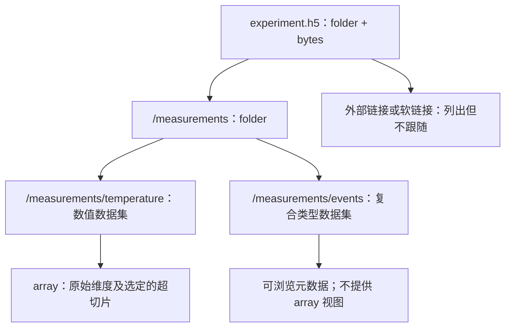

# HDF5 格式插件

[English](hdf5-formats.md)

可选的 `xstream-data-hdf5` 插件将 HDF5 group 保留为 folder Item，将 dataset 保留为数据 Item；根项提供原始 bytes。定长有符号/无符号整数（8/16/32/64 位）及 float32/float64 数据集提供已有的 `array` 视图，保留原始秩、维度、超切片 origin/shape/stride 及原始数值。标量的秩为零；零长度数组只输出描述，不输出数据块。复合、字符串、引用、枚举、变长、opaque、复数及布尔数据集仍可浏览，但不声明 array 视图。HDF5 是文件格式，其插件独立于多格式读写库 GDAL。

描述保留 dtype、数据集属性、所在 group 的属性、分块布局、压缩、填充值及维度标签。属性值附带 dtype 和 shape；二进制字符串使用 Base64。不支持的引用或复合属性值明确标记 unsupported，过大的属性值标记 omitted 并记录存储大小。解析上限明确，不承诺无损暴露 HDF5 的全部特性。

外部链接和软链接仅列出，不跟随。硬链接 group 只遍历一次以避免循环，别名保留为可浏览条目但不重复展开后代。虚拟数据集和使用外部存储的数据集不可读取。禁用外部过滤器插件。不做隐式展平、缩放、跨文件访问，也不提供 SWMR 实时流语义；本插件是有界的只读快照读取器。

## 安装与配置

```bash
sudo apt-get install python3-h5py
cd xstream-data/xstream-data-reader-process
sbt package
cd ../xstream-data-hdf5
sbt package
```

将生成的两个 JAR 放入 `plugin_directory`，使用宿主已有的 core 和科学 array 视图支持。重启后通过 `META-INF/services/xstream.data.FormatHandler` 发现 `xstream.data.hdf5.Hdf5Format`，无需修改核心注册表或客户端；不要安装重复的插件/core 版本，并匹配宿主 Scala/API 版本。服务不自动安装原生依赖。默认 Python 为 `/usr/bin/python3`，管理员可用 `XSTREAM_HDF5_PYTHON` 指向提供 h5py、NumPy 的解释器。已在 Linux、h5py 3.10.0 / Python 3.12 上测试。

```yaml
plugin_directory: /opt/xstream/plugins
datasets:
  science:
    provider: mixed
    items:
      /experiment.h5:
        file: /srv/science/experiment.h5
        format: hdf5
        options: {chunk_bytes: 65536, max_source_bytes: 1073741824}
```

扩展名 `.h5`、`.hdf5`、`.hdf` 和偏移零处的 HDF5 签名可以选择此处理器；`.hdf` 不表示支持 HDF4。含 HDF5 user block 的文件可显式指定 `format: hdf5`。`.nc`/`.nc4` 仍由独立 `netcdf` 插件负责，普通 HDF5 不会自动套用 NetCDF 约定模型。

通过普通 `item_source@1.0` 参数读取真实数据集路径：

```yaml
uri: context:/science/experiment.h5/observations/temperature
view: array
```
## 限制、生命周期与验证

参数由插件校验：`chunk_bytes` 默认 65536（8–16777216），`max_source_bytes` 默认 1073741824（1 字节–1 TiB），`worker_timeout_seconds` 默认 60（1–3600），`worker_memory_mb` 默认 512（128–16384）。拒绝未知参数和显式列覆盖。元数据响应上限 32 MiB，最多 10000 个条目、64 层嵌套，每个对象最多 256 个属性。超过 64 KiB 存储大小的属性值明确省略。`chunk_bytes` 限制数组载荷大小。

本地和远程 ByteSource 都复制到私有、大小受限的临时快照后解析，避免驱动发现源文件相邻文件；这会产生磁盘开销和启动 I/O。不会把整个数据集收集到 JVM 内存。HDF5 在只读专用进程中运行，限制地址空间及 IPC，等待响应时检查取消并执行超时。访问关闭、失败、超时或取消时释放工作进程和临时目录，调用方必须关闭 DatasetAccess 租约。丢弃读取器 stderr，公开错误不包含原生诊断或私有源路径。禁用外部 HDF5 过滤器加载。

专用进程不等于操作系统沙箱或授权边界；宿主仍负责授权及命名空间校验。原生读取器应以最小权限及宿主/容器资源限制运行。磁盘上限针对单次访问，不是全局并发暂存配额。数组切片直接读取所选超切片，不执行 SQL。


```bash
cd xstream-data/xstream-data-hdf5
sbt test
```

测试在本地生成 HDF5 文件，覆盖压缩大端数组、跨步超切片、属性、uint64 标量、空数组、原始 bytes、不支持类型、硬链接循环、外部/软链接、虚拟/外部存储拒绝、命名空间路由、非本地来源、损坏输入、暂存上限及取消。缺少 h5py 时原生测试明确跳过，应先安装再验证支持。

## 层次与读取能力



路径仅示意一种可能的文件布局。可读的数值数据集保留原始维度；不支持的数据集仍可见，但不会声明无法提供的视图。
