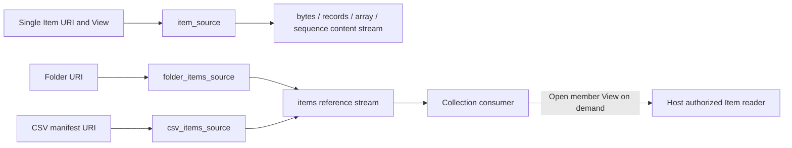

# Item reference streams

[中文](items-stream_zh.md)

`items` is a stream representation alongside `bytes`, `records`, `array` and `sequence`. It transports resource references, not resource contents. Jobs remain static DAGs; collection iteration and aggregation happen inside operators.



## Contract

The Arrow schema contains `uri`, `name`, `kind`, `format`, `views` (JSON array or null when unknown), and `metadata` (JSON object). No credentials or executable objects are transported. Ordering and duplicates are preserved. A collection is consumed incrementally, without an implicit Map or Set conversion. References do not grant access and do not promise snapshot or repeatable reads.

`folder_items_source` enumerates a folder, optionally recursively. `csv_items_source` reads a CSV URI column; each row becomes one reference and other columns are retained as metadata. Relative paths resolve against the manifest's logical parent, never the container working directory. Multiple URI columns are not implicitly paired or expanded.

## Lazy access

The JVM SDK exposes `ctx.input("source").foreachItem` and callback-scoped `ctx.openItem(item, view, selection)`. The engine opens the requested view only when called. Access uses the host's existing authorized Item reader, keeping credentials in the host. Containers remain network-isolated. Open streams close after the callback, including failures and cancellation. A reference may become unavailable between enumeration and access; opening fails rather than silently skipping it.

The execution host supplies a per-step Unix-domain socket in the private input directory. Each bounded JSON request selects a URI, view and selection; the response is a status, one standard Arrow IPC stream, and a final JSON completion message. The host ends, closes and flushes the Arrow writer, releases its Item reader, and only then acknowledges completion. Closing the writer does not close the shared socket. Consumers use the same buffered input for Arrow and the completion message so socket short reads cannot truncate IPC metadata. Arrow EOS without the final completion message is a failed read. Socket and open readers are closed with the step. This service permits Item access only; it does not expose arbitrary host paths or submit Jobs.

## Example

```yaml
steps:
  - id: list
    operator: folder_items_source@1.0
    inputs: {}
    params: {uri: 'context:/science/labels', recursive: true}
  - id: analyze
    operator: item_inventory@1.0
    inputs: {source: 'list:result'}
    params: {}
  - id: receive
    operator: client_sink@1.0
    inputs: {result: 'analyze:result'}
```

Sources are published operators, not implicit engine registrations. See the [source implementations](../examples/operators/item-sources/README.md) and [operator SDK](../xstream-operator-sdk/README.md). Existing content operators retain their input contracts; an `items` port cannot connect directly to a `records`-only port. There is no implicit per-member invocation, concatenation or Job-level map/reduce.

## Single Items and Item collections

`item_source(uri, view, sql, selection)` opens the selected View of one Item and emits its content stream directly, without first emitting a reference. Folder and CSV collection Sources emit `items` references whose members are opened on demand by downstream collection operators. There is no separate view-selection step or implicit per-member execution.

In a remote collection, `context:/dataset/item` refers to the service that supplied that collection. Fully qualified remote URIs retain their identity; relative paths resolve against the manifest’s logical directory.
