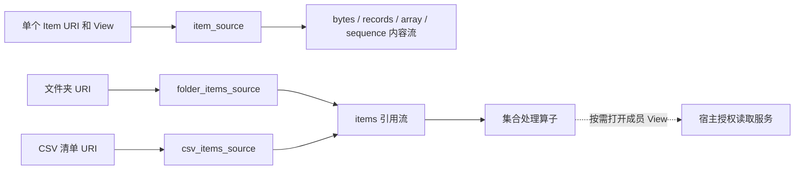

# Item 引用流

[English](items-stream.md)

`items` 与 `bytes`、`records`、`array`、`sequence` 是并列的流表示。它传递资源引用，不传递资源内容。Job 保持静态 DAG；集合遍历与汇总发生在算子内部。



## 契约

Arrow schema 包含 `uri`、`name`、`kind`、`format`、`views`（JSON 数组，未知时为空值）和 `metadata`（JSON 对象）。不传递凭据或可执行对象。保留顺序与重复项，增量消费集合，不隐式转成 Map 或 Set。引用不授予访问权限，也不保证快照或重复读取的一致性。

`folder_items_source` 列举目录，可选择递归。`csv_items_source` 读取 CSV 的 URI 列，每行生成一个引用，其他列保留为元数据。相对路径以清单所在的逻辑父目录为基准，不使用容器工作目录。多个 URI 列不会被隐式配对或展开。

## 延迟读取

JVM SDK 提供 `ctx.input("source").foreachItem` 和限定在回调内使用的 `ctx.openItem(item, view, selection)`。仅调用读取时才打开指定 View。访问沿用宿主已有的授权 Item 读取接口，凭据保留在宿主，容器保持网络隔离。回调结束、异常或取消时关闭读取资源。列举后资源可能变化或不可用；读取失败会报错，不静默跳过。

执行宿主在私有输入目录提供每步骤独立的 Unix 域套接字。每个有大小限制的 JSON 请求指定 URI、视图与选择参数；响应为状态及标准 Arrow IPC 流。步骤结束时关闭套接字与读取器。该服务只支持 Item 访问，不开放任意宿主文件路径，也不提交 Job。

## 示例

```yaml
steps:
  - id: list
    operator: folder_items_source@1.0
    inputs: {}
    params: {uri: 'context:/science/labels', recursive: true}
  - id: analyze
    operator: item_inventory@1.0
    inputs: {source: 'list:result'}
    params: {}
  - id: receive
    operator: client_sink@1.0
    inputs: {result: 'analyze:result'}
```

Source 是发布的算子，不是引擎隐式注册项。见 [Source 实现](../examples/operators/item-sources/README_zh.md)和[算子 SDK](../xstream-operator-sdk/README_zh.md)。已有内容算子保留输入契约；`items` 不能直接连到仅接收 `records` 的端口。不隐式逐成员调用、拼接内容，也不增加 Job 层 map/reduce。

## 单 Item 与 Item 集合

`item_source(uri, view, sql, selection)` 直接打开单个 Item 的指定 View，输出该 View 的内容流，不先输出引用。文件夹与 CSV 集合 Source 输出 `items` 引用流，由下游集合算子按需打开成员。没有单独的视图选择步骤，也没有隐式的逐成员执行。

远程集合中的 `context:/dataset/item` 指向提供该集合的远程服务。完整的远程 URI 保留其地址；相对路径以清单所在逻辑目录为基准。
