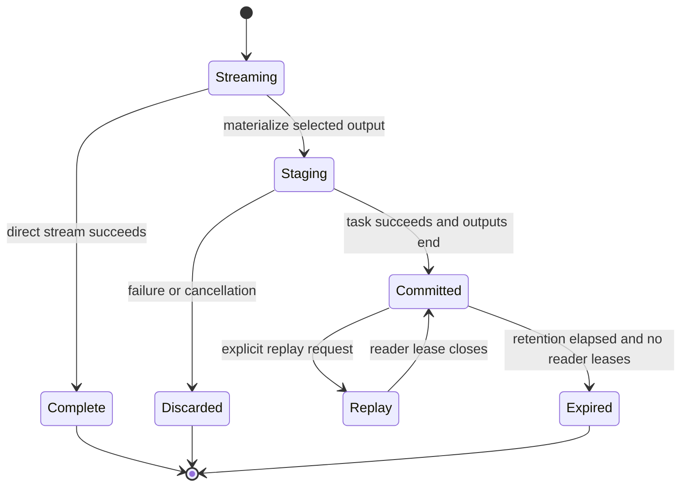

# Execution policies, materialization and replay

[中文](materialization_zh.md)

The Job defines the stream graph. A separate policy YAML controls output retention, retry count and overall timeout. Direct streaming is the default; the engine never automatically materializes an edge.

```yaml
max_retries: 2
timeout_seconds: 300
materialization:
  allowed: true
  default: stream
  steps:
    filter:
      outputs:
        result: materialize
```

`max_retries` accepts 0–10 (default 0). `timeout_seconds` accepts 1–86400 and cannot exceed the host limit. `materialization.default` is `stream` or `materialize`; per-step output settings override it. Only connected output ports are selectable. Set `materialization: {allowed: false, default: stream}` to prohibit engine-managed stream retention. This does not prohibit input files, operator scratch files, logs or execution history.

## Host storage

Configure the runner or embedding host:

```yaml
materialization_store:
  provider: file
  settings:
    directory: .xstream-materialized
    max_bytes: 1073741824
    max_task_bytes: 268435456
    retention_seconds: 86400
```

The standard distribution includes `xstream-plugin-execution-file`. Each storage directory has one writer host. A step commits its selected Arrow IPC File segments atomically after successful execution and valid output termination; failures discard uncommitted data. Manifests retain schema, dictionaries, batch boundaries, lengths and checksums. Leases protect active readers from retention cleanup. Missing configuration, quota exhaustion, corruption and expiration fail explicitly. Materialization creates no Dataset and does not checkpoint internal operator state.

`directory` is required; quota and retention defaults are shown above and must be positive integers. `max_bytes` covers the directory and `max_task_bytes` covers one step’s selected outputs, including Arrow files and manifest overhead. Startup removes uncommitted temporary directories; append or quota failures prevent commit. Expired content cannot receive new leases, while existing leases protect files from deletion. Commit requires operator success, fully consumed inputs and complete selected outputs; downstream failure does not delete committed upstream output.

## Submit and consume

```bash
xstream-runner engine.yaml job.yaml variables.yaml policy.yaml
```

Use `{}` in `variables.yaml` when no variables are needed. Embedding applications pass the parsed policy to `JobEngine.run`. Execution history records submitted/effective policy and attempts. A retry starts a new attempt; consumers must discard partial output from a failed attempt before accepting retry output. Cancellation and the overall deadline apply across all attempts. Retry can repeat external side effects, so operators with such effects require idempotency.

## Replay

Embedding applications request replay through `JobEngine.execute` with a source execution ID, its original parsed Job/policy, the same owner and a new execution record. The source execution must be terminated. Only complete, unexpired outputs matching the step signature and owner are reusable. Every connected output of a reused step must be materialized. The engine prunes upstream work when its output can be supplied from committed streams; other steps run again. Replay produces a new execution and is not byte-offset resume, process restoration or exactly-once execution. The standalone launcher accepts policy files but does not expose a replay command.

Storage implementations use `MaterializationStoreProvider` and ServiceLoader. See [plugins](plugins.md) and the [execution API](../xstream-execution-api/README.md).

## Commit and replay lifecycle

Only committed output is replayable. Failure before commit never publishes a reusable artifact.



## Storage plugin contract

Public contracts live in `xstream-execution-api`: `MaterializationStoreProvider`, `MaterializationStore`, `MaterializationWriter`, `MaterializedTask`, and `MaterializedFrames`. Register an external provider class through `META-INF/services/xstream.execution.MaterializationStoreProvider`, install its JAR and dependencies in the node `plugin_directory`, and configure `provider` to its `id`. No core registry edits are needed.

Plugins own private configuration, quotas, expiration, atomic step commit, durability, leases, and read integrity. Core owns authorization, policy validation, frame protocol, cancellation, and execution resources. `append(port, OperatorFrame)` accepts typed frames; replay returns `MaterializedFrames`. Frame headers are bounded by 64 KiB and payloads by 8 MiB. Plugins must not buffer a whole step. The file plugin stores an initial zero-row Arrow File segment and independent data segments, with ordered names, sizes and checksums in a manifest. A failed append prevents commit. Closing an uncommitted writer must abort it, `get` may expose committed artifacts only, and expired artifacts cannot receive new leases. Cleanup must preserve existing leases. New implementations should test discovery, commit/abort, restart reads, quota, expiration/leases, truncation/corruption, and close cleanup. See `MaterializationSpec` for executable contract examples.

## Container temporary space and memory

Execution policy accepts a per-execution-unit resource request (MiB):

```yaml
resources:
  tmp_size_mb: 2048
  memory_mb: 4096
```

Defaults are 512 MiB for `/tmp` and 1024 MiB total container memory. `/tmp` remains a private, non-executable tmpfs; its actual usage counts toward container memory. `tmp_size_mb` must be strictly less than `memory_mb`; leave enough memory for the program and Arrow buffers. Increasing its capacity does not preallocate that memory or guarantee aggregate host capacity. Separate processes each receive this limit; fused steps share one limit for their execution unit. Host-side format-reader staging and the native executable-copy `/operator-work` tmpfs are separate and unaffected. No disk-backed workspace or disk quota is implied.

The request applies to local, fused, retry/replay, and Union-dispatched execution. The effective policy includes resolved defaults. Unknown keys, non-integers, and values outside the accepted ranges fail before execution. `tmp_size_mb` accepts 1–1048576 and `memory_mb` 128–1048576, subject to the host caps below. Reaching tmpfs capacity normally fails the program's write; reaching total memory can cause an OOM termination.

Administrators set node/standalone-engine startup limits:

```yaml
execution_resources:
  max_tmp_size_mb: 8192
  max_memory_mb: 16384
```

These are the default per-container request ceilings, not host reservations or global quotas. Minimum administrator ceilings are 512 and 1024 MiB respectively, preserving default requests; each ceiling is at most 1048576 MiB. Members validate requests during Union preparation before execution starts; an excessive request fails rather than silently shrinking. Jobs cannot select host paths or add mounts. Choose limits and task concurrency to fit the actual machine.
