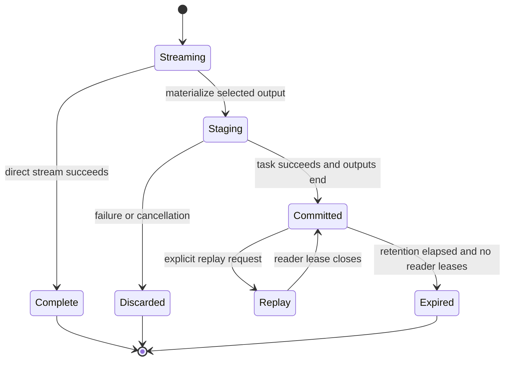

# Execution policies, materialization and replay

[中文](materialization_zh.md)

The Job defines the stream graph. A separate policy YAML controls output retention, retry count and overall timeout. Direct streaming is the default; the engine never automatically materializes an edge.

```yaml
max_retries: 2
timeout_seconds: 300
materialization:
  allowed: true
  default: stream
  steps:
    filter:
      outputs:
        result: materialize
```

`max_retries` accepts 0–10 (default 0). `timeout_seconds` accepts 1–86400 and cannot exceed the host limit. `materialization.default` is `stream` or `materialize`; per-step output settings override it. Only connected output ports are selectable. Set `materialization: {allowed: false, default: stream}` to prohibit engine-managed stream retention. This does not prohibit input files, operator scratch files, logs or execution history.

## Host storage

Configure the runner or embedding host:

```yaml
materialization_store:
  provider: file
  settings:
    directory: .xstream-materialized
    max_bytes: 1073741824
    max_task_bytes: 268435456
    retention_seconds: 86400
```

The standard distribution includes `xstream-plugin-execution-file`. Each storage directory has one writer host. A task commits its selected Arrow IPC File segments atomically after successful execution and valid output termination; failures discard uncommitted data. Manifests retain schema, dictionaries, batch boundaries, lengths and checksums. Leases protect active readers from retention cleanup. Missing configuration, quota exhaustion, corruption and expiration fail explicitly. Materialization creates no Dataset and does not checkpoint internal operator state.

## Submit and consume

```bash
xstream-runner engine.yaml job.yaml variables.yaml policy.yaml
```

Use `{}` in `variables.yaml` when no variables are needed. Embedding applications pass the parsed policy to `JobEngine.run`. Execution history records submitted/effective policy and attempts. A retry starts a new attempt; consumers must discard partial output from a failed attempt before accepting retry output. Cancellation and the overall deadline apply across all attempts. Retry can repeat external side effects, so operators with such effects require idempotency.

## Replay

Embedding applications request replay through `JobEngine.execute` with a source execution ID, its original parsed Job/policy, the same owner and a new execution record. The source execution must be terminated. Only complete, unexpired outputs matching the task signature and owner are reusable. Every connected output of a reused step must be materialized. The engine prunes upstream work when its output can be supplied from committed streams; other steps run again. Replay produces a new execution and is not byte-offset resume, process restoration or exactly-once execution. The standalone launcher accepts policy files but does not expose a replay command.

Storage implementations use `MaterializationStoreProvider` and ServiceLoader. See [plugins](plugins.md) and the [execution API](../xstream-execution-api/README.md).

## Commit and replay lifecycle

Only committed output is replayable. Failure before commit never publishes a reusable artifact.


