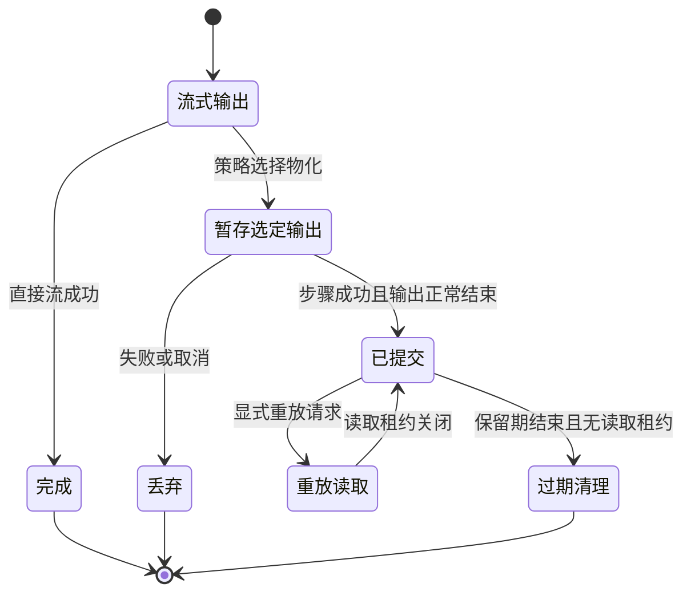

# 执行策略、物化与重放

[English](materialization.md)

Job 定义流图，单独的策略 YAML 控制输出保留、重试次数和总超时。默认直接流式传递，引擎不会自动物化某条边。

```yaml
max_retries: 2
timeout_seconds: 300
materialization:
  allowed: true
  default: stream
  tasks:
    filter:
      outputs:
        result: materialize
```

`max_retries` 范围为 0–10，默认 0。`timeout_seconds` 范围为 1–86400，不能超过宿主上限。`materialization.default` 为 `stream` 或 `materialize`，步骤输出配置覆盖默认值，只能选择已连接的输出端口。设置 `materialization: {allowed: false, default: stream}` 可禁止引擎保留结果流，但不禁止输入文件、算子临时文件、日志和执行历史。

## 宿主存储

在 Runner 或嵌入宿主中配置：

```yaml
materialization_store:
  provider: file
  settings:
    directory: .xstream-materialized
    max_bytes: 1073741824
    max_task_bytes: 268435456
    retention_seconds: 86400
```

标准发行包包含 `xstream-plugin-execution-file`。每个存储目录只由一个宿主写入。步骤成功执行且输出正常结束后，其选定 Arrow IPC File 分段才原子提交；失败会丢弃未提交数据。清单保留 schema、字典、批次边界、长度和校验值。租约保护正在读取的内容不被过期清理。缺少配置、配额耗尽、内容损坏和过期均明确失败。物化不生成 Dataset，也不保存算子内部状态。

## 提交与消费

```bash
xstream-runner engine.yaml job.yaml variables.yaml policy.yaml
```

不需要变量时，`variables.yaml` 填写 `{}`。嵌入应用把解析后的策略传给 `JobEngine.run`。执行历史记录提交策略、有效策略和尝试。重试创建新的尝试；消费者必须丢弃失败尝试的部分输出后再接受重试结果。取消和总超时覆盖所有尝试。重试可能重复外部副作用，因此有副作用的算子需要幂等设计。

## 重放

嵌入应用通过 `JobEngine.execute` 请求重放，传入源执行 ID、原始解析后的 Job/策略、相同所有者和新的执行记录。源执行必须已结束。只有完整、未过期且匹配步骤签名及所有者的输出可以复用。复用步骤的每个已连接输出都必须物化。引擎使用已提交的流供给下游时会裁剪不需要的上游工作，其他步骤重新执行。重放生成新执行，不是字节偏移续传、进程恢复或恰好一次执行。独立启动器接受策略文件，但不提供重放命令。

存储实现使用 `MaterializationStoreProvider` 和 ServiceLoader。参见[插件](plugins_zh.md)和[执行 API](../xstream-execution-api/README_zh.md)。

## 提交与重放生命周期

只有已提交的输出可以重放，提交前失败不会产生可复用制品。


