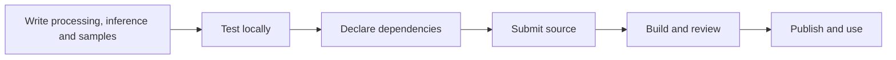

# Write, submit and use an operator

[中文](operator-authoring_zh.md)

XStream operators run in the standalone engine or DACP nodes. The repository accepts source and third-party binary submissions with wrapper source, scans and builds in isolation, and publishes after administrator approval. Executor support for a package does not imply that public submission accepts that prebuilt package directly. Administrators assign categories and the final trust score.



Every repository submission also includes human-readable port descriptions, parameter descriptions/help/examples and a complete copyable Job in `documentation`. See [required usage documentation](operator-submission.md#required-usage-documentation). The repository validates these fields before accepting a new submission.

## Four independent choices

| Choice | Values | What it answers |
|---|---|---|
| Graph `role` | `source`, `transform`, `sink` | Where the step gets input and sends output |
| Integration `type` | `sdk`, `command`, `script` | Whether the implementation uses the SDK, wraps a command, or runs a script |
| `executor` | `jvm`, `python`, `command`, `container` | Which installed launcher runs the operator in its Runtime |
| Definition location | Repository, local library, or Job `operators` | How the definition is distributed and selected |

`source` has no input ports and produces a stream; `transform` consumes and produces streams; `sink` consumes a stream and has no output port. The repository operator `item_source@1.0` is a Source and `client_sink@1.0` is the caller-facing Sink. Source, Transform and Sink are graph roles, so each may use a suitable implementation type. In a Job, a step uses a published `name@version`, a [local library](local-operators.md), or an [inline definition](inline-operators.md). Inline definitions are for local Jobs; remote nodes accept only publicly approved operators. The [Scala Source and Sink examples](../examples/operators/scala-endpoints/README.md) show complete code and publication.


## Choose among four executors

`executor` controls how an operator starts; the Runtime supplies its environment. All four executors run inside Docker containers.

| executor | What the developer supplies | Suitable workloads | Inference and samples |
|---|---|---|---|
| `jvm` | Scala/Java implementation, main class and build declarations; execution artifact is a JAR | New operators, JVM libraries, typed stream processing | SDK methods or templates |
| `python` | Python implementation and dependency declarations; execution artifacts include `.py`, `.zip` and `.whl` | Scientific computing and Python libraries | SDK methods or templates |
| `command` | Program, runtime and stdin/stdout mapping configuration | Existing command-line tools and binaries | Configuration infers bytes output; the generic adapter does not execute programs for samples |
| `container` | Image with its own entrypoint implementing the operator protocol | Custom languages or complete runtime stacks | Entrypoint implements the protocol |

Develop in this order: define ports and parameters → choose Runtime/executor → write implementation or adapter configuration → verify processing, inference, samples and cancellation → submit through a supported repository review workflow. The Scala/Python examples below show business code; the command/container examples show execution definitions, not repository source-submission manifests.

## Preferred language: Scala

**Scala is the preferred language for new XStream operators.** Start with the JVM SDK templates and keep processing, structure inference and bounded samples in the same operator implementation. Java uses the same JVM contracts; Python, scripts and native commands remain supported for existing code and language-specific libraries.

Scala expresses typed stream transformations and shares JVM interfaces and libraries with the engine. Use `BytesOperator`, `ByteStreamOperator` and `RecordsOperator` templates to keep protocol and resource-management details out of business logic. Match dependencies, Scala and JDK versions to the selected runtime.

Using the same language does not automatically provide zero-copy transfer or in-process execution. Fusion still depends on dependency compatibility, operator capabilities and execution policy. See [operator fusion](operator-fusion.md) and [dependency environments](dependency-environments.md).

## Choose an interface and runtime

Every operator declares two independent attributes. `role` is `source` (no inputs), `transform` (inputs and outputs), or `sink` (inputs and no outputs). `type` is `sdk`, `command`, or `script`, describing how the program is integrated. These attributes also appear as overlays on the operator ICON in the repository; they do not change the original artwork. The repository operator `item_source@1.0` starts an Item stream, and `client_sink@1.0` explicitly returns a stream to the caller.

Select an actually registered runtime and version at `/runtimes`. Execution and build dependencies must match; JVM environments provide the XStream SDK and Scala build environments also provide the Scala compiler. Keep business code in the small operator package and dependencies in the shared runtime.

Scala and Java implement `Operator` or use the JVM `BytesOperator`, `ByteStreamOperator` and `RecordsOperator` templates. Python offers `BytesOperator` and `RecordsOperator`. Templates supply schema and bounded-sample inference; override the relevant method when changing the output structure. Low-level implementations must provide processing, structure inference and output samples.

## jvm: Scala / Java

Save this as `src/example/Identity.scala`. It transfers an `InputStream` to an `OutputStream` without buffering the whole Item. Submit with `language: scala`, `entrypoint: example.Identity` and a registered JVM runtime. Java can implement the same JVM SDK `Operator` interface.

```scala
package example

import java.io.{InputStream, OutputStream}
import com.fasterxml.jackson.databind.JsonNode
import xstream.operator.ByteStreamOperator

object Identity extends ByteStreamOperator {
  override def transform(input: InputStream, output: OutputStream,
                         params: JsonNode): Unit = {
    input.transferTo(output)
  }
}
```

## python: Python SDK

Install the SDK and save this as `src/upper_ascii.py`. Input `abc\n` produces `ABC\n`; `uppercase: false` preserves the input. This example handles ASCII: byte chunks do not guarantee UTF-8 character or business-record boundaries.

```bash
python -m pip install ./xstream-operator-sdk/python
```

```python
from xstream_operator import BytesOperator

class UpperAscii(BytesOperator):
    def transform(self, chunk, params):
        return chunk.upper() if params.get('uppercase', True) else chunk

if __name__ == '__main__':
    UpperAscii().main()
```

## command: reuse a command-line program

Programs that read bytes from stdin and write bytes to stdout can use the framework adapter without implementing basic stream framing. This execution-definition fragment converts input to uppercase:

```yaml
executor: command
entrypoint: /usr/bin/tr
executor_config:
  args: [a-z, A-Z]
  stdin: source
  stdout: {port: result, representation: bytes, format: text}
inputs:
  source: {representations: [bytes], formats: []}
```

Include the fragment in a complete execution definition with name, version, image, icon and parameter contract. The image must actually provide `/usr/bin/tr`, Python and PyArrow; execution does not install them. Input `abc` should produce `ABC`. Reserve stdout for results and stderr for diagnostics.

Currently at most one bytes input and one bytes output are supported; sources and sinks can respectively set `stdin: null` or `stdout: null`. `args` contains fixed literal strings, without Job parameter substitution or shell interpretation. Records conversion, filename arguments, multiple inputs/outputs, dynamic parameters and special formats require a custom wrapper. The framework infers structure from stdout configuration but does not run arbitrary commands for samples; provide a dedicated adapter when samples are required. See [native commands](native-commands.md) for complete configuration, separate executable mounting and cancellation.

**Publication boundary:** a generic execution adapter is not a configuration-only binary upload API. Current repository third-party binary submissions require wrapper source; do not pass this fragment directly to `submit`. For public publication, prepare wrapper source and provenance using the [binary-wrapper submission workflow](dependency-environments.md).

## container: provide the entrypoint in the image

The image ENTRYPOINT is the operator program. Use `executor: container` without `entrypoint` or `artifact`; `executor_config` is not accepted. For example, add a Scala operator to a base image supplying the SDK, JDK and dependencies:

```dockerfile
FROM example/jvm-arrow:1
COPY operator.jar /opt/operator/operator.jar
ENTRYPOINT ["/opt/java/bin/java", "--add-opens=java.base/java.nio=ALL-UNNAMED", "-Dio.netty.tryReflectionSetAccessible=true", "-cp", "/opt/operator/operator.jar:/opt/lib/*:/opt/xstream/jars/*", "example.Identity"]
```

The base image is a placeholder: replace it with an image actually supplying the dependencies. The entrypoint can use the Scala SDK implementation above; a Docker image does not automatically turn an arbitrary program into an operator.

The entrypoint must handle framework processing and inference requests, read input channels and parameters under `/input`, and return valid output and bounded samples. SDKs handle protocol details; custom languages must implement the corresponding protocol. Reserve stdout for protocol and stderr for logs. The image must tolerate a read-only root filesystem, disabled networking and bounded temporary space. See [packaging](operator-packaging.md), [structure inference](structure-inference.md) and [stream contracts](operator-streams.md).

Local or administrator-managed execution definitions can use these images. Public developer submission still follows the supported source or binary-wrapper review workflow; `executor: container` does not authorize direct arbitrary-image uploads.

## Verify and publish

For all approaches, verify empty and multi-batch inputs, output structures, parameter changes, failure exits, cancellation and resource cleanup. SDK implementations must also verify sample budgets; see above for the generic command sample limitation. Run test Jobs with the local operator library and ensure target machines provide compatible Runtimes, executor plugins and dependencies. Compatible `jvm`/`python` steps can fuse; matching dependencies do not automatically fuse commands into one process.

```bash
xstream-operator check ./my-operator
xstream-operator build ./my-operator --config ./engine.yaml
xstream-operator submit ./my-operator \
  --url https://repo.example.org --token-file ./publisher.token
```

These commands apply to directories following the source-project convention, not as a replacement for image execution-definition validation. Building requires a configured local build environment. Submission requires a repository-issued token, and public downloads require approval. See [dependency environments](dependency-environments.md) for dependencies and binary submissions, and [local operators](local-operators.md) for test Jobs.

## Inputs, parameters and outputs

`inputs` declares named inputs, each with one concrete representation or `variable`; `outputs` declares named outputs with a single `view`. `parameters` declares JSON parameter types, defaults and constraints. Implement `inferOutputs`/`infer_outputs` to describe structures for the declared outputs. See [port Views](operator-ports.md). Parameter values come from Job `params`, such as `uppercase: true`, rather than the input data stream.

Record templates process Arrow RecordBatch/VectorSchemaRoot tables with field types intact; implement `output_schema`/`outputSchema` when changing fields. General contexts provide `ctx.input(name)`, `ctx.records_output`/`ctx.recordsOutput` and byte equivalents. Fully consume multiple inputs one at a time in lexical port-name order; declare all outputs before writing data.

See the complete [split_orders](../examples/operators/python/split_orders/1.0/split_orders.py) example: `left` and `right` accept `id:int64, amount:float64`, then route rows into `accepted` and `rejected` using `min_amount`. Job bindings such as `left: step_a:result` and `right: step_b:result` reference upstream outputs; omitted ports use the default. Sources have `inputs: {}`; operators without outputs are also allowed.

## Prepare a source submission

The manifest below publishes the Scala `Identity` implementation above. Use a directory containing `submission.yaml`, `src/example/Identity.scala` and `LICENSE.txt`. Choose an available Scala-capable repository Runtime, such as `jvm-arrow@2.1`, and declare the actual source license. Python and Java use the same submission and review workflow; see the [source submission guide](operator-submission.md).

```yaml
name: scala_identity
version: '1.0'
role: transform
type: sdk
description: Stream bytes unchanged
language: scala
entrypoint: example.Identity
runtime: jvm-arrow@2.1
source_public: true
icon:
  path: M4 19L12 5l8 14M7 14h10
inputs:
  source:
    representations:
    - bytes
    formats: []
parameters:
  type: object
  properties: {}
  required: []
  additionalProperties: false
provenance:
  license: Apache-2.0
  license_file: LICENSE.txt
outputs:
  result:
    view: variable
```
Source archives cannot contain prebuilt JARs, wheels, executables, nested archives or symlinks. Package from the operator project, then run the helper from the XStream checkout:

```bash
python -m zipfile -c sources.zip src
xstream-operator submit /path/to/submission.yaml \
  --source /path/to/sources.zip --url https://operators.example.org \
  --token-file /secure/submitter.token
```
The repository administrator issues the Token. Submission returns a submission ID, not a published operator. Administrators inspect source, scan and build results, select categories and a trust score, then approve public download. `source_public` controls public source visibility; administrators can always inspect source. See [source submission and review](operator-submission.md) for APIs, isolation and review details.

## Use in a Job

```yaml
name: Stream observations
steps:
- id: read
  operator: item_source@1.0
  inputs: {}
  params:
    uri: context:/science/observations.csv
    view: bytes
- id: identity
  operator: scala_identity@1.0
  inputs:
    source: read
- id: client_sink
  operator: client_sink@1.0
  inputs:
    result: identity
```

Replace the URI with an actual Item in the execution catalog. `context:` uses the bound catalog; a remote URI specifies its DACP address explicitly. Standalone execution uses `xstream-runner CONFIG.yaml JOB.yaml [VARIABLES.yaml] [POLICY.yaml]`.

## Startup arguments and protocol boundaries

An equivalent JVM launcher call is `/opt/java/bin/java -cp '/operator/operator.jar:/opt/lib/*:/opt/xstream/jars/*' example.Identity operator /input /input/params.json`: `operator` is the processing mode, `/input` holds the generated input manifest and stream channels, and `/input/params.json` contains the parameter object. Use the SDK to manage stream channels.

stdout is reserved for the stream protocol; logs go to stderr. Consume inputs through EOS; successful completion emits end events and errors must not claim success. Byte output is chunked; record batches must fit protocol limits, and samples have additional row/byte budgets. Do not collect an entire stream in memory or create persistent files for ordinary intermediate steps.

Further reading: [SDK](../xstream-operator-sdk/README.md) · [Parameters](operator-parameters.md) · [Structure inference](structure-inference.md) · [Stream protocol](operator-streams.md)

## Local development

The standalone engine supports source-directory references, reusable builds and direct source submission; see [local operator libraries](local-operators.md). `LocalOperatorBuilder` is an implemented build extension point with built-in `python` and `command` providers registered through ServiceLoader.

## Development topic reference

| Goal | Examples and reference |
|---|---|
| Set up development tools | [CLI](../xstream-operator-sdk/cli/README.md), [local operators](local-operators.md) |
| Choose dependencies and reduce package size | [Dependency environments](dependency-environments.md), [packaging reference](operator-packaging.md), [runtimes](operator-runtimes.md) |
| Define ports and streams | [Stream contract](operator-streams.md), [SDK](../xstream-operator-sdk/README.md) |
| Supply parameters, structures and samples | [Parameter types](operator-parameters.md), [structure inference](structure-inference.md) |
| Use scripts or third-party programs | [Script examples](../examples/operators/scripts/README.md), [native commands](native-commands.md) |
| Prepare public publication | [Submission](operator-submission.md), [provenance](operator-provenance.md), [icons](operator-presentation.md) |

## Job-local (inline) operators

For local development, put a definition in the Job's top-level `operators` mapping and reference it from a step with `operator: {inline: name}`. Choose `sdk` for an SDK program, `command` for a third-party executable, or `script` for embedded source or a local script file. Configure its container runtime in the engine's `inline_runtimes`.

[Write an inline operator: runtime configuration, SDK entrypoints, command arguments, script source and a complete runnable Job](inline-operators.md).

Inline definitions are only accepted for local execution. To submit the Job to a remote node or Union, publish the custom operators and use approved repository references.

## Item collection inputs

`items` is a peer representation to bytes, records and array. See [Item reference streams](items-stream.md), [complete Source and Transform examples](../examples/operators/item-sources/README.md), and [FAQ 10](faq.md#10-how-does-a-custom-operator-process-an-items-reference-stream).

## Sink publication

Sink operators implement `process`, `onComplete` and `onDiscard`. See the [complete staged Sink contract and examples](sink-lifecycle.md).
