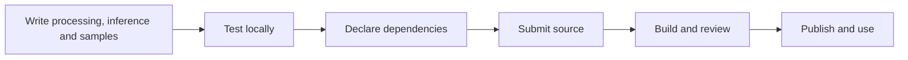

# Write, submit and use an operator

[中文](operator-authoring_zh.md)

XStream operators run in the standalone engine or DACP nodes. Developers submit source only; the repository scans, builds in isolation and publishes after administrator approval. Administrators assign categories and the final trust score.



## Preferred language: Scala

**Scala is the preferred language for new XStream operators.** Start with the JVM SDK templates and keep processing, structure inference and bounded samples in the same operator implementation. Java uses the same JVM contracts; Python, scripts and native commands remain supported for existing code and language-specific libraries.

Scala expresses typed stream transformations and shares JVM interfaces and libraries with the engine. Use `BytesOperator`, `ByteStreamOperator` and `RecordsOperator` templates to keep protocol and resource-management details out of business logic. Match dependencies, Scala and JDK versions to the selected runtime.

Using the same language does not automatically provide zero-copy transfer or in-process execution. Fusion still depends on dependency compatibility, operator capabilities and execution policy. See [operator fusion](operator-fusion.md) and [dependency environments](dependency-environments.md).

## Choose an interface and runtime

Select an actually registered runtime and version at `/runtimes`. Execution and build dependencies must match; JVM environments provide the XStream SDK and Scala build environments also provide the Scala compiler. Keep business code in the small operator package and dependencies in the shared runtime.

Scala and Java implement `Operator` or use the JVM `BytesOperator`, `ByteStreamOperator` and `RecordsOperator` templates. Python offers `BytesOperator` and `RecordsOperator`. Templates supply schema and bounded-sample inference; override the relevant method when changing the output structure. Low-level implementations must provide processing, structure inference and output samples.

## Scala

Save this as `src/example/Identity.scala`. It transfers an `InputStream` to an `OutputStream` without buffering the whole Item. Submit with `language: scala`, `entrypoint: example.Identity` and a registered JVM runtime. Java can implement the same JVM SDK `Operator` interface.

```scala
package example

import java.io.{InputStream, OutputStream}
import com.fasterxml.jackson.databind.JsonNode
import xstream.operator.ByteStreamOperator

object Identity extends ByteStreamOperator {
  override def transform(input: InputStream, output: OutputStream,
                         params: JsonNode): Unit = {
    input.transferTo(output)
  }
}
```

## Python

Install the SDK and save this as `src/upper_ascii.py`. Input `abc\n` produces `ABC\n`; `uppercase: false` preserves the input. This example handles ASCII: byte chunks do not guarantee UTF-8 character or business-record boundaries.

```bash
python -m pip install ./xstream-operator-sdk/python
```

```python
from xstream_operator import BytesOperator

class UpperAscii(BytesOperator):
    def transform(self, chunk, params):
        return chunk.upper() if params.get('uppercase', True) else chunk

if __name__ == '__main__':
    UpperAscii().main()
```

## Inputs, parameters and outputs

`inputs` declares named input ports and representations; `parameters` declares JSON parameter types, defaults and constraints. Implement `inferOutputs`/`infer_outputs` to return output ports and structures. Parameter values come from Job `params`, such as `uppercase: true`, rather than the input data stream.

Record templates process Arrow RecordBatch/VectorSchemaRoot tables with field types intact; implement `output_schema`/`outputSchema` when changing fields. General contexts provide `ctx.input(name)`, `ctx.records_output`/`ctx.recordsOutput` and byte equivalents. Fully consume multiple inputs one at a time in lexical port-name order; declare all outputs before writing data.

See the complete [split_orders](../examples/operators/python/split_orders/1.0/split_orders.py) example: `left` and `right` accept `id:int64, amount:float64`, then route rows into `accepted` and `rejected` using `min_amount`. Job bindings such as `left: step_a:result` and `right: step_b:result` reference upstream outputs; omitted ports use the default. Sources have `inputs: {}`; operators without outputs are also allowed.

## Prepare a source submission

The manifest below publishes the Scala `Identity` implementation above. Use a directory containing `submission.yaml`, `src/example/Identity.scala` and `LICENSE.txt`. Choose an available Scala-capable repository Runtime, such as `jvm-arrow@2.1`, and declare the actual source license. Python and Java use the same submission and review workflow; see the [source submission guide](operator-submission.md).

```yaml
name: scala_identity
version: '1.0'
description: Stream bytes unchanged
language: scala
entrypoint: example.Identity
runtime: jvm-arrow@2.1
source_public: true
icon:
  path: M4 19L12 5l8 14M7 14h10
  color: '#14866b'
inputs:
  source:
    representations: [bytes]
    formats: []
parameters:
  type: object
  properties: {}
  required: []
  additionalProperties: false
provenance:
  license: Apache-2.0
  license_file: LICENSE.txt
```
Source archives cannot contain prebuilt JARs, wheels, executables, nested archives or symlinks. Package from the operator project, then run the helper from the XStream checkout:

```bash
python -m zipfile -c sources.zip src
xstream-operator submit /path/to/submission.yaml \
  --source /path/to/sources.zip --url https://operators.example.org \
  --token-file /secure/submitter.token
```
The repository administrator issues the Token. Submission returns a submission ID, not a published operator. Administrators inspect source, scan and build results, select categories and a trust score, then approve public download. `source_public` controls public source visibility; administrators can always inspect source. See [source submission and review](operator-submission.md) for APIs, isolation and review details.

## Use in a Job

```yaml
name: Stream observations
steps:
- id: read
  operator: read_item@1.0
  inputs: {}
  params:
    uri: context:/science/observations.csv
    view: bytes
- id: identity
  operator: scala_identity@1.0
  inputs:
    source: read
outputs:
  result: identity
```

Replace the URI with an actual Item in the execution catalog. `context:` uses the bound catalog; a remote URI specifies its DACP address explicitly. Standalone execution uses `xstream-runner CONFIG.yaml JOB.yaml [VARIABLES.yaml] [POLICY.yaml]`.

## Startup arguments and protocol boundaries

An equivalent JVM launcher call is `/opt/java/bin/java -cp '/operator/operator.jar:/opt/lib/*:/opt/xstream/jars/*' example.Identity operator /input /input/params.json`: `operator` is the processing mode, `/input` holds the generated input manifest and stream channels, and `/input/params.json` contains the parameter object. Use the SDK to manage stream channels.

stdout is reserved for the stream protocol; logs go to stderr. Consume inputs through EOS; successful completion emits end events and errors must not claim success. Byte output is chunked; record batches must fit protocol limits, and samples have additional row/byte budgets. Do not collect an entire stream in memory or create persistent files for ordinary intermediate steps.

Further reading: [SDK](../xstream-operator-sdk/README.md) · [Parameters](operator-parameters.md) · [Structure inference](structure-inference.md) · [Stream protocol](operator-streams.md)

## Local development

The standalone engine supports source-directory references, reusable builds and direct source submission; see [local operator libraries](local-operators.md). `LocalOperatorBuilder` is an implemented build extension point with built-in `python` and `command` providers registered through ServiceLoader.

## Development topic reference

| Goal | Examples and reference |
|---|---|
| Set up development tools | [CLI](../xstream-operator-sdk/cli/README.md), [local operators](local-operators.md) |
| Choose dependencies and reduce package size | [Dependency environments](dependency-environments.md), [packaging reference](operator-packaging.md), [runtimes](operator-runtimes.md) |
| Define ports and streams | [Stream contract](operator-streams.md), [SDK](../xstream-operator-sdk/README.md) |
| Supply parameters, structures and samples | [Parameter types](operator-parameters.md), [structure inference](structure-inference.md) |
| Use scripts or third-party programs | [Script examples](../examples/operators/scripts/README.md), [native commands](native-commands.md) |
| Prepare public publication | [Submission](operator-submission.md), [provenance](operator-provenance.md), [icons](operator-presentation.md) |
