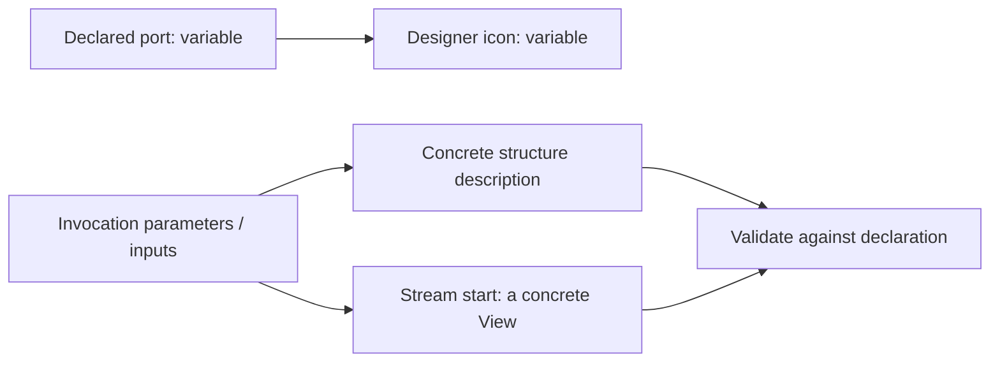

# Operator port Views

[中文](operator-ports_zh.md)

Every operator declares its port names and a single View type for each port. Concrete types include `bytes`, `records`, `items`, `array` and `sequence`; plugins can provide further View types. Declare `variable` when the operator cannot fix the View in its public interface.

```yaml
role: transform
inputs:
  source: {representations: [records], formats: []}
outputs:
  result: {view: records, description: Filtered records}
```

An input's `representations` list contains exactly one concrete View or `variable`. An output's `view` is one string, never a list. Sources declare `inputs: {}` and nonempty outputs; Sinks declare nonempty inputs and `outputs: {}`. Transforms declare both. These declarations apply to repository, local and inline operators.

## Variable interfaces and concrete streams

```yaml
role: transform
inputs:
  source: {representations: [variable], formats: []}
outputs:
  result:
    view: variable
    view_from: {input: source}
```

A variable output can optionally select its invocation's concrete View from an input, as above, or from a declared string parameter:

```yaml
role: source
inputs: {}
outputs:
  result: {view: variable, view_from: {parameter: view}}
parameters:
  type: object
  properties:
    view: {type: string, enum: [bytes, records], default: bytes}
  required: []
  additionalProperties: false
```

Omit `view_from` when the concrete View is determined only when the operator opens its output stream. Parameter/input selectors must resolve before generic execution; authoring can retain an unresolved selector. Catalog Item sources use the selected Item's advertised View when selection is automatic.

The public interface remains **variable** after a parameter is selected, schema inference completes, or a stream is opened. The concrete stream uses a supported concrete View in its `start` frame and retains that View until `end`; `variable` is not a wire representation.

## Structure inference

`inferOutputs` / `infer_outputs` describes invocation-specific formats, record schemas, scientific structures and bounded samples for the declared output ports. It cannot add, remove or rename ports, or contradict a fixed View or resolved selector. An unresolved variable output can report an empty representation set with unknown certainty. A fixed `records` port can have an unknown schema while remaining a records port.



Designer shows small View icons with accessible names and hover descriptions. Different fixed types cannot be connected; matching types or a variable type at either end can connect. Inference and execution check concrete compatibility. Unavailable declaration metadata must load before creating a connection.
