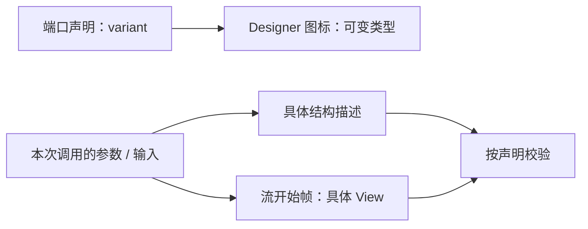

# 算子端口 View

[English](operator-ports.md)

每个算子声明其端口名称，并为每个端口声明单个 View 类型。具体类型包括 `bytes`、`records`、`items`、`array`、`sequence`，插件可以提供更多 View 类型。公共接口无法固定类型时，声明为 `variant`（可变类型）。

```yaml
role: transform
inputs:
  source: {representations: [records], formats: []}
outputs:
  result: {view: records, description: Filtered records}
```

输入的 `representations` 列表只能包含一个具体 View 或 `variant`。输出的 `view` 是单个字符串，不能使用列表。Source 声明 `inputs: {}` 和非空输出；Sink 声明非空输入和 `outputs: {}`；Transform 同时声明输入和输出。仓库算子、本地算子及 inline 算子均遵循此契约。

## 可变接口与具体数据流

```yaml
role: transform
inputs:
  source: {representations: [variant], formats: []}
outputs:
  result:
    view: variant
    view_from: {input: source}
```

可变输出可以选择从输入确定本次调用的具体 View，如上例；也可以通过已声明的字符串参数确定：

```yaml
role: source
inputs: {}
outputs:
  result: {view: variant, view_from: {parameter: view}}
parameters:
  type: object
  properties:
    view: {type: string, enum: [bytes, records], default: bytes}
  required: []
  additionalProperties: false
```

如果直到打开输出流时才能确定具体 View，可以省略 `view_from`。通用执行路径要求参数或输入选择器在执行前可解析，设计阶段则可保留未解析状态。目录 Item Source 自动选择视图时，采用所选 Item 实际发布的 View。

选择参数、完成 schema 推导或打开数据流后，公共接口仍为**可变类型**。实际数据流的 `start` 帧必须指定受支持的具体 View，并保持到 `end`；`variant` 不是线上传输的数据表示。

## 结构推导

`inferOutputs` / `infer_outputs` 为已声明的输出端口描述本次调用的格式、记录 schema、科学数据结构及有界样例。它不能新增、删除或重命名端口，也不能与固定 View 或已解析的选择器冲突。尚未解析的可变输出可以返回空的表示集合和未知确定性。固定为 `records` 的端口即使 schema 未知，也仍是 records 类型。



Designer 使用小型 View 图标，提供无障碍名称及悬停说明。bytes 使用 `[01]` 二进制符号，variant 使用紫色菱形加实心中心点。不同固定类型不能连接；同类型或任一端为可变类型时可以连接，具体兼容性在推导和执行时校验。端口声明元数据不可用时，需等待加载完成再创建连线。
