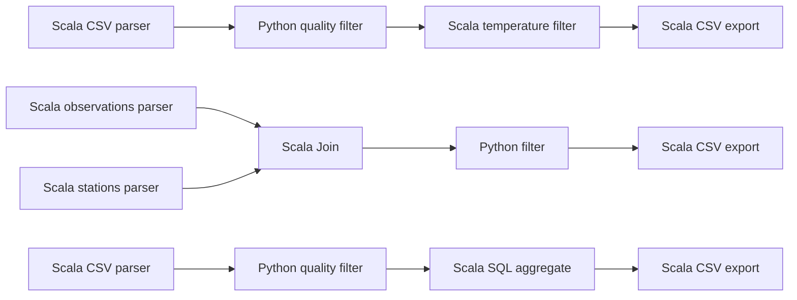
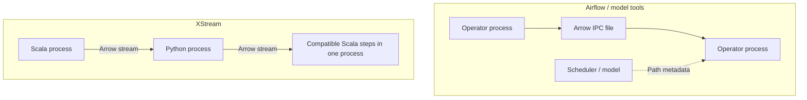
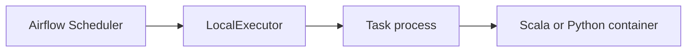
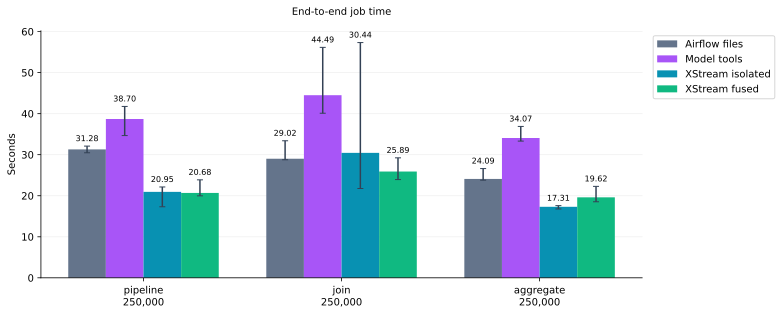
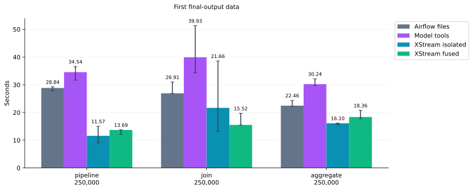
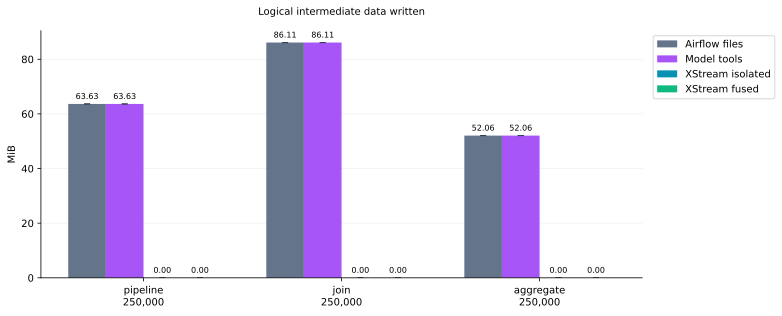
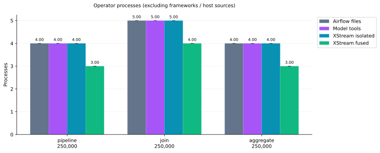
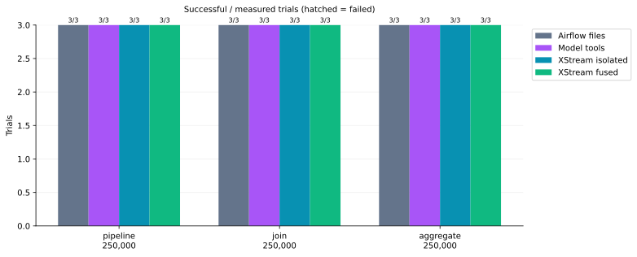
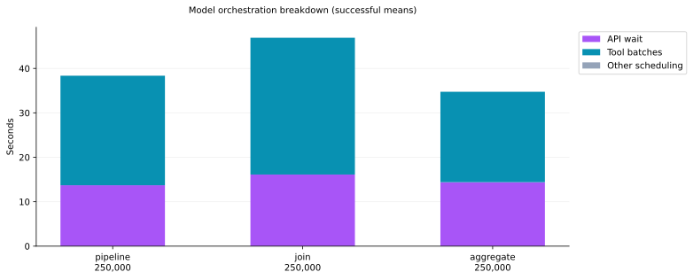

# Measured file, model-tool and streaming orchestration

2026-11-05T12:48:46Z

Four configurations are interleaved in one test batch: Airflow file handoffs, LangGraph model-tool orchestration, XStream isolated-process streaming and XStream fused-process streaming. There are 48 executions including warmups, with 0 failures. Workloads are CSV filtering, two-table Join and grouped aggregation. Each combination has 1 warmups and 3 measured repetitions.

Every method uses the same Scala/Python operators, runtime images and deterministic meteorological observations. An independent Python implementation validates final SHA-256, length and row count. Failed trials are excluded from medians and retained in raw records.

## Workloads and execution mechanisms

Each chain is one workload; Scala/Python boundaries retain separate processes.

The Scheduler decides when steps are ready. LocalExecutor executes tasks in local processes; each benchmark task launches its operator container.

## Measured figures

Bars show successful measured medians; whiskers span minimum to maximum, not confidence intervals. Completion counts show failures separately. The additive model breakdown uses means.

Airflow uses a real standalone scheduler and LocalExecutor with a local SQLite test database. XCom carries path metadata; tasks hand data over through Arrow IPC files. This is not dag.test().

Scala operators use version 2.0; Python piflow_filter uses version 1.2. Runtime image and dependency hashes are in the raw records.

## Model configuration and timing

Airflow parallelism is 8; Scheduler heartbeat is 1 second; DAG refresh and minimum processing intervals are 5 seconds. The controller polls completion every 0.2 seconds; scheduling and polling waits are timed. Framework services stay running throughout the batch.

- Model: `gpt-6.1-sol`; provider: `cliproxyapi`; API: `responses`; reasoning: `low`.
- [Airflow LocalExecutor](https://airflow.apache.org/docs/apache-airflow/stable/core-concepts/executor/local.html) · [Airflow XCom](https://airflow.apache.org/docs/apache-airflow/stable/core-concepts/xcoms.html)
- LangGraph 1.2.20; Airflow 3.3.2; PyArrow 26.0.1.

Model settings are read from local Codex configuration without copying credentials, request headers or service URLs. Only model/provider names and reasoning effort are recorded. The configured model is preserved.

The model selects ready steps through Responses function calls and supplies upstream result handles. LangGraph executes real tool calls and returns result handles. Independent calls may run concurrently. Data payloads never enter model context. The fixed DAG and operator parameters match the other methods: this measures execution orchestration, not natural-language workflow-generation quality.

Model tools and Airflow share the same Arrow-file executor. Timing includes API/network/reasoning waits, the LangGraph loop, container startup, computation and the final DONE response. No simulated calls, cached plan or hardcoded next-step fallback replaces the model. API retries are disabled; the response limit is 12.

Input generation, operator/image retrieval and framework startup are excluded. OS caches remain warm. Methods are randomly interleaved with a recorded seed. Each operator container has 1 GiB memory and 128 PIDs. The shared virtual host has 16 logical CPUs and approximately 31.3 GiB RAM.

## Wall time

Seconds, median of successful measured samples.

| Workload | Input rows | Airflow files | Model tools | XStream isolated | XStream fused |
|---|---:|---:|---:|---:|---:|
| pipeline | 250,000 | 31.284 | 38.702 | 20.948 | 20.679 |
| join | 250,000 | 29.016 | 44.494 | 30.443 | 25.890 |
| aggregate | 250,000 | 24.095 | 34.072 | 17.309 | 19.616 |

## Relative time and execution units

Speedup is the Airflow-file median / the corresponding XStream median; greater than 1 means XStream was faster in this batch.

| Workload | Rows | Isolated stream speedup | Fused stream speedup |
|---|---:|---:|---:|
| pipeline | 250,000 | 1.49× | 1.51× |
| join | 250,000 | 0.95× | 1.12× |
| aggregate | 250,000 | 1.39× | 1.23× |

Operator process counts come from actual execution-unit records, excluding framework processes and host read_item sources. Fusion respects language and locked dependency environments.

| Workload | Steps sharing an execution unit | Runtime |
|---|---|---|
| pipeline (250,000) | `warm`, `export` | jvm |
| join (250,000) | `stations`, `combine` | jvm |
| aggregate (250,000) | `stats`, `export` | jvm |

## Model completion and variability

| Workload | Rows | Successful/measured | Successful range s | Failed wall times s |
|---|---:|---:|---:|---:|
| pipeline | 250,000 | 3/3 | 34.653–41.759 | — |
| join | 250,000 | 3/3 | 40.094–56.150 | — |
| aggregate | 250,000 | 3/3 | 33.312–36.884 | — |

## Model overhead and usage

| Workload | Rows | API wait s | Tool batches s | Responses | Input tokens | Output tokens | Total tokens |
|---|---:|---:|---:|---:|---:|---:|---:|
| pipeline | 250,000 | 14.458 | 24.164 | 5 | 3604 | 106 | 3710 |
| join | 250,000 | 16.213 | 27.950 | 5 | 4045 | 148 | 4193 |
| aggregate | 250,000 | 14.322 | 20.478 | 5 | 3734 | 106 | 3840 |

## Time to first final-output data

| Workload | Rows | Airflow s | Model tools s | Isolated s | Fused s |
|---|---:|---:|---:|---:|---:|
| pipeline | 250,000 | 28.844 | 34.544 | 11.574 | 13.687 |
| join | 250,000 | 26.914 | 39.935 | 21.662 | 15.524 |
| aggregate | 250,000 | 22.460 | 30.237 | 16.102 | 18.360 |

## Interpretation and limits

- Model orchestration can interpret dynamic requests and choose tools. Here the DAG is known: the measurement is online scheduling cost, not planning quality.
- API latency depends on network, provider load and model. Provider prompt caching may occur; cached tokens are recorded in raw data. Token usage is not pricing; no fee is inferred. Token columns are independent medians and need not sum to the median total.
- Airflow does not require file handoffs. These are concrete configurations; the file executor uses Python/PyArrow while XStream uses JVM protocols. This is not a transport-only ablation.
- XStream forbids materialization and has no materialization store, so steps do not exchange data files. Metadata and runtime code may still be written. SQL/Join use in-memory tables.
- fsync is disabled. Logical file sizes are not physical disk I/O. Strong durability, recovery, cross-node transport and peak resource usage are not tested.
- Three measured repetitions on a shared host only support the reported measurements. Raw records retain per-trial times, tool call order, token details and content hashes.

## Reproduction

- [Programs, dependencies, configuration resolution and commands](../benchmarks/orchestration/README.md)
- [All raw records](benchmarks/orchestration-with-llm-20261105.json)
