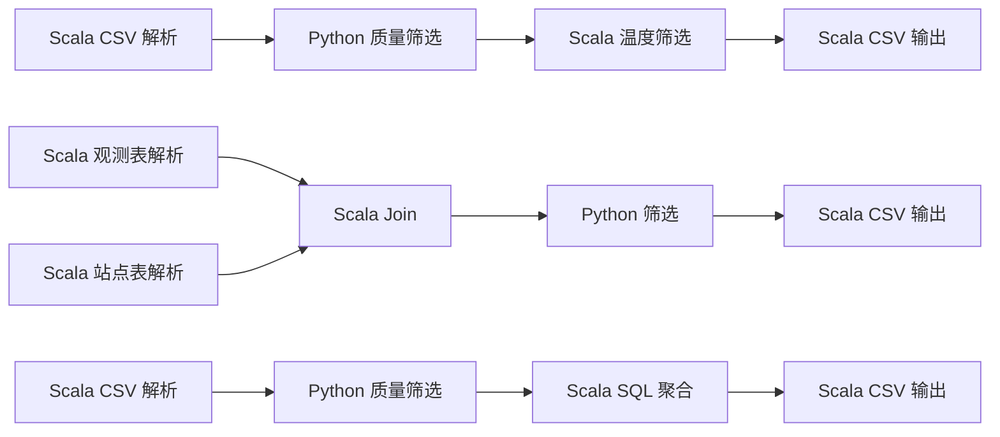
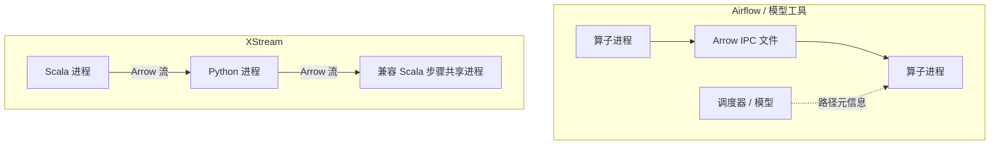
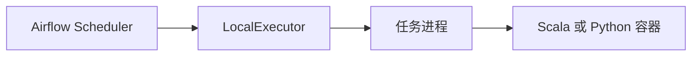
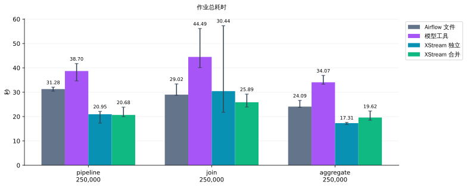
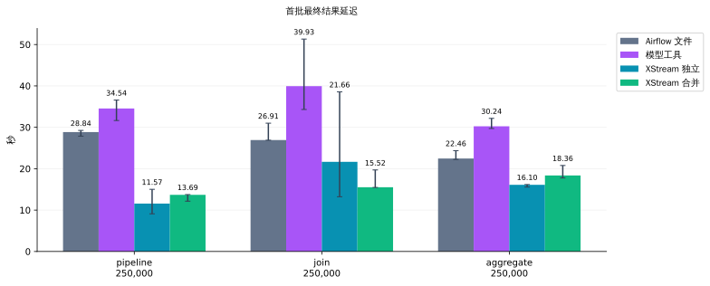
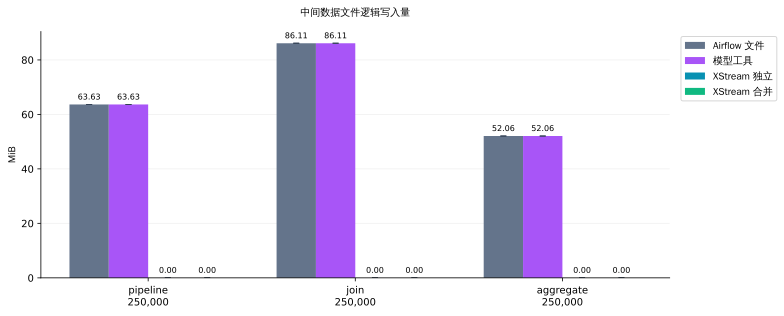
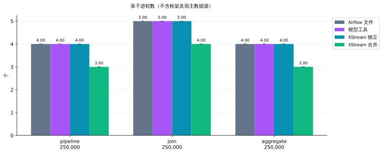
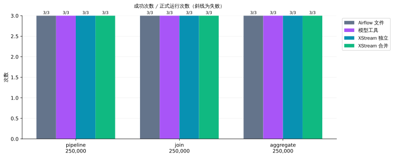
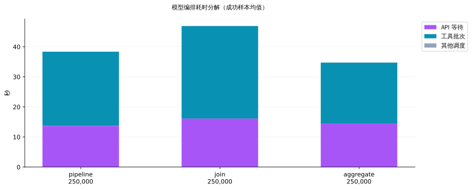

# 文件、模型工具编排与流传递实测

2026-11-05T12:48:46Z

本次在同一批测试中交错执行四种配置：Airflow 文件传递、LangGraph 大模型工具编排、XStream 独立进程流传递、XStream 合并进程流传递。共 48 次运行（含预热），失败 0 次。三组工作负载为 CSV 筛选、双表 Join 和分组聚合。每个组合预热 1 次，正式运行 3 次。

所有方式使用相同的 Scala/Python 算子、运行镜像和确定性气象观测数据，按独立 Python 实现校验最终输出的 SHA-256、字节数和行数。失败样本不进入中位数，保留在原始记录中。

## 工作流与执行机制

每条链是一组工作负载；Scala/Python 边界保留独立进程。

Scheduler 判断步骤何时就绪，LocalExecutor 在本机进程中执行任务；本测试的任务再启动对应算子容器。

## 实测图表

柱为成功正式样本中位数，误差线为最小值到最大值，不是置信区间。失败次数单独展示。模型分解图采用均值以便相加。

Airflow 使用真实 standalone 调度器与 LocalExecutor，调度状态采用本地 SQLite 测试数据库，XCom 只交换路径元信息，任务通过 Arrow IPC 文件交接数据；不是 dag.test()。

Scala 算子版本为 2.0，Python piflow_filter 版本为 1.2；运行镜像及依赖摘要见原始记录。

## 模型配置与计时

Airflow 并行度为 8，Scheduler 心跳为 1 秒，DAG 刷新和最短处理间隔为 5 秒，控制端每 0.2 秒查询完成状态；这些调度及查询等待均包含在作业耗时中。框架进程在整批测试期间保持运行。

- 模型：`gpt-6.1-sol`；提供商：`cliproxyapi`；API：`responses`；推理强度：`low`。
- [Airflow LocalExecutor](https://airflow.apache.org/docs/apache-airflow/stable/core-concepts/executor/local.html) · [Airflow XCom](https://airflow.apache.org/docs/apache-airflow/stable/core-concepts/xcoms.html)
- LangGraph 1.2.20; Airflow 3.3.2; PyArrow 26.0.1.

模型配置从本机 Codex 配置只读加载，不复制凭据、请求头或服务 URL。报告只记录模型与提供商名称及推理强度。没有更换配置中的模型。

模型通过 Responses 函数调用选择就绪步骤，并提交上游结果句柄。LangGraph 执行这些真实工具调用，再把结果句柄返回给模型；独立调用可以并行。模型不接收数据负载。固定 DAG 和算子参数与其他方法一致，所以测试的是执行编排，不是自然语言生成工作流的质量。

大模型方法与 Airflow 复用同一个 Arrow 文件执行器。计时包括模型请求、网络与推理等待、LangGraph 循环、容器启动、实际计算和最终 DONE 响应。不会用模拟调用、缓存计划或硬编码下一步代替模型。API 不重试，轮数上限为 12。

输入生成、算子/镜像下载和框架启动不计入作业耗时。保留系统热缓存，按记录的种子随机交错各方法。每个算子容器限制 1 GiB 内存和 128 个 PID。宿主为 16 逻辑 CPU、约 31.3 GiB 内存的共享虚拟机。

## 总耗时

秒，成功正式样本的中位数。

| 工作负载 | 输入行数 | Airflow 文件 | 模型工具编排 | XStream 独立 | XStream 合并 |
|---|---:|---:|---:|---:|---:|
| pipeline | 250,000 | 31.284 | 38.702 | 20.948 | 20.679 |
| join | 250,000 | 29.016 | 44.494 | 30.443 | 25.890 |
| aggregate | 250,000 | 24.095 | 34.072 | 17.309 | 19.616 |

## 相对耗时与执行单元

加速比为 Airflow 文件方案中位数 / 对应 XStream 中位数；大于 1 表示本批测试中 XStream 更快。

| 工作负载 | 行数 | 独立流加速比 | 合并流加速比 |
|---|---:|---:|---:|
| pipeline | 250,000 | 1.49× | 1.51× |
| join | 250,000 | 0.95× | 1.12× |
| aggregate | 250,000 | 1.39× | 1.23× |

算子进程数由实际执行单元记录计算，不含 Airflow/模型/XStream 框架进程及宿主 read_item 数据源。合并受到语言及锁定依赖环境限制。

| 工作负载 | 合并单元内的步骤 | 运行环境 |
|---|---|---|
| pipeline (250,000) | `warm`, `export` | jvm |
| join (250,000) | `stations`, `combine` | jvm |
| aggregate (250,000) | `stats`, `export` | jvm |

## 模型运行成功率与波动

| 工作负载 | 行数 | 成功/正式次数 | 成功耗时范围 s | 失败耗时 s |
|---|---:|---:|---:|---:|
| pipeline | 250,000 | 3/3 | 34.653–41.759 | — |
| join | 250,000 | 3/3 | 40.094–56.150 | — |
| aggregate | 250,000 | 3/3 | 33.312–36.884 | — |

## 模型开销与用量

| 工作负载 | 行数 | API 等待 s | 工具批次 s | 响应轮数 | 输入 token | 输出 token | 总 token |
|---|---:|---:|---:|---:|---:|---:|---:|
| pipeline | 250,000 | 14.458 | 24.164 | 5 | 3604 | 106 | 3710 |
| join | 250,000 | 16.213 | 27.950 | 5 | 4045 | 148 | 4193 |
| aggregate | 250,000 | 14.322 | 20.478 | 5 | 3734 | 106 | 3840 |

## 首批结果延迟

| 工作负载 | 行数 | Airflow 秒 | 模型工具秒 | 独立进程秒 | 合并进程秒 |
|---|---:|---:|---:|---:|---:|
| pipeline | 250,000 | 28.844 | 34.544 | 11.574 | 13.687 |
| join | 250,000 | 26.914 | 39.935 | 21.662 | 15.524 |
| aggregate | 250,000 | 22.460 | 30.237 | 16.102 | 18.360 |

## 解释与限制

- 大模型方案能理解动态需求、选择工具，但本轮 DAG 已知，测量的是其在线调度成本；不能据此判断模型规划质量。
- API 耗时受网络、提供商负载与模型影响。模型提供商可能缓存重复提示词，缓存 token 在原始数据中记录。token 用量不代表价格，未推算费用。用量表各列分别取中位数，因此不保证逐列相加等于总量中位数。
- Airflow 并不强制文件传递。此处比较具体配置；文件执行器使用 Python/PyArrow，XStream 使用 JVM 协议，并非只替换传输介质的消融实验。
- XStream 策略禁止物化且没有配置物化存储，步骤间没有数据文件。元数据和运行代码仍可写盘。SQL/Join 使用内存表。
- 文件模式未开启 fsync，文件逻辑大小不能当作物理磁盘 I/O。本轮不测试强持久化、故障恢复、跨节点传输或资源峰值。
- 三次正式重复与共享主机只能支持这组测量的结论；原始记录包含每次耗时、工具调用顺序、token 细项及内容摘要。

## 复现

- [程序、依赖、配置读取规则和运行命令](../benchmarks/orchestration/README_zh.md)
- [全部原始记录](benchmarks/orchestration-with-llm-20261105.json)
