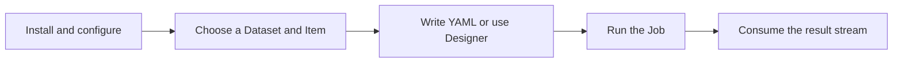
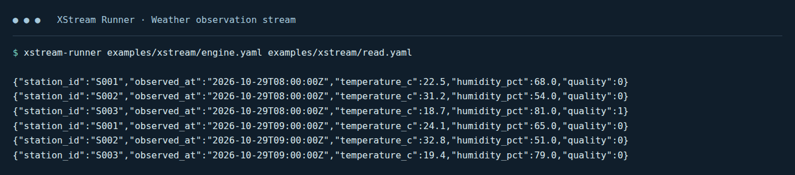

# User guide

[中文](usage_zh.md)

Manage Datasets, design and execute Jobs, or embed XStream in an application. Start with a working example, then use the topic tables to find configuration, examples and reference.

## 1. Get started

| Task | Guide and example |
|---|---|
| Build and run your first Job | [Quick start](quickstart.md), using the checked-in JSONL file |
| Start the visual editor | [Designer guide](designer-guide.md) and [startup configuration](../xstream-designer/README.md#start) |
| Understand the output | Records print as JSONL; bytes write directly to stdout. [Read different views](data-view-examples.md). |

*Captured output of the supplied quick-start Job. Each JSONL line is one observation; the command and source path match the quick-start instructions.*

## 2. Manage and read data

| Task | Guide and example |
|---|---|
| Understand catalogs, Datasets, Items and views | [Data model](data-model.md), including logical trees over physical files |
| Configure directory, mixed or SQL Datasets | [Dataset backends](dataset-providers.md); [dynamic catalog configuration](dataset-catalogs.md#configuration-and-discovery) |
| Browse folders and choose a view | [Dataset access](dataset-access.md), [complete Scala reading examples](data-view-examples.md) |
| Read CSV, JSONL, Excel, Parquet or archives | [File formats](file-formats.md); [GZIP and archive paths](data-model.md#how-gzip-becomes-an-item) |
| Read NetCDF, FITS or FASTA | [Scientific view examples](data-view-examples.md) and [Designer selections](designer-scientific.md) |
| Connect PostgreSQL and map SQL types | [JDBC datasets](jdbc-datasets.md) |
| Filter, project and limit records | [Record queries](records-scans.md) |
| Read a remote Item | [Item references](xstream.md#item-references) and [remote connection settings](execution-targets.md) |

## 3. Write and run Jobs

| Task | Guide and example |
|---|---|
| Define steps, ports and final outputs | [Job YAML](jobs.md) |
| Supply variables and keep their types | [Job variables](jobs.md) |
| Select repository operators or develop locally | [Operator examples](operator-catalog.md), [local libraries](local-operators.md) |
| Run, consume results and cancel | [Runner and embedding](xstream.md) |
| Set timeout, retries, materialization and replay | [Execution policies](materialization.md) |
| Understand execution units and dependency compatibility | [Fusion](operator-fusion.md), [dependency environments](dependency-environments.md) |
| Compare performance | [Measured fusion example](operator-fusion-benchmark.md) |

## 4. Design visually

Use the [Designer guide](designer-guide.md) for Target selection, catalogs, canvas operations, parameters, variables, schema/sample previews, validation, YAML import/export and Chat. The guide includes current screenshots and a complete editing flow.

## 5. Integrate an application

| Task | Guide and reference |
|---|---|
| Initialize a catalog and consume views in Scala | [Scala examples](data-view-examples.md), [Data SDK](../xstream-data/README.md) |
| Embed the Job engine and manage cancellation/lifecycle | [Embedding example](xstream.md#embed-in-scala), [execution API](../xstream-execution-api/README.md) |
| Configure execution records | [Execution history](execution-history.md) |
| Look up stream and buffer ownership | [DataView API](data-streams.md), [Arrow encoding reference](arrow-streams.md) |

To implement an operator, backend, format or other plugin, continue with the [development guide](development.md).
