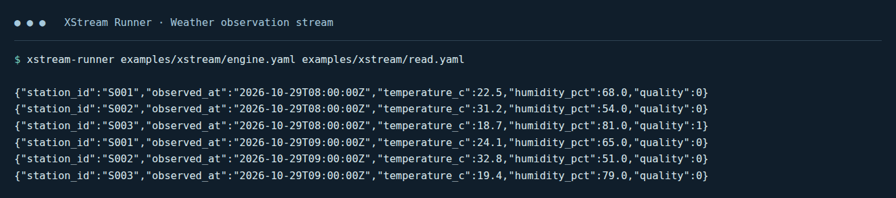

# 使用指南

[English](usage.md)

管理 Dataset、设计与执行 Job，或在应用中嵌入 XStream。从可运行的示例开始，再按主题查找配置、示例与参考。

## 1. 快速上手

| 目标 | 指南与示例 |
|---|---|
| 构建并执行第一个 Job | [快速入门](quickstart_zh.md)，使用仓库附带的 JSONL 文件 |
| 启动图形编辑器 | [Designer 使用指南](designer-guide_zh.md)及[启动配置](../xstream-designer/README_zh.md) |
| 理解输出 | records 输出 JSONL，bytes 直接写入标准输出。参见[视图读取示例](data-view-examples_zh.md)。 |

*图中为实际执行附带示例后的输出，每行 JSONL 是一条观测记录；命令及源路径与快速入门一致。软件界面保留其原始英文。*

## 2. 数据管理与读取

| 目标 | 指南与示例 |
|---|---|
| 理解目录、Dataset、Item 与视图 | [数据模型](data-model_zh.md)，含物理文件到逻辑目录的映射 |
| 配置目录、mixed 或 SQL Dataset | [Dataset 后端](dataset-providers_zh.md)、[动态目录配置](dataset-catalogs_zh.md) |
| 浏览目录并选择视图 | [Dataset 访问](dataset-access_zh.md)、[完整 Scala 读取示例](data-view-examples_zh.md) |
| 读取 CSV、JSONL、Excel、Parquet 或压缩包 | [文件格式](file-formats_zh.md)、[GZIP 与归档路径](data-model_zh.md) |
| 读取 NetCDF、FITS 或 FASTA | [科学视图示例](data-view-examples_zh.md)、[Designer 选择参数](designer-scientific_zh.md) |
| 连接 PostgreSQL 并映射 SQL 类型 | [JDBC 数据集](jdbc-datasets_zh.md) |
| 筛选、投影及限制记录数 | [记录查询](records-scans_zh.md) |
| 读取远程 Item | [Item 引用](xstream_zh.md)、[远程连接配置](execution-targets_zh.md) |

## 3. Job 编写与执行

| 目标 | 指南与示例 |
|---|---|
| 定义步骤、端口及最终输出 | [Job YAML](jobs_zh.md) |
| 传入变量并保留类型 | [Job 变量](jobs_zh.md) |
| 选择仓库算子或本地开发 | [算子示例](operator-catalog_zh.md)、[本地算子库](local-operators_zh.md) |
| 执行、消费结果及取消 | [Runner 与嵌入执行](xstream_zh.md) |
| 设置超时、重试、物化及重放 | [执行策略](materialization_zh.md) |
| 理解执行单元与依赖兼容性 | [同进程合并](operator-fusion_zh.md)、[依赖环境](dependency-environments_zh.md) |
| 对比性能 | [合并执行测量示例](operator-fusion-benchmark_zh.md) |

## 4. Designer 使用

[Designer 使用指南](designer-guide_zh.md)介绍 Target、目录、画布、参数、变量、结构与样例预览、校验、YAML 导入导出及 Chat，并配有当前界面截图和完整操作流程。

## 5. 应用集成

| 目标 | 指南与参考 |
|---|---|
| 在 Scala 中初始化目录并消费视图 | [Scala 示例](data-view-examples_zh.md)、[数据 SDK](../xstream-data/README_zh.md) |
| 嵌入 Job 引擎、管理取消与生命周期 | [嵌入示例](xstream_zh.md)、[执行 API](../xstream-execution-api/README_zh.md) |
| 配置执行记录 | [执行历史](execution-history_zh.md) |
| 查阅流与缓冲区所有权 | [DataView API](data-streams_zh.md)、[Arrow 编码参考](arrow-streams_zh.md) |

实现算子、后端、格式或其他插件，请继续阅读[开发指南](development_zh.md)。
