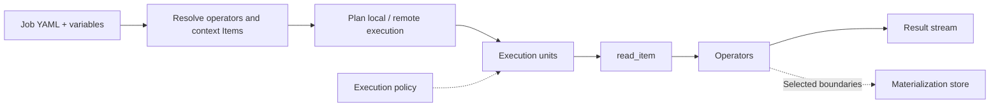

# XStream execution engine

XStream executes YAML Jobs with bounded, backpressured streams. `xstream-engine` is an embeddable Scala module containing the `xstream-runner` launcher. Local execution needs no data server; remote access and automatic compute pushdown use configured connectors.

## DataCatalog lifecycle

The shared hierarchy is **DataCatalog → Dataset → Item**. One JVM binds one DataCatalog through `DataCatalogRuntime`. Hosts acquire a lease for the same instance; binding a different catalog while one is active is rejected. The final lease closes the catalog. Applications must stop Jobs before releasing the catalog. No Dataset, Item or content snapshot is required at startup: providers may discover them dynamically.

The host initializes its catalog from `datasets` or `data_catalog` and embeds a `JobEngine` sharing that instance. A `context:` read uses direct bounded queues without loopback networking. Remote `dacp:` reads use this repository’s connector. Dataset backends and formats are plugins.

## Item references

`read_item@1.0` has no input ports and one `result` output. Its only addressing parameter is `uri`:

```yaml
params:
  uri: context:/weather/observations
  view: records
  sql: SELECT station_id, temperature FROM source LIMIT 100
```

`context:/dataset/item` addresses the receiving JVM's catalog. It is not an operating-system file path. `dacp://host:port/dataset/item` explicitly addresses a service, including a service on the local machine. Both support the same `view` and restricted read-only `sql` options. Context references are fixed against the submission catalog before dispatch to another node, never reinterpreted in the downstream member's catalog.

Folder Items are browsed with `DatasetAccess.list(path)` (or the SDK equivalent), one level at a time. A Folder is not implicitly concatenated or recursively read by `read_item`.

## Run without a server

```bash
cd xstream-engine
sbt stage
cd ..
xstream-engine/target/universal/stage/bin/xstream-runner \
  examples/xstream/engine.yaml examples/xstream/read.yaml
```

The launcher accepts `CONFIG.yaml JOB.yaml [VARIABLES.yaml] [POLICY.yaml]`. To supply a policy without variables, pass an empty variables YAML mapping. Records print as JSONL; byte streams write directly to stdout. The launcher requires one selected output for stdout; the embedded engine supports multiple named outputs. Execution metadata is recorded in `execution_directory`; stream data is not persisted unless the execution policy requests materialization.

For remote reads, add an entry to `nodes`:

```yaml
nodes:
  - url: dacp://node-a.example.org:18861
    ca: /etc/dacp/ca.crt
    token_file: /etc/dacp/node-a.token
```

Credentials stay in the host configuration. The Job contains only the Item URI. Remote reads followed by processing can be submitted as a sub-job to that service when automatic pushdown is enabled.

## Embed in Scala

```scala
import dacp._
import xstream.util.YamlDocument
import java.nio.file.{Files, Path}

val settings = YamlDocument.parse(Files.readString(Path.of("engine.yaml")))
val plugins = new PluginEnvironment()
val host = new LocalEngine(settings, plugins)
val cancel = new StreamCancel()
try {
  val engine = host.engine
  assert(engine.dataCatalog eq DataCatalogRuntime.catalog)
  engine.run(Files.readString(Path.of("job.yaml")), frame => {
    // Consume metadata and data incrementally; do not retain an unbounded result.
    println(StreamProtocol.header(frame))
  }, cancel)
} finally {
  cancel.close()
  host.close()
  plugins.close()
}
```

`LocalEngine` accepts an optional remote Item callback. `EngineEnvironment` supplies runtime configuration, execution history, materialization and Item opening; `JobEngine` does not depend on server configuration, server credentials or server ingress classes. Cancellation, timeout, retries, materialization/replay and compatible-operator fusion remain shared engine functionality. Output schema inference is an explicit design-time action, not a prerequisite for execution.

## Catalog and runtime plugins

Implement `DataCatalogProvider` and register its fully qualified class in `META-INF/services/xstream.data.DataCatalogProvider`. Configure it with:

```yaml
data_catalog:
  provider: example-jdbc-catalog
  source:
    jdbc_url: jdbc:h2:/srv/catalog
```

The provider returns a thread-safe `DataCatalog`. Its `open(name)` returns a caller-owned `PublishedDataset` lease; open it for a `DatasetAccess` and close both handles after use. `DatasetProvider`, `FormatHandler` and operator executor plugins use public contracts; see [plugins](plugins.md). The runner bundles standard datasets, basic formats, the static catalog, execution storage and operator executors. Additional plugins can be loaded through `plugin_directory`.

Versioned references use approved public repository operators and verified artifacts. Standalone development can explicitly reference [local operator source directories](local-operators.md), with reusable builds and the same SDK. `read_item` is a built-in data source and needs no operator container.

## Designer

The `xstream-designer` module starts a browser-based editor. Its `local_catalog` section uses the same `datasets`/`data_catalog` settings. `nodes` supplies additional DACP connections; the configured execution `target` is also listed. The sidebar initially fetches only catalog roots. Expanding a root loads datasets; expanding a Dataset or Folder Item loads its direct children. Errors affect only the expanded branch and can be retried by collapsing and reopening it.

When the receiving service is a Union, `context:/public-dataset/item` resolves through its public dataset-to-member mapping. An explicit URI using that Union's configured public origin has the same meaning. A recognized member URI instead pins the read to its data-owning member.

Local selections become `context:/dataset/item`; node selections retain their full DACP URI. Local schema/sample previews run against the designer's catalog. When running the exported Job elsewhere, provide a matching context catalog or explicitly change the Item URI.

## Automatic compute pushdown

The standalone `LocalEngine` enables automatic pushdown by default. The YAML Job remains logical: it contains no execution-node assignments. Configure services and ordinary client credentials on the host:

```yaml
compute_pushdown_enabled: true
nodes:
  - url: dacp://node-a.example.org:18861
    ca: /etc/dacp/ca.crt
    token_file: /etc/dacp/node-a.token
    compute_pushdown: true
```

`compute_pushdown_enabled: false` keeps computation local. A node with `compute_pushdown: false` is used for data access only. An omitted node option means it is eligible for execution, subject to the receiving server's normal authorization, available resources, repository and runtime support. Configuration is not an access grant. The engine does not require Union membership or special Union credentials and does not call schema inference to plan execution.

For `read(A) → filter → aggregate`, the closed chain is sent to A as one ordinary Job. Its remote reads become `context:` references to A's catalog. For two branches `read(A) → filterA` and `read(B) → filterB`, followed by a merge, each closed branch runs at its source; the merge runs locally. Returned outputs feed bounded local queues with backpressure, without intermediate data files. Multiple boundary ports and user-facing Job output names are preserved. Disconnected closed regions on the same service can share one submitted sub-job.

The planner follows data locality, not a general cost optimizer. It pushes only regions whose complete input dependencies are on one configured remote service and that contain at least one processing step. A raw remote read alone is fetched normally. Local `context:` reads, source operators without a remote Item dependency, mixed local/remote merges, and subsequent steps stay local. The engine does not send local input streams to arbitrary remote workers or arrange direct A-to-B transfers; Union remains the option for centrally coordinated multi-node placement. Independent remote branches are consumed concurrently.

A policy selecting any materialized output, or an explicit replay, retains the original local graph and persistence ownership. Ordinary streaming retry and timeout policies still apply to the physical execution. Remote sub-jobs do not retry independently or materialize output; retries are coordinated by the originating engine and require consumers to discard failed-attempt output according to the stream protocol. The original engine's client deadline bounds remote requests; each receiving service retains its own potentially shorter execution limit. Cancellation closes remote result streams and cancels their server-side executions. A remote failure propagates; there is no automatic local fallback that could repeat side effects.

Execution history stores the original Job, `placements`, `remote_subjobs` with submitted YAML, and `remote_job` child records with `remote_execution_id` and terminal state. Package downloads, runtime caches and execution metadata may use disk; stream edges do not materialize payloads. Embedded hosts can provide their own `ComputePushdown` adapter through `EngineEnvironment.computePushdown`; `LocalEngine` also accepts an optional `remoteCompute` adapter. Embedding hosts decide whether to enable pushdown and coordinate it with their own scheduling.

See [pushdown Job example](../examples/xstream/pushdown.yaml). Adjust the remote URI and host configuration before running it with `xstream-runner`.

## Execution path

Execution units reflect actual executor capabilities and matching runtime images. Stream edges carry data; schema inference is a separate authoring operation.


