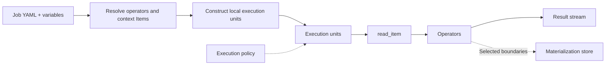

# XStream execution engine

XStream executes YAML Jobs with bounded, backpressured streams. `xstream-engine` is an embeddable Scala module containing the `xstream-runner` launcher. Local execution needs no data server; remote Item access uses optional data connectors. All Job steps execute locally.

## DataCatalog lifecycle

The shared hierarchy is **DataCatalog → Dataset → Item**. One JVM binds one DataCatalog through `DataCatalogRuntime`. Hosts acquire a lease for the same instance; binding a different catalog while one is active is rejected. The final lease closes the catalog. Applications must stop Jobs before releasing the catalog. No Dataset, Item or content snapshot is required at startup: providers may discover them dynamically.

The host initializes its catalog from `datasets` or `data_catalog` and embeds a `JobEngine` sharing that instance. A `context:` read uses direct bounded queues without loopback networking. Remote `dacp:` reads use this repository’s connector. Dataset backends and formats are plugins.

## Item references

`read_item@1.0` has no input ports and one `result` output. Its only addressing parameter is `uri`:

```yaml
params:
  uri: context:/weather/observations
  view: records
  sql: SELECT station_id, temperature FROM source LIMIT 100
```

`context:/dataset/item` addresses the receiving JVM's catalog. It is not an operating-system file path. `dacp://host:port/dataset/item` explicitly addresses a service, including a service on the local machine. Both support the same `view` and restricted read-only `sql` options. Context references are fixed against the submission catalog before dispatch to another node, never reinterpreted in the downstream member's catalog.

Folder Items are browsed with `DatasetAccess.list(path)` (or the SDK equivalent), one level at a time. A Folder is not implicitly concatenated or recursively read by `read_item`.

## Run without a server

```bash
cd xstream-engine
sbt stage
cd ..
xstream-engine/target/universal/stage/bin/xstream-runner \
  examples/xstream/engine.yaml examples/xstream/read.yaml
```

The launcher accepts `CONFIG.yaml JOB.yaml [VARIABLES.yaml] [POLICY.yaml]`. To supply a policy without variables, pass an empty variables YAML mapping. Records print as JSONL; byte streams write directly to stdout. The launcher requires one selected output for stdout; the embedded engine supports multiple named outputs. Execution metadata is recorded in `execution_directory`; stream data is not persisted unless the execution policy requests materialization.

For remote reads, add an entry to `nodes`:

```yaml
nodes:
  - url: dacp://node-a.example.org:18861
    ca: /etc/dacp/ca.crt
    token_file: /etc/dacp/node-a.token
```

Credentials stay in the host configuration. The Job contains only the Item URI. Remote Item streams feed local operators. Remote Job submission is provided by the DACP client; Union owns automatic placement.

## Embed in Scala

```scala
import xstream.engine._
import xstream.execution._
import xstream.data._
import xstream.util.YamlDocument
import java.nio.file.{Files, Path}

val settings = YamlDocument.parse(Files.readString(Path.of("engine.yaml")))
val plugins = new PluginEnvironment()
val host = new LocalEngine(settings, plugins)
val cancel = new StreamCancel()
try {
  val engine = host.engine
  assert(engine.dataCatalog eq DataCatalogRuntime.catalog)
  engine.run(Files.readString(Path.of("job.yaml")), frame => {
    // Consume metadata and data incrementally; do not retain an unbounded result.
    println(StreamProtocol.header(frame))
  }, cancel)
} finally {
  cancel.close()
  host.close()
  plugins.close()
}
```

`LocalEngine` accepts an optional remote Item callback. `EngineEnvironment` supplies runtime configuration, execution history, materialization and Item opening; `JobEngine` does not depend on server configuration, server credentials or server ingress classes. Cancellation, timeout, retries, materialization/replay and compatible-operator fusion remain shared engine functionality. Output schema inference is an explicit design-time action, not a prerequisite for execution.

## Catalog and runtime plugins

Implement `DataCatalogProvider` and register its fully qualified class in `META-INF/services/xstream.data.DataCatalogProvider`. Configure it with:

```yaml
data_catalog:
  provider: example-jdbc-catalog
  source:
    jdbc_url: jdbc:h2:/srv/catalog
```

The provider returns a thread-safe `DataCatalog`. Its `open(name)` returns a caller-owned `PublishedDataset` lease; open it for a `DatasetAccess` and close both handles after use. `DatasetProvider`, `FormatHandler` and operator executor plugins use public contracts; see [plugins](plugins.md). The runner bundles standard datasets, basic formats, the static catalog, execution storage and operator executors. Additional plugins can be loaded through `plugin_directory`.

Versioned references use approved public repository operators and verified artifacts. Standalone development can explicitly reference [local operator source directories](local-operators.md), with reusable builds and the same SDK. `read_item` is a built-in data source and needs no operator container.

## Designer

The `xstream-designer` module starts a browser-based editor. Its `local_catalog` section uses the same `datasets`/`data_catalog` settings. `nodes` supplies available remote DACP connections. Target defaults to Local; choosing a configured node makes its catalog the in-context catalog and removes its duplicate root. The sidebar initially fetches only catalog roots. Expanding a root loads datasets; expanding a Dataset or Folder Item loads its direct children. Errors affect only the expanded branch and can be retried by collapsing and reopening it.

When the receiving service is a Union, `context:/public-dataset/item` resolves through its public dataset-to-member mapping. An explicit URI using that Union's configured public origin has the same meaning. A recognized member URI instead pins the read to its data-owning member.

Selections in the in-context catalog become `context:/dataset/item`; other catalog selections retain their full DACP URI. Schema/sample previews resolve context against the selected Target. When running the exported Job elsewhere, provide a matching context catalog or explicitly change the Item URI.

## Local execution and remote data

XStream executes Jobs locally, including downstream processing of remote Item streams. Use the DACP client for explicit remote Job submission. Union owns automatic member placement. See [execution boundaries](execution-targets.md). Designer designs Jobs and selects their context Target; execution services plan and execute them.

## Execution path

Execution units reflect actual executor capabilities and matching runtime images. Stream edges carry data; schema inference is a separate authoring operation.


