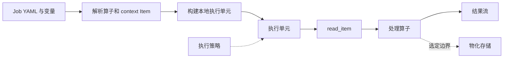

# XStream 执行引擎

XStream 使用有界、支持背压的数据流执行 YAML Job。`xstream-engine` 是可嵌入的 Scala 模块，内含 `xstream-runner` 启动程序。本地执行不需要数据服务器；需要远程数据时，可配置数据连接器，Job 的所有步骤仍在本地执行。

## DataCatalog 生命周期

统一层次为 **DataCatalog → Dataset → Item**。一个 JVM 通过 `DataCatalogRuntime` 绑定一个 DataCatalog。宿主可为同一实例申请租约；已有目录时不能绑定另一个目录，最后一个租约负责关闭目录。应用必须先停止 Job 再释放目录。启动不要求预加载全部 Dataset、Item 或数据内容，插件可以动态发现它们。

宿主根据 `datasets` 或 `data_catalog` 初始化目录，内嵌的 `JobEngine` 使用同一实例。`context:` 读取使用直接、有界的队列，不绕回网络。远程 `dacp:` 读取使用本仓库的连接器。数据源和格式通过插件提供。

## Item 引用

`read_item@1.0` 没有输入端口，输出端口为 `result`。寻址参数统一为 `uri`：

```yaml
params:
  uri: context:/weather/observations
  view: records
  sql: SELECT station_id, temperature FROM source LIMIT 100
```

`context:/dataset/item` 引用接收方 JVM 的目录，不是操作系统文件路径。`dacp://host:port/dataset/item` 显式指定服务，服务也可位于本机。两种引用都支持相同的 `view` 和受限只读 SQL。远程下发前，context 引用必须固定到提交目录的数据源，不能在下游成员的目录中重新解释。

Folder Item 通过 `DatasetAccess.list(path)` 或相应 SDK 逐层浏览。`read_item` 不隐式拼接或递归读取文件夹。

## 不启动服务器直接执行

```bash
cd xstream-engine
sbt stage
cd ..
xstream-engine/target/universal/stage/bin/xstream-runner \
  examples/xstream/engine.yaml examples/xstream/read.yaml
```

启动程序接受 `CONFIG.yaml JOB.yaml [VARIABLES.yaml] [POLICY.yaml]`。没有变量但需策略时，传入空变量 YAML 映射。记录以 JSONL 输出，字节流直接写到 stdout。为避免混淆，启动程序要求选中一个输出；嵌入式引擎支持多个具名输出。执行元信息记录到 `execution_directory`；只有策略明确要求物化时才持久化流数据。

远程读取在 `nodes` 中配置连接：

```yaml
nodes:
  - url: dacp://node-a.example.org:18861
    ca: /etc/dacp/ca.crt
    token_file: /etc/dacp/node-a.token
```

凭据留在宿主配置中，Job 只包含 Item URI。远程 Item 流交给本地算子处理。远程 Job 提交由 DACP 客户端提供，自动放置由 Union 提供。

## Scala 嵌入

```scala
import xstream.engine._
import xstream.execution._
import xstream.data._
import xstream.util.YamlDocument
import java.nio.file.{Files, Path}

val settings = YamlDocument.parse(Files.readString(Path.of("engine.yaml")))
val plugins = new PluginEnvironment()
val host = new LocalEngine(settings, plugins)
val cancel = new StreamCancel()
try {
  val engine = host.engine
  assert(engine.dataCatalog eq DataCatalogRuntime.catalog)
  engine.run(Files.readString(Path.of("job.yaml")), frame => {
    // 增量消费元信息和数据，不保留无限增长的结果。
    println(StreamProtocol.header(frame))
  }, cancel)
} finally {
  cancel.close()
  host.close()
  plugins.close()
}
```

`LocalEngine` 可接收远程 Item 回调。`EngineEnvironment` 提供运行配置、历史记录、物化和 Item 打开能力；`JobEngine` 不依赖服务器配置、服务端凭据或请求接入类。取消、超时、重试、物化/重放和兼容算子同进程合并属于共享引擎。结构推导仍是显式的设计时能力，不作为执行前置条件。

## 目录与运行插件

实现 `DataCatalogProvider`，在 `META-INF/services/xstream.data.DataCatalogProvider` 中注册完整类名，配置为：

```yaml
data_catalog:
  provider: example-jdbc-catalog
  source:
    jdbc_url: jdbc:h2:/srv/catalog
```

提供者返回线程安全的 `DataCatalog`。其 `open(name)` 返回调用者持有的 `PublishedDataset` 租约，再打开 `DatasetAccess`，使用后关闭两个句柄。`DatasetProvider`、`FormatHandler` 和算子执行器继续使用现有契约，详见[插件](plugins_zh.md)。启动程序打包标准数据源、基础格式、静态目录、执行存储和算子执行器；更多插件通过 `plugin_directory` 加载。

名称/版本引用使用已审核公开的仓库算子及校验过的产物。独立本地开发可显式引用[本地算子源码目录](local-operators_zh.md)，复用构建缓存与同一 SDK。`read_item` 是内置数据源，无需算子容器。

## 设计器

`xstream-designer` 模块提供浏览器编辑器。`local_catalog` 使用相同的 `datasets`/`data_catalog` 配置；`nodes` 配置可用的远程 DACP 连接。Target 默认为 Local；选择配置节点后，其目录成为上下文目录，其他目录入口不重复显示该节点。侧栏初始只获取目录入口，展开入口加载 Dataset，展开 Dataset 或 Folder Item 加载直接子项。失败仅影响当前分支，折叠后重新展开可重试。

上下文目录中的选择生成 `context:/dataset/item`，其他目录的选择保留完整 DACP URI。结构和样例预览根据所选 Target 解析上下文。在别处执行导出的 Job 时，需要提供匹配的上下文目录，或显式更改 Item URI。

## 本地执行与远程数据

XStream 在本地执行 Job，包括远程 Item 流的后续处理。显式远程提交使用 DACP 客户端，自动成员放置由 Union 提供。见[执行职责](execution-targets_zh.md)。Designer 负责 Job 设计和上下文 Target 选择，执行服务负责规划与执行。

## 执行路径

执行单元由执行器能力和相同运行时镜像决定。流边传递数据，结构推导属于独立的编排操作。


