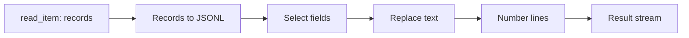

# Script operators

[中文](README_zh.md)

Four pure Python script operators, with no external command invocation or third-party application dependencies. They implement `process`, `infer_outputs` and `preview_outputs` using the shared XStream SDK. The Python interpreter, Arrow and SDK are supplied by `python-arrow@2.0`; source `pyproject.toml` declares `dependencies = []`. The Python dependency provider produces a locked environment shared with other operators using the same Runtime and lock.

These are independent named operators backed by a small shared code bundle. No core registry or server changes are needed. Administrator-assigned categories are not declared by developers. Packages contain no SDK, Python interpreter or Arrow library. Repository compilation creates bytecode ZIPs; no native binary or shell interpreter is required.

## Operators

All operators have input `source` and output `result`, version `1.0`.

| Operator | Input → output | Parameters | Behavior |
|---|---|---|---|
| `script_text_replace` | bytes → bytes/text | Required `find`; optional `replacement` (default empty) | Literal replacement within UTF-8 lines; works across transport chunk boundaries. No regular expressions or cross-line matches. Each string is limited to 4096 characters. |
| `script_line_number` | bytes → bytes/text | `start` (default 1), `separator` (default tab) | Prefixes every line, including blank lines; preserves CRLF, LF and an unterminated final line. Start is a nonnegative int64; separator is at most 64 characters. |
| `script_jsonl_project` | bytes/JSONL → bytes/JSONL | Required `fields` array; `missing`: `null` (default) or `error` | Selects ordered top-level keys. Blank lines are skipped; missing keys become null or cause failure. Retained nested values keep their structure. Accepts 1–128 unique keys of 1–256 characters each. |
| `script_records_to_jsonl` | records → bytes/JSONL | None | Encodes each record as one UTF-8 JSON object followed by LF. Processes one input batch at a time. |

Text inputs must be valid UTF-8. Lines, including their ending, are limited to 1 MiB; output JSONL rows from Records are also limited to 1 MiB. Long lines fail explicitly instead of accumulating the entire input. Processing starts when a complete line arrives; an unterminated line is emitted at end of input. JSONL accepts objects only and rejects duplicate keys, non-finite numbers and malformed JSON. Input errors fail the stream; already emitted output may be partial.

Records encoding preserves JSON-compatible nested values and nulls. Dates/times use ISO strings, decimals use strings to preserve precision, and binary values use Base64 strings. Duplicate record field names and non-finite numbers are rejected. These encodings are explicit conversions, not a lossless replacement for Arrow's type information.

The processing code creates no files and does not materialize intermediate results. Job history, runtime caches and repository build files are managed separately by the host. Sample generation is bounded by the SDK's requested row/byte limits.

## Example

`workflow.yaml` connects all four scripts after a records read:



Set its `context:/weather/observations` URI to an Item exposing records with `station_id` and `temperature` fields. For this input:

```json
{"station_id":"A","temperature":12.5,"quality":0}
{"station_id":"B","temperature":13.0,"quality":1}
```

The final text output is:

```text
1: {"station":"A","temperature":12.5}
2: {"station":"B","temperature":13.0}
```

The example replacement targets the serialized key spelling. For general structural renaming, use a records transformation instead of relying on textual substitution. The final numbered stream is text, not JSONL.

## Test and submit

From the XStream checkout, use a Python environment with PyArrow installed:

```bash
python examples/operators/scripts/test.py
python examples/operators/scripts/package_sources.py
xstream-operator submit examples/operators/scripts/text_replace.yaml \
  --source examples/operators/scripts/target/script-sources.zip \
  --url http://localhost:8820 --token-file /path/to/publisher.token
```

Submit `line_number.yaml`, `jsonl_project.yaml` and `records_to_jsonl.yaml` in the same way, one at a time. The source archive includes the four scripts, their shared helper and dependency declaration. Only administrator-approved versions become publicly downloadable. Before publishing to another repository, choose a registered Runtime containing the same SDK and compatible Python/Arrow versions.

Tests exercise real SDK stream input/output, UTF-8 and arbitrary chunk boundaries, incremental consumption, invalid JSON, bounded lines, structured values, parameter validation, inference and output samples. The same test can verify a repository-built ZIP inside its environment: set `SCRIPT_CODE=/path/to/operator.zip` and run `test.py` using that environment's Python. This path selects packaged code instead of checkout sources.
