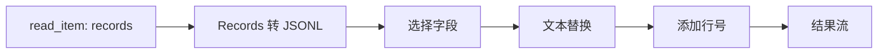

# 脚本算子

[English](README.md)

四个纯 Python 脚本算子，不调用外部命令，不依赖额外的第三方应用库。通过共享 XStream SDK 实现 `process`、`infer_outputs` 和 `preview_outputs`。Python 解释器、Arrow 与 SDK 由 `python-arrow@2.0` 提供；源码的 `pyproject.toml` 声明 `dependencies = []`。Python 依赖提供器生成锁定环境，与使用相同 Runtime 和依赖锁的其他算子共享。

这些算子具有独立名称，共用一个小型代码包，无需修改核心注册表或服务器。分类由管理员指定，不由开发者声明。包内不包含 SDK、Python 解释器或 Arrow 库。仓库编译生成字节码 ZIP，不需要原生二进制程序或 Shell 解释器。

## 算子列表

所有算子的输入端口为 `source`，输出端口为 `result`，版本均为 `1.0`。

| 算子 | 输入 → 输出 | 参数 | 行为 |
|---|---|---|---|
| `script_text_replace` | bytes → bytes/text | 必填 `find`；可选 `replacement`，默认空字符串 | 在 UTF-8 行内执行字面文本替换，正确处理传输块边界；不支持正则和跨行匹配。两个字符串各限 4096 个字符。 |
| `script_line_number` | bytes → bytes/text | `start` 默认 1；`separator` 默认制表符 | 每行（含空行）添加行号；保留 CRLF、LF 和末行无换行的情况。起始值为非负 int64，分隔符最多 64 个字符。 |
| `script_jsonl_project` | bytes/JSONL → bytes/JSONL | 必填数组 `fields`；`missing` 可为 `null`（默认）或 `error` | 按指定顺序选择顶层字段；跳过空白行；缺失字段填 null 或报错。保留字段的嵌套结构不变。接受 1–128 个唯一字段名，每个 1–256 个字符。 |
| `script_records_to_jsonl` | records → bytes/JSONL | 无 | 每条记录编码为一个 UTF-8 JSON 对象并追加 LF；逐输入批次处理。 |

文本输入必须为合法 UTF-8。每行（含换行符）最多 1 MiB；Records 转换后的 JSONL 每行也最多 1 MiB。超长行明确报错，不累积整个输入。收到完整行后即可处理；没有换行符的末行在输入结束时输出。JSONL 仅接受对象，拒绝重复键、非有限数值及非法 JSON。输入错误导致流失败；已经输出的内容可能是不完整结果。

Records 编码保留 JSON 可表达的嵌套结构和 null。日期与时间转换为 ISO 字符串，十进制数转换为字符串以保留精度，二进制值转换为 Base64 字符串。拒绝重复字段名和非有限数值。这些是明确的数据转换，不能无损替代 Arrow 的类型信息。

业务处理代码不创建文件，不物化中间结果。Job 历史、运行环境缓存及仓库构建文件由宿主另行管理。样例生成受 SDK 请求的行数与字节数上限约束。

## 示例

`workflow.yaml` 在 records 读取步骤后串联四个脚本：



将其中的 `context:/weather/observations` 改为提供 records 视图、包含 `station_id` 和 `temperature` 字段的 Item。输入例如：

```json
{"station_id":"A","temperature":12.5,"quality":0}
{"station_id":"B","temperature":13.0,"quality":1}
```

最终文本输出为：

```text
1: {"station":"A","temperature":12.5}
2: {"station":"B","temperature":13.0}
```

示例中的文本替换针对序列化后的键名拼写。通用的结构字段重命名应使用 records 变换，而非依赖文本替换。最后带行号的输出为文本，不再是 JSONL。

## 测试与提交

在 XStream 源码目录中，使用安装了 PyArrow 的 Python 环境：

```bash
python examples/operators/scripts/test.py
python examples/operators/scripts/package_sources.py
xstream-operator submit examples/operators/scripts/text_replace.yaml \
  --source examples/operators/scripts/target/script-sources.zip \
  --url http://localhost:8820 --token-file /path/to/publisher.token
```

同样逐个提交 `line_number.yaml`、`jsonl_project.yaml` 和 `records_to_jsonl.yaml`。源码归档包含四个脚本、共享辅助模块和依赖声明。只有经管理员审核的版本才会公开下载。向其他仓库发布前，应选择包含相同 SDK、且 Python/Arrow 版本兼容的已注册 Runtime。

测试覆盖真实 SDK 流输入输出、UTF-8 与任意块边界、增量读取、非法 JSON、有界行、结构化值、参数校验、结构推导及输出样例。同一测试也可在依赖环境内验证仓库编译出的 ZIP：设置 `SCRIPT_CODE=/path/to/operator.zip`，用该环境的 Python 运行 `test.py`，即可加载包内代码而非工作区源码。
